# Forumulate templates

The official space templates for [Forumulate](https://forumulate.com) — the
hosted platform for docs, forums, blogs and changelogs. Each folder is a whole
space, ready-made: the look (a theme bundle), the reader layout, the front page
and, for blogs and forums, a handful of short sample posts, so a space started
from one looks like its preview on day one.

Every template is built entirely from theme settings — no custom CSS — so
everything you see can be changed from the space's settings afterwards.

## Using a template

**In the app.** Create a new space, pick its type (any of them: blog, docs,
forum, changelog, roadmap, status page, legal, FAQ, careers, contact, events,
courses or custom), then pick a template. You can also install just the *look* of any
template from the theme marketplace (listed as `template-<id>`); the
new-space picker brings the look, the front page and the sample content.

**With the API.** Authenticate with a Personal Access Token (create one at
https://forumulate.com/account/tokens), list the templates for a type, then
apply one to a space by its id (the folder name):

```sh
export FORUMULATE_TOKEN=cft_...

curl -H "Authorization: Bearer $FORUMULATE_TOKEN" \
  "https://forumulate.com/api/orgs/$ORG_ID/space-templates?type=DOCS"

curl -X POST -H "Authorization: Bearer $FORUMULATE_TOKEN" \
  -H "Content-Type: application/json" \
  -d '{"templateId": "basalt"}' \
  "https://forumulate.com/api/orgs/$ORG_ID/spaces/$SPACE_ID/apply-template"
```

The same calls are available in the TypeScript SDK
([`@forumulate/sdk`](https://github.com/forumulate/forumulate-js)) and the
CLI ([`@forumulate/cli`](https://github.com/forumulate/cli)).

## The templates

### Blog

| Preview | Template |
| --- | --- |
| <a href="corvane/">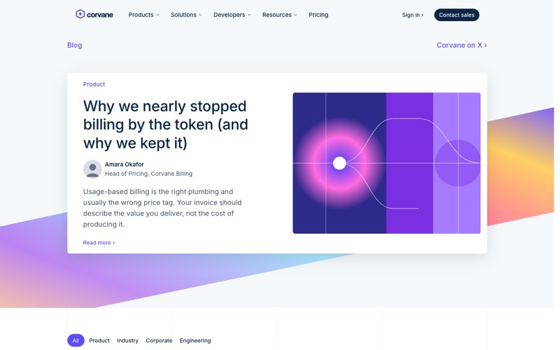</a> | **[Corvane](corvane/)**<br>A bright product blog with a gradient hero band, a lead story, category tabs and a subscribe band after every post. Light, crisp and corporate.<br><sub>Template id: `corvane`</sub> |
| <a href="kestrel/">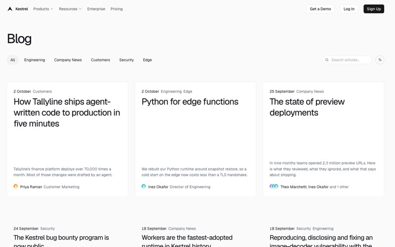</a> | **[Kestrel](kestrel/)**<br>A monochrome developer blog: a dense card grid, tag pills, mega-menu header, six-column footer and a closing call to action under every post.<br><sub>Template id: `kestrel`</sub> |
| <a href="margins/">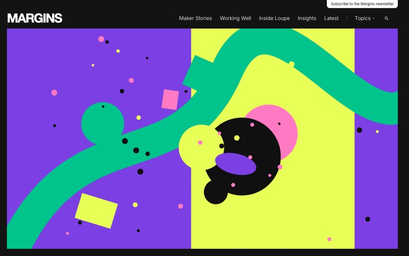</a> | **[Margins](margins/)**<br>A dark editorial magazine with condensed headlines, colourful collage covers, featured-story menus and a newsletter band — a design publication, not a changelog.<br><sub>Template id: `margins`</sub> |
| <a href="kilter/">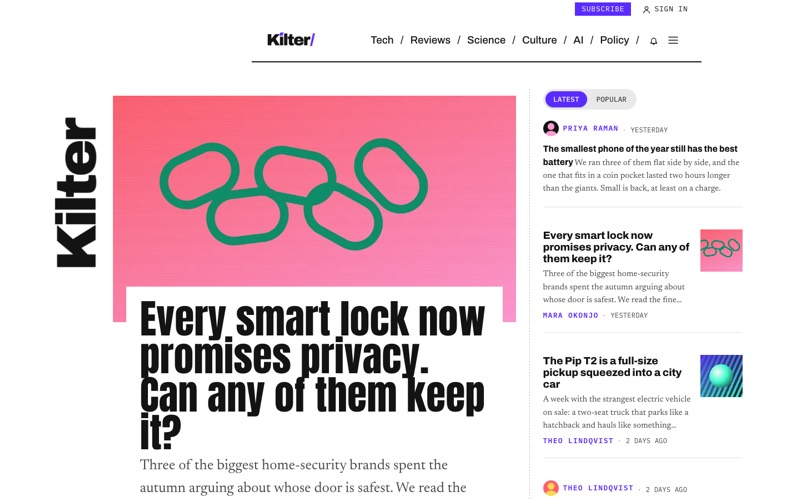</a> | **[Kilter](kilter/)**<br>A loud tech-news front page: a vertical masthead, lead story, quick-hit rail, colour-coded sections and a “most popular” sidebar on every story.<br><sub>Template id: `kilter`</sub> |
| <a href="forgeline/">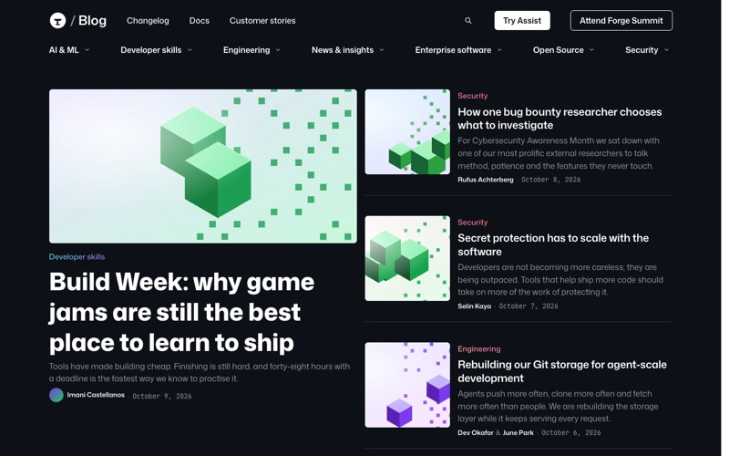</a> | **[Forgeline](forgeline/)**<br>A developer-platform blog with a dark header and footer, category mega-menus, featured strip, “popular” sidebar and a table-of-contents article layout.<br><sub>Template id: `forgeline`</sub> |
| <a href="halcyon/">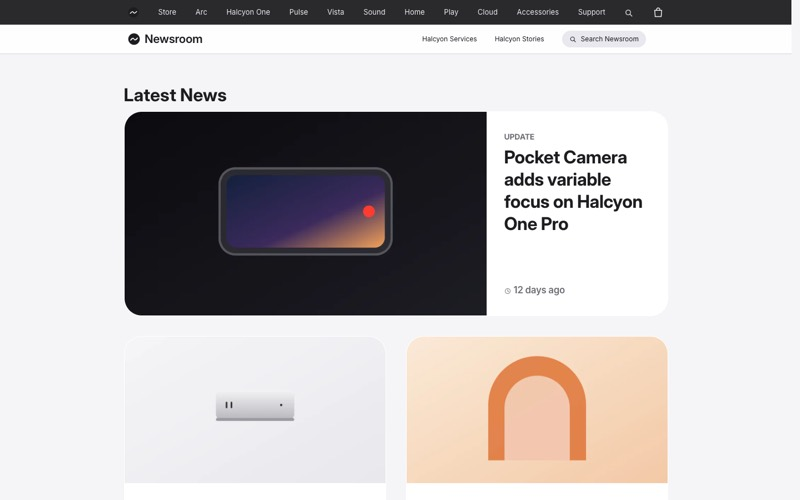</a> | **[Halcyon](halcyon/)**<br>A polished newsroom: a thin top bar, large feature tiles with standfirsts, “In the loop” stories and a share-and-download press kit on every article.<br><sub>Template id: `halcyon`</sub> |
| <a href="vectra/">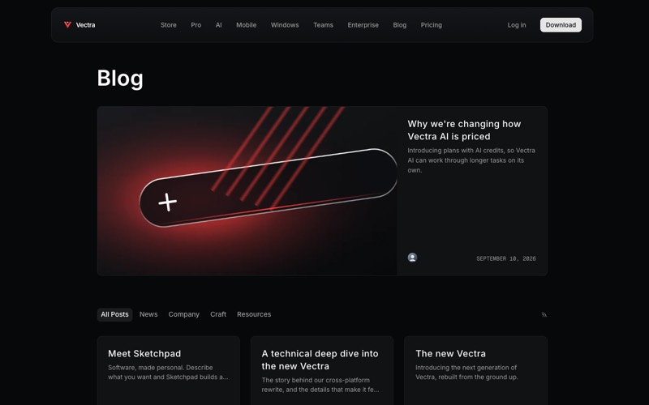</a> | **[Vectra](vectra/)**<br>A near-black product blog with a red accent, glowing footer art, a two-up post grid and a newsletter footer — launch-day energy for an app company.<br><sub>Template id: `vectra`</sub> |
| <a href="tinkerbloom/">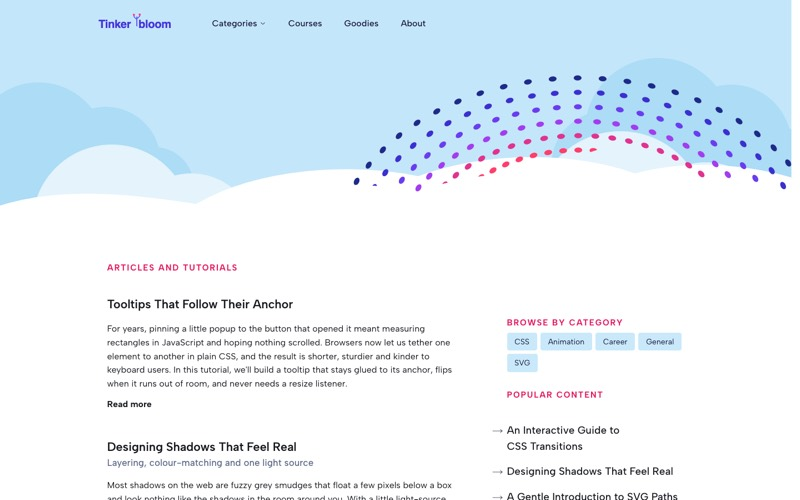</a> | **[Tinkerbloom](tinkerbloom/)**<br>A friendly, hand-made tutorial blog: sky-and-hills hero, category chips, a “popular content” list and a table-of-contents article page with a playful masthead.<br><sub>Template id: `tinkerbloom`</sub> |
| <a href="kiln-journal/">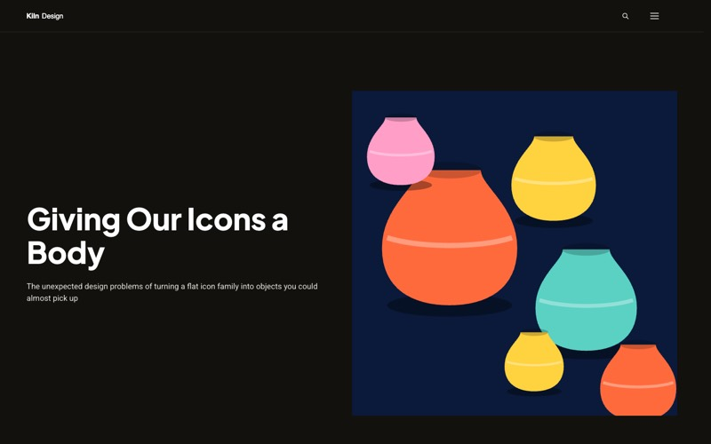</a> | **[Kiln Journal](kiln-journal/)**<br>A warm, dark studio journal: big cover grid, outlined topic badges, illustrated menu feature and a quiet single-column article page.<br><sub>Template id: `kiln-journal`</sub> |

### Changelog

| Preview | Template |
| --- | --- |
| <a href="plinth/">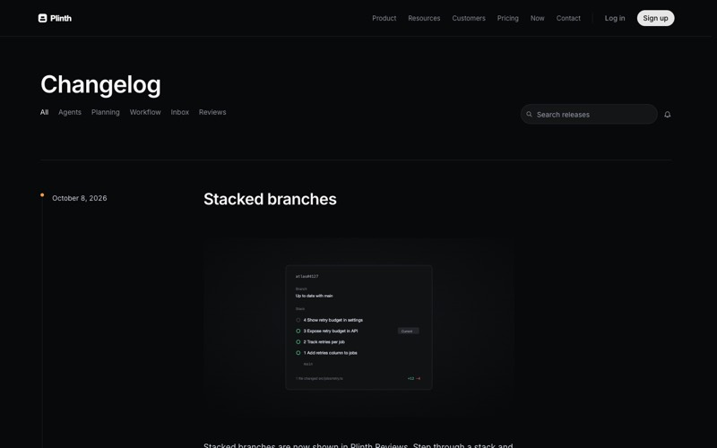</a> | **[Plinth](plinth/)**<br>A sleek dark changelog: dates in the gutter, illustrated release notes, tag filters and a one-line email subscribe.<br><sub>Template id: `plinth`</sub> |
| <a href="quarrel/">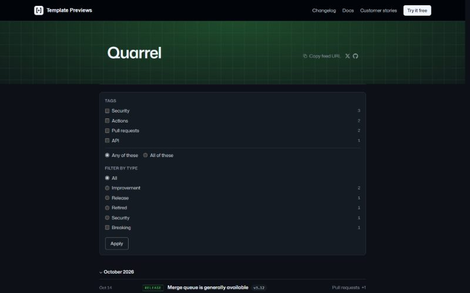</a> | **[Quarrel](quarrel/)**<br>A dark, dense changelog of typed rows: a grid-line hero, releases grouped under collapsible month headings, a mono date and an upper-case type label on every row, and a checkbox panel to narrow by type and tag.<br><sub>Template id: `quarrel`</sub> |
| <a href="vellum/">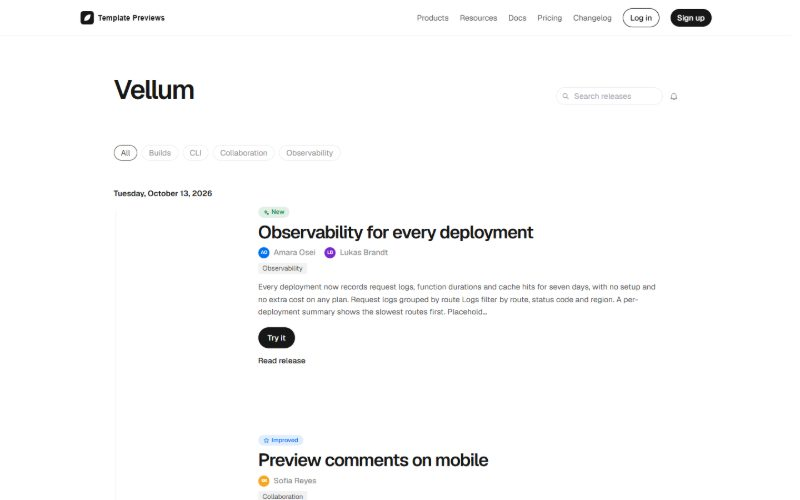</a> | **[Vellum](vellum/)**<br>A light, airy changelog of summaries: each day once in a wide date gutter beside a hairline rail, big tight titles, the people who shipped it, tag pills and a round feed button — and a release page with its facts in a side column.<br><sub>Template id: `vellum`</sub> |
| <a href="keystroke/">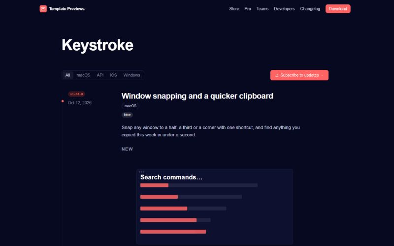</a> | **[Keystroke](keystroke/)**<br>A dark, version-led changelog for an app on several platforms: the version in a red pill over the date in the gutter, platforms as a segmented switch, every release in full under New, Improvements and Fixes, and key caps inline.<br><sub>Template id: `keystroke`</sub> |
| <a href="inkwell/">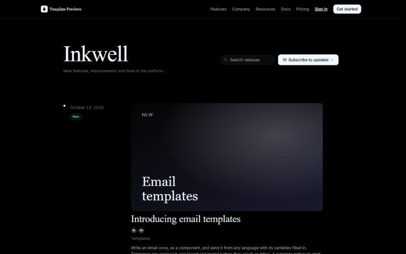</a> | **[Inkwell](inkwell/)**<br>A black, editorial changelog: a large serif title, a cover picture over every release, summaries with the authors’ faces, a white-dotted rail — and a centred release page with code in tabs, video and a link to the page as Markdown.<br><sub>Template id: `inkwell`</sub> |
| <a href="ledgerline-changes/">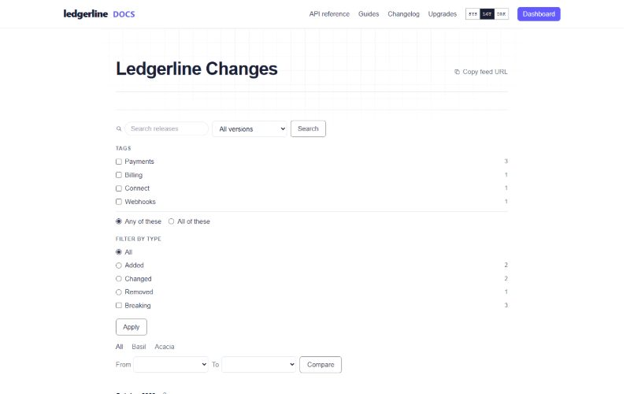</a> | **[Ledgerline Changes](ledgerline-changes/)**<br>A payments company's API changelog in a docs-like shell: dated versions grouped under named release families with an overview card, Breaking badges, typed rows, a version compare form and GA / preview channels.<br><sub>Template id: `ledgerline-changes`</sub> |

### Docs

| Preview | Template |
| --- | --- |
| <a href="basalt/">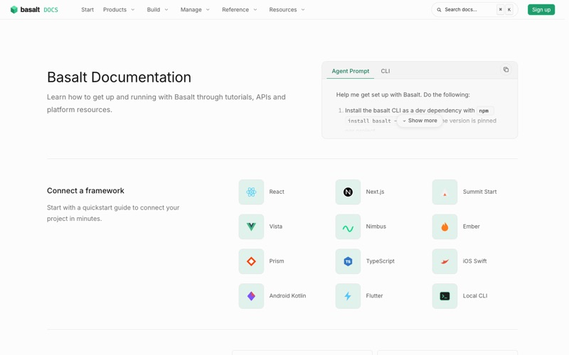</a> | **[Basalt Docs](basalt/)**<br>Roomy developer docs with an agent-prompt panel beside the title, a framework quickstart grid and product menus in the top bar.<br><sub>Template id: `basalt`</sub> |
| <a href="emberline/">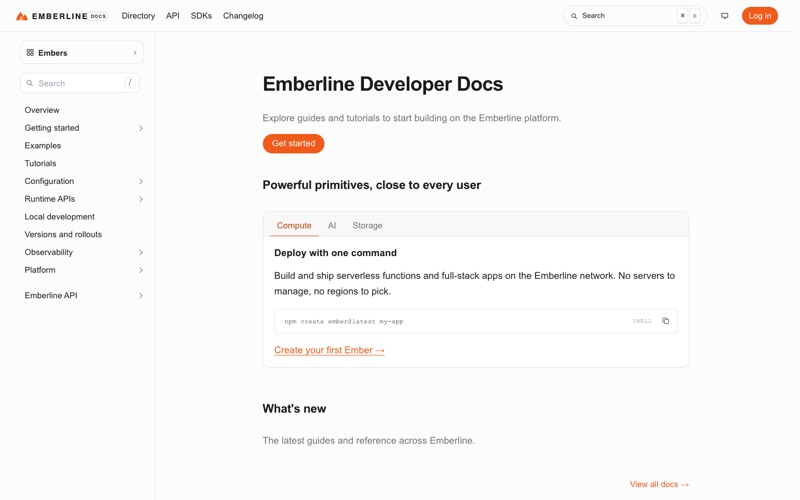</a> | **[Emberline Developer Docs](emberline/)**<br>Developer docs with a tabbed product panel under the title, an orange accent and a slim header of top-level sections.<br><sub>Template id: `emberline`</sub> |
| <a href="halite/">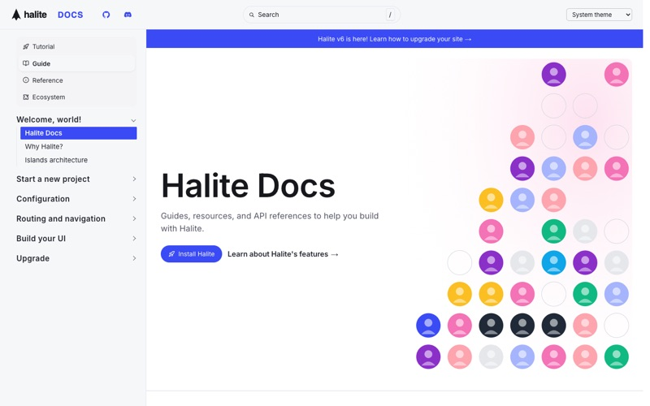</a> | **[Halite](halite/)**<br>Framework docs with a version banner, a bold hero beside a dotted illustration and a sidebar switching Tutorial, Guide, Reference and Ecosystem.<br><sub>Template id: `halite`</sub> |
| <a href="keyward/">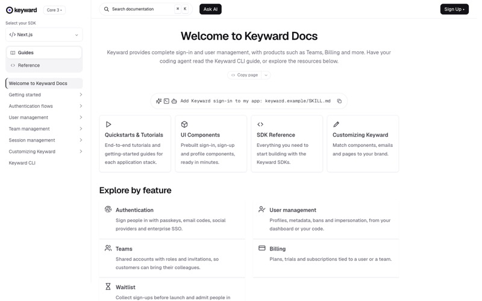</a> | **[Keyward Docs](keyward/)**<br>A centred welcome, a copy-a-prompt bar, product cards and an explore-by-feature grid, with an SDK picker in the sidebar.<br><sub>Template id: `keyward`</sub> |
| <a href="ledgerline/">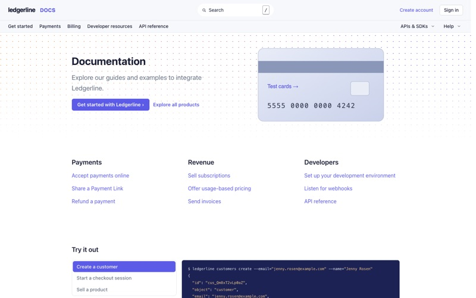</a> | **[Ledgerline](ledgerline/)**<br>Payments-style docs: a dotted hero with an illustrated card, product link columns and a try-it-out code panel.<br><sub>Template id: `ledgerline`</sub> |
| <a href="postwick/">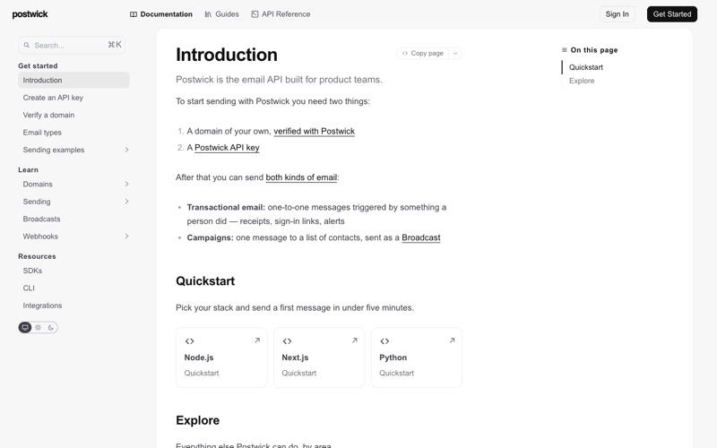</a> | **[Postwick](postwick/)**<br>Compact, tidy API docs with a top tab bar, an on-this-page rail and quickstart cards.<br><sub>Template id: `postwick`</sub> |
| <a href="ridgeline/">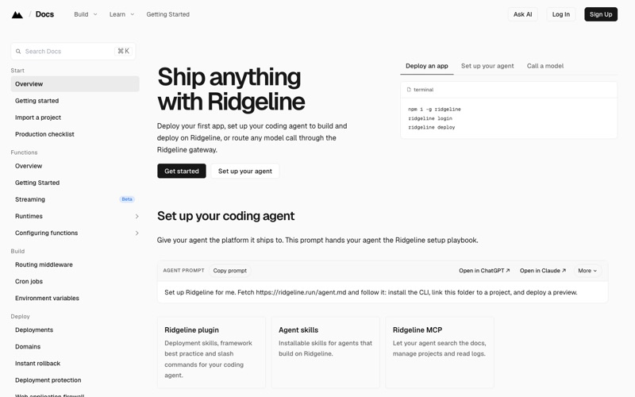</a> | **[Ridgeline Docs](ridgeline/)**<br>A big headline beside a tabbed terminal panel, an agent-prompt block and plugin cards.<br><sub>Template id: `ridgeline`</sub> |
| <a href="sprig/">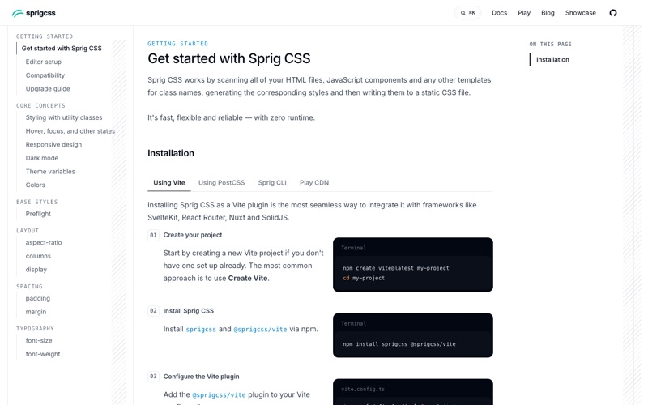</a> | **[Sprig CSS](sprig/)**<br>Monospace section labels, numbered install steps with terminal panels and hatched gutters.<br><sub>Template id: `sprig`</sub> |
| <a href="strata/">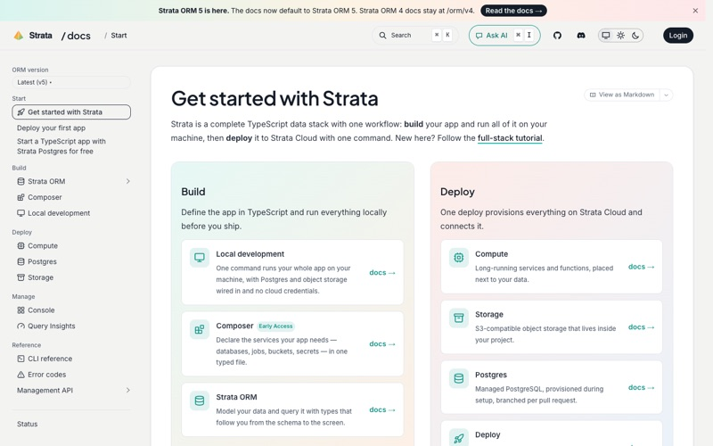</a> | **[Strata Docs](strata/)**<br>Gradient Build and Deploy panels of linked cards, a version picker in the sidebar and an announcement bar.<br><sub>Template id: `strata`</sub> |
| <a href="tessel/">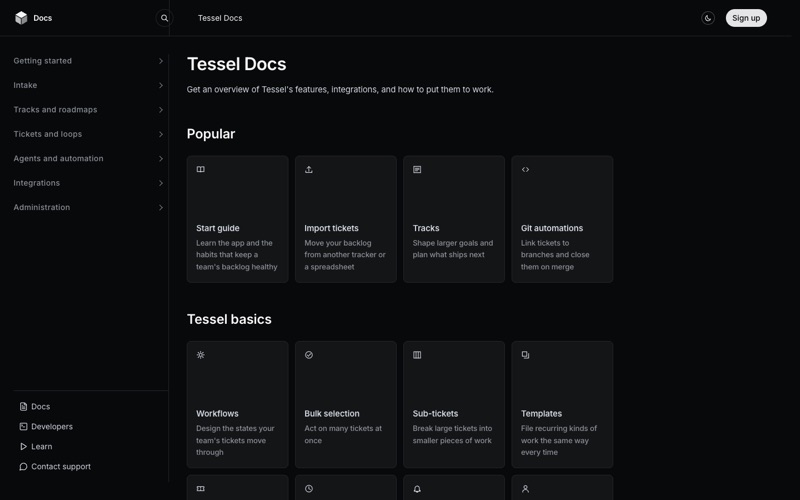</a> | **[Tessel Docs](tessel/)**<br>A dark help centre: Popular and Basics card grids under a quiet title, with collapsible sidebar sections.<br><sub>Template id: `tessel`</sub> |

### Forum

| Preview | Template |
| --- | --- |
| <a href="driftline/">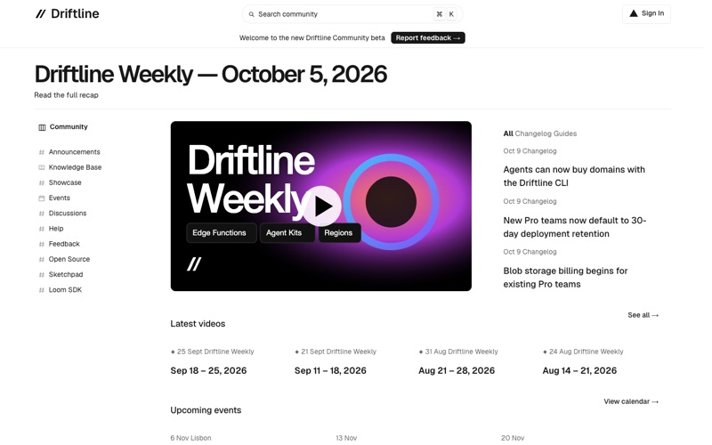</a> | **[Driftline Community](driftline/)**<br>A community front page with a featured video, changelog and guides tabs, latest videos and upcoming events.<br><sub>Template id: `driftline`</sub> |
| <a href="heapfield/">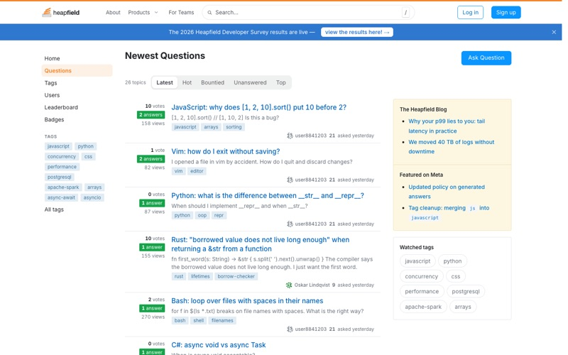</a> | **[Heapfield](heapfield/)**<br>A Q&A forum: vote and answer counts beside each question, tag chips, a left nav and a sidebar of featured posts.<br><sub>Template id: `heapfield`</sub> |
| <a href="hearthlink/">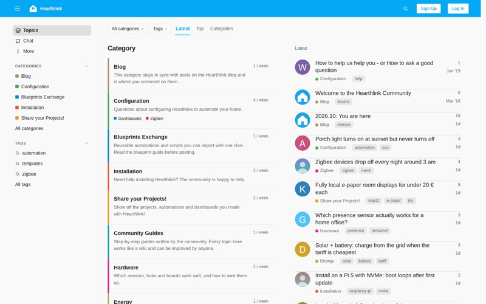</a> | **[Hearthlink Community](hearthlink/)**<br>Categories with coloured bars beside the latest topics, under a bright blue header.<br><sub>Template id: `hearthlink`</sub> |
| <a href="kitebox/">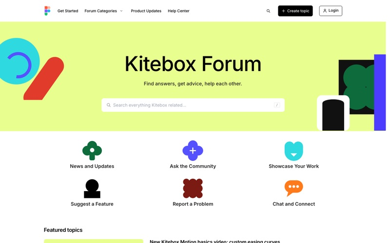</a> | **[Kitebox Forum](kitebox/)**<br>A bright hero with illustrated shapes and a search box, an icon grid of categories and featured topics.<br><sub>Template id: `kitebox`</sub> |
| <a href="larkhost/">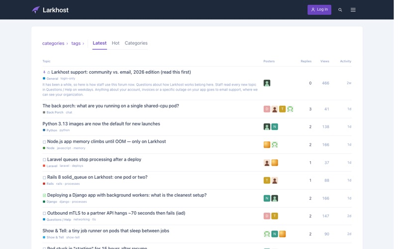</a> | **[Larkhost Community](larkhost/)**<br>A dark header over a boxed topic table with poster avatars, replies, views and activity.<br><sub>Template id: `larkhost`</sub> |
| <a href="lattice-commons/">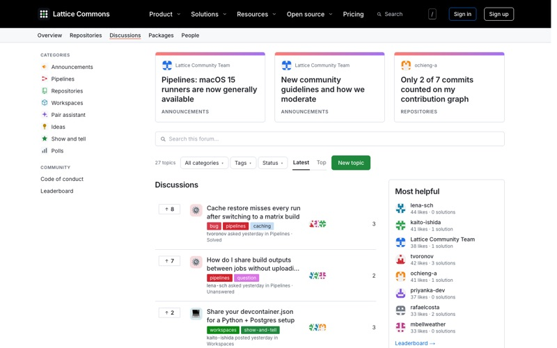</a> | **[Lattice Commons](lattice-commons/)**<br>Discussions with pinned announcement cards, vote counts, solved labels and a most-helpful leaderboard.<br><sub>Template id: `lattice-commons`</sub> |
| <a href="quillstone/">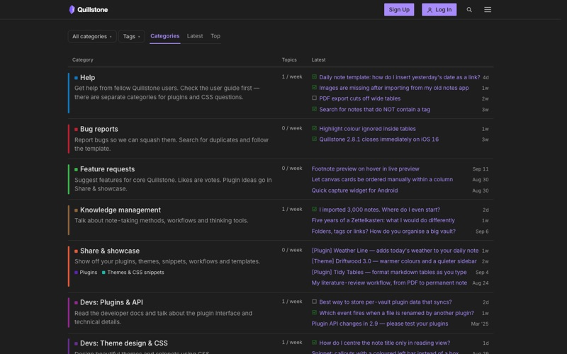</a> | **[Quillstone Forum](quillstone/)**<br>A dark forum: categories beside their latest topics, coloured category bars and purple accents.<br><sub>Template id: `quillstone`</sub> |
| <a href="threadwell/">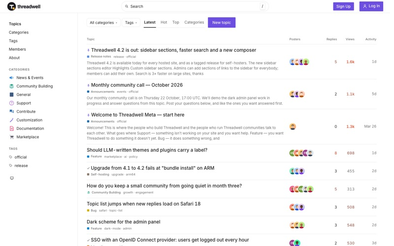</a> | **[Threadwell Meta](threadwell/)**<br>A classic topic list with excerpts, poster avatars, views and activity, and a categories sidebar.<br><sub>Template id: `threadwell`</sub> |
| <a href="tessel-forum/">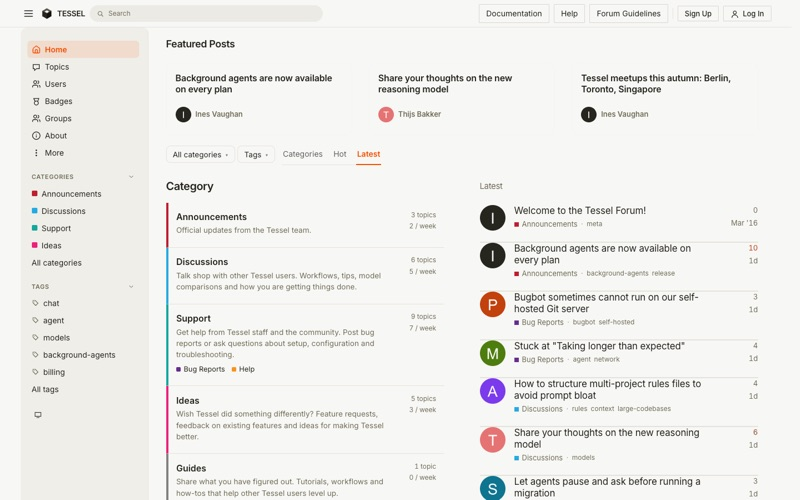</a> | **[Tessel Forum](tessel-forum/)**<br>A warm off-white forum: featured posts, categories with descriptions and the latest topics with avatars.<br><sub>Template id: `tessel-forum`</sub> |
| <a href="vantor-dev/">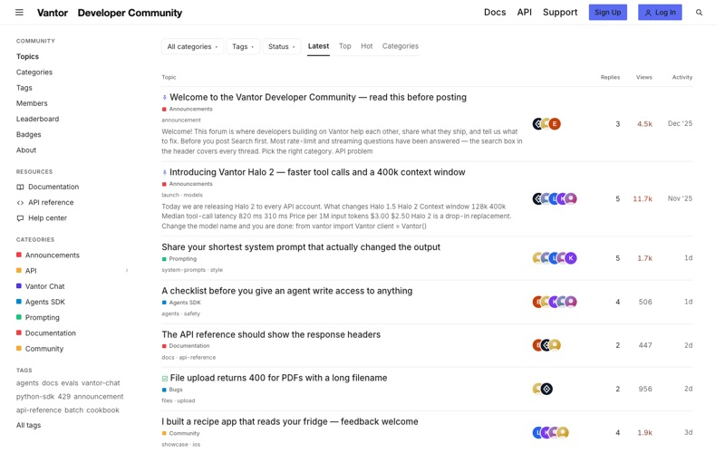</a> | **[Vantor Developer Community](vantor-dev/)**<br>A developer forum with resource links in the sidebar, pinned announcements and a dense topic table.<br><sub>Template id: `vantor-dev`</sub> |

### Roadmap

| Preview | Template |
| --- | --- |
| <a href="lanyard/">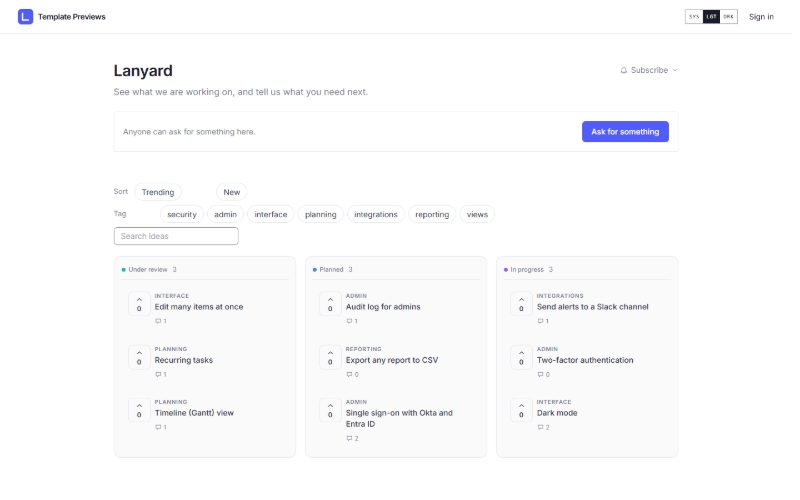</a> | **[Lanyard](lanyard/)**<br>A feedback board’s public roadmap: three bordered lane panels with a coloured dot in each head, a square vote box on the left of every card, an uppercase theme eyebrow, and an item page with its voters in a left-hand rail.<br><sub>Template id: `lanyard`</sub> |
| <a href="fernway/">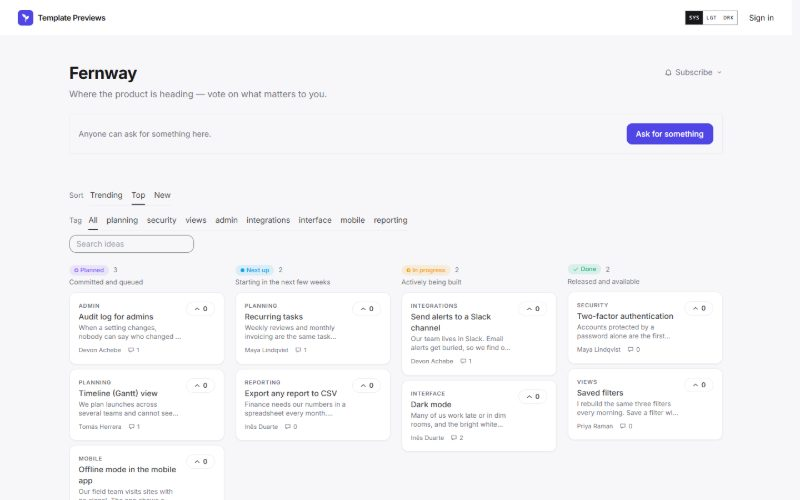</a> | **[Fernway](fernway/)**<br>A product roadmap in four open columns — Planned, Next up, In progress, Done — each with its own mark and a one-line description, raised rounded cards with a vote pill in the corner, and a light or dark look that follows the reader.<br><sub>Template id: `fernway`</sub> |
| <a href="gridlane/">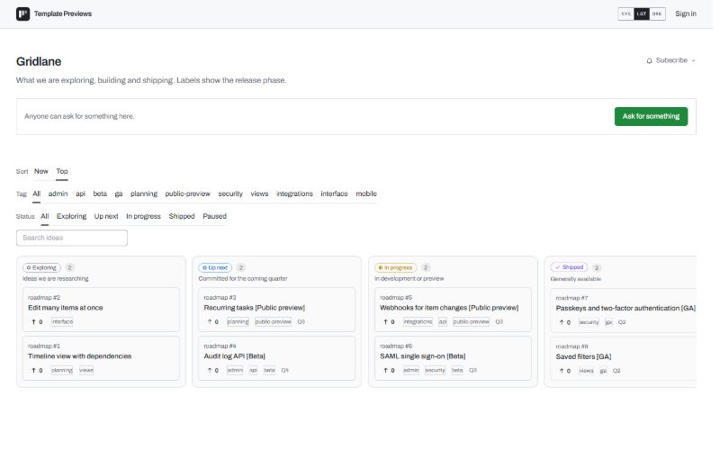</a> | **[Gridlane](gridlane/)**<br>A dense project-board roadmap: five grey lane panels that scroll sideways, open-ring status marks with count pills, compact outlined cards with many-coloured label chips, and tabs to filter by status — set in the system font.<br><sub>Template id: `gridlane`</sub> |
| <a href="horizon-roadmap/">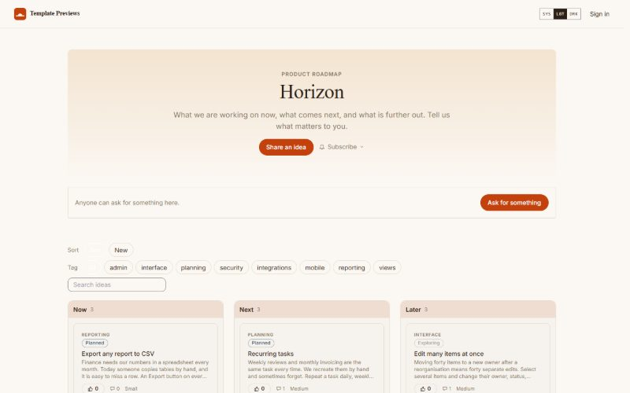</a> | **[Horizon](horizon-roadmap/)**<br>A Now / Next / Later portal: the lanes are horizons rather than workflow, each with a tinted head; outlined cards carry a theme eyebrow, a three-line description and their status as a chip, under a warm serif headline.<br><sub>Template id: `horizon-roadmap`</sub> |
| <a href="slate-roadmap/">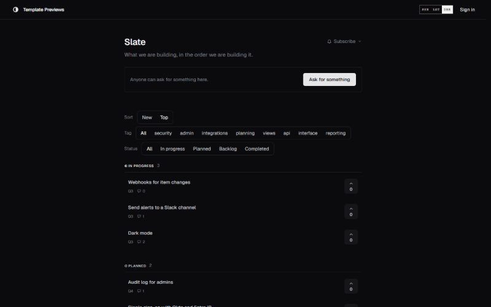</a> | **[Slate](slate-roadmap/)**<br>A dark, dense list roadmap: one column grouped by status under ring, half and check marks in grey, single-line rows with target and comments, a quiet vote at the end, and an item page that leads with its history.<br><sub>Template id: `slate-roadmap`</sub> |

### Status page

| Preview | Template |
| --- | --- |
| <a href="beacon-status/">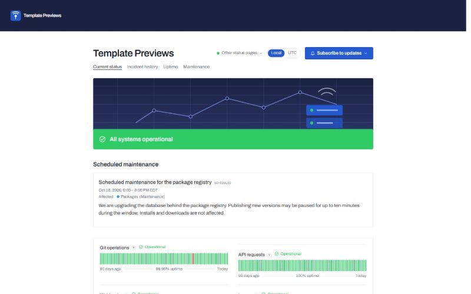</a> | **[Beacon Status](beacon-status/)**<br>The classic status page: a painted header, a solid banner that says it in one line, every component in a two-column grid with thin ninety-day bars, a legend under them and the last fifteen days spelled out — “No incidents reported” included.<br><sub>Template id: `beacon-status`</sub> |
| <a href="quietline/">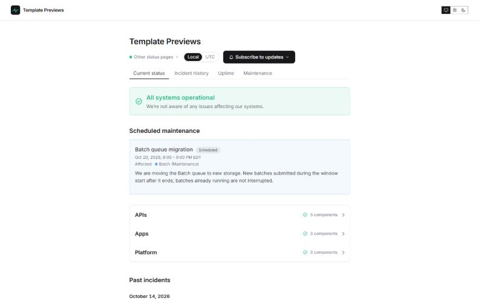</a> | **[Quietline](quietline/)**<br>A calm, narrow status page that follows the visitor’s light or dark setting: a tinted banner, components folded into groups that say how many they hold, small rounded bars with the uptime beside each, and the incident history as a month calendar.<br><sub>Template id: `quietline`</sub> |
| <a href="halo-status/">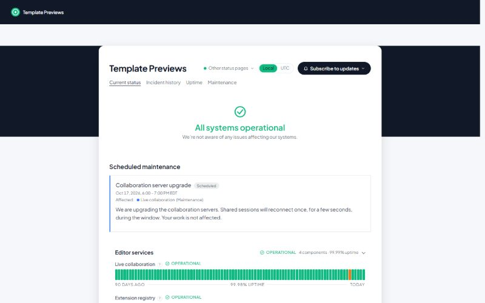</a> | **[Halo Status](halo-status/)**<br>A floating card over a dark band: a centred headline inside a soft halo, each group as its own card with its uptime, fat ribbon bars that read as one stripe, and a light/dark switch in the footer.<br><sub>Template id: `halo-status`</sub> |
| <a href="switchyard/">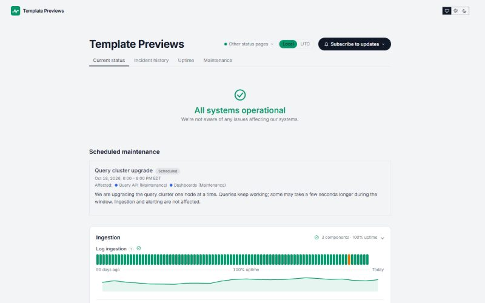</a> | **[Switchyard](switchyard/)**<br>An observability dashboard: pill tabs, a big centred headline with the time it was last checked, a card per group with its uptime, response-time charts under the bars, and a system-metrics panel with a Day / Week / Month switch.<br><sub>Template id: `switchyard`</sub> |
| <a href="meridian-status/">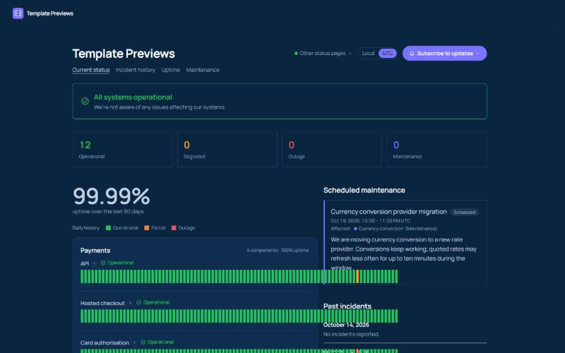</a> | **[Meridian](meridian-status/)**<br>A dark, bespoke page for a payments network: tiles that count components by state, the flagship group as a hero card beside the open incidents and maintenance, square bars, and times in UTC with a Local / UTC switch.<br><sub>Template id: `meridian-status`</sub> |

### Legal

| Preview | Template |
| --- | --- |
| <a href="covenant/">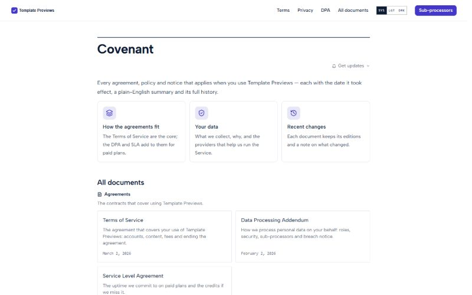</a> | **[Covenant](covenant/)**<br>A legal hub with weight: an intro and three cards on how the agreements fit, documents grouped as Agreements, Privacy and Policies, and documents with numbered clauses, a boxed plain-English summary and the register in a sidebar.<br><sub>Template id: `covenant`</sub> |
| <a href="bylaw/">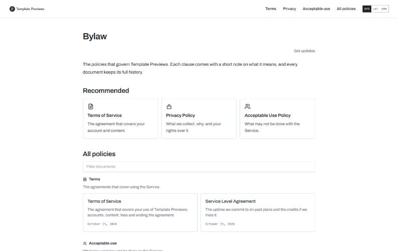</a> | **[Bylaw](bylaw/)**<br>A site-policy register like an open-source handbook: recommended cards, a filterable list grouped as Terms, Acceptable use, Privacy and Security, and documents with lettered clauses, a “what each section says” table, a breadcrumb and Copy as Markdown.<br><sub>Template id: `bylaw`</sub> |
| <a href="folio/">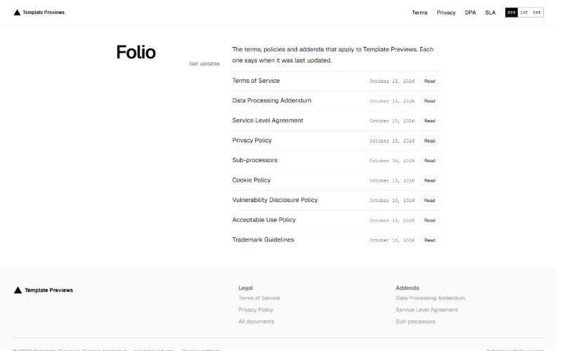</a> | **[Folio](folio/)**<br>A monochrome register in two columns: a large heading on the left, the documents ruled on the right with “Last updated” and a pill Read button each; documents are minimal, with an on-this-page rail.<br><sub>Template id: `folio`</sub> |
| <a href="statute/">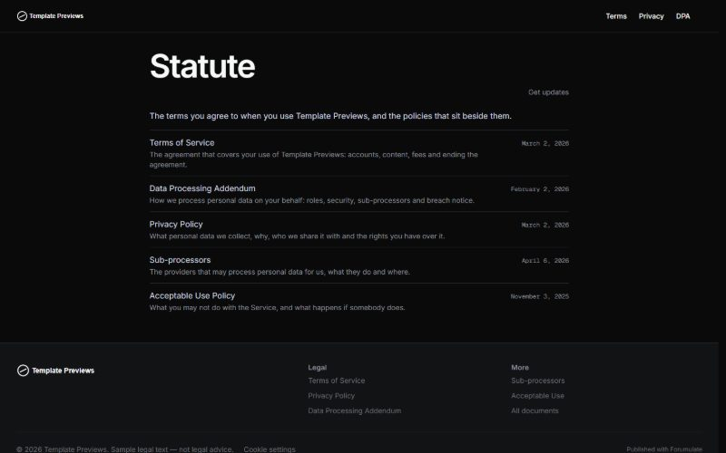</a> | **[Statute](statute/)**<br>Minimal and typographic, on dark: a huge title under a monospace “EFFECTIVE DATE” kicker, headings exactly as written, defined terms set bold at the start of their meaning, and a narrow measure.<br><sub>Template id: `statute`</sub> |
| <a href="assurance/">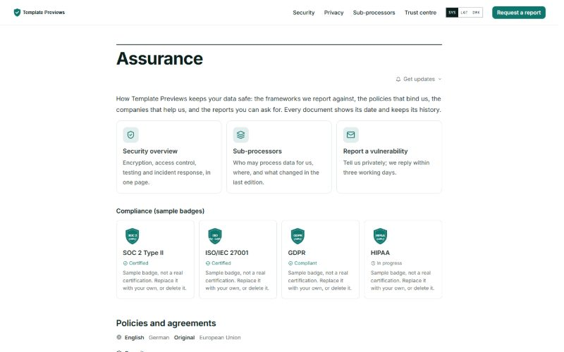</a> | **[Assurance](assurance/)**<br>A trust centre: compliance badge tiles in the brand accent, the policies grouped as Security, Privacy and Terms, a document library with public reports and Request access, the status page’s live state, a sortable sub-processor list and region/language versions.<br><sub>Template id: `assurance`</sub> |

### FAQ

| Preview | Template |
| --- | --- |
| <a href="lamplight/"></a> | **[Lamplight](lamplight/)**<br>A friendly help centre: a soft gradient search hero, four-up category cards with icons and question counts, popular questions and a contact band.<br><sub>Template id: `lamplight`</sub> |
| <a href="meadow/"></a> | **[Meadow](meadow/)**<br>A calm, editorial help centre: a serif headline over a landscape hero, a centred search, and three-up collection tiles with large icons.<br><sub>Template id: `meadow`</sub> |
| <a href="helmsway/"></a> | **[Helmsway](helmsway/)**<br>A restrained support site: a left-aligned search hero, popular articles with their first line and topic chips, then a compact topic list and contact.<br><sub>Template id: `helmsway`</sub> |
| <a href="pricefold/"></a> | **[Pricefold](pricefold/)**<br>The pricing-page FAQ: heading, intro and contact on the left, a single-open accordion with plus icons and muted answers on the right, in a dark scheme.<br><sub>Template id: `pricefold`</sub> |
| <a href="patchbay/"></a> | **[Patchbay](patchbay/)**<br>A plain-spoken support page: big title and lede, contact cards first, then the common issues as ruled rows with muted answers, all open. Dark.<br><sub>Template id: `patchbay`</sub> |

### Careers

| Preview | Template |
| --- | --- |
| <a href="quarry-careers/"></a> | **[Quarry Careers](quarry-careers/)**<br>A dark, culture-first careers page: a one-line hero with an anchor to the roles, a short essay on quality, eleven numbered principles, talks and interviews, then every opening grouped under its team with counts.<br><sub>Template id: `quarry-careers`</sub> |
| <a href="ledgerwise/"></a> | **[Ledgerwise Jobs](ledgerwise/)**<br>A bright, large-board jobs search: a slim hero, an “assess your fit” band, then one ruled table of roles — team, location and type as columns — with search, a filter bar and pages of twenty.<br><sub>Template id: `ledgerwise`</sub> |
| <a href="brightwater/"></a> | **[Brightwater Careers](brightwater/)**<br>A warm, culture-led careers page: a photo-collage hero, values and benefits as cards, words from the team with portraits, office cards, then roles as two-up cards with their facts as chips.<br><sub>Template id: `brightwater`</sub> |
| <a href="hostboard/"></a> | **[Hostboard](hostboard/)**<br>A neutral, hosted-style job board: the brand’s accent and nothing else, a left filter rail beside roles grouped by department with pill chips, and role pages with Overview and Application tabs and a full native apply form.<br><sub>Template id: `hostboard`</sub> |
| <a href="plainwork/"></a> | **[Plainwork Jobs](plainwork/)**<br>A calm, single-column jobs page in large serif prose: a few paragraphs about the company, a link to how we hire, and a plain list of openings with the salary stated in every one.<br><sub>Template id: `plainwork`</sub> |

### Contact

| Preview | Template |
| --- | --- |
| <a href="merrow-sales/"></a> | **[Merrow Sales](merrow-sales/)**<br>A two-step contact-sales page: work email and topic first, the qualifying questions after Continue, in a raised card on a bright, generous page.<br><sub>Template id: `merrow-sales`</sub> |
| <a href="halyard/"></a> | **[Halyard Contact](halyard/)**<br>A dark topic router: a card per topic with a line saying what it is for, and the form opening on the one somebody picks — asking only that topic’s questions.<br><sub>Template id: `halyard`</sub> |
| <a href="vantage-contact/"></a> | **[Vantage Contact](vantage-contact/)**<br>A split contact-sales page: the pitch, three proof numbers and a logo wall on the left; a raised form card on the right that stays in view while you read.<br><sub>Template id: `vantage-contact`</sub> |
| <a href="atriumline/"></a> | **[Atriumline Contact](atriumline/)**<br>A company contact page for a business with offices around the world: topic cards that open the right form, your sales line and hours with an “Open now” line, and a grid of office cards — photo, address, phone, hours and a map link each.<br><sub>Template id: `atriumline`</sub> |
| <a href="fieldnote/"></a> | **[Fieldnote Support](fieldnote/)**<br>A calm, single-column support page in a large serif: a human promise, your hours and how fast you answer up front, and a plain form with no box around it.<br><sub>Template id: `fieldnote`</sub> |

### Events

| Preview | Template |
| --- | --- |
| <a href="lanternhall/"></a> | **[Lanternhall](lanternhall/)**<br>A community calendar in the day-by-day style: every event on a timeline under its date, a square cover beside it, the hosts and who is going; each event page puts the cover on the left over a sticky register card, with the place drawn as our own map card.<br><sub>Template id: `lanternhall`</sub> |
| <a href="gatherwell/"></a> | **[Gatherwell](gatherwell/)**<br>A local group’s home: a warm banner, what the group is about, its numbers and its organizers, then the meetups as rows with seats left and who is going. Each event opens on a wide picture with the place, a map card and a sticky RSVP bar on phones.<br><sub>Template id: `gatherwell`</sub> |
| <a href="keynote-coast/"></a> | **[Keynote Coast](keynote-coast/)**<br>An annual conference microsite: a saturated full-width hero, the numbers, featured speakers, the calendar, a call for proposals, tiered sponsors and an FAQ. The conference itself opens on a full-bleed hero with a countdown, and its programme reads as a grid by stage with day tabs and filters.<br><sub>Template id: `keynote-coast`</sub> |
| <a href="shipcast/"></a> | **[Shipcast](shipcast/)**<br>A developer launch stream: strict dark, hairline borders and square corners, times in mono in both zones. The launch page counts down over a single column, its schedule is a time · title · speaker table, and after the stream every session keeps its recording.<br><sub>Template id: `shipcast`</sub> |
| <a href="briefing-room/"></a> | **[Briefing Room](briefing-room/)**<br>A webinar series: a calm white page with one blue call to action, the hosts, then each episode as a card with a wide cover; past episodes stay listed with their recordings. Each episode page opens on a wide cover with a sticky register card and every time shown in the host’s zone and the reader’s.<br><sub>Template id: `briefing-room`</sub> |

### Courses

| Preview | Template |
| --- | --- |
| <a href="primer/"></a> | **[Primer](primer/)**<br>A chapter-by-chapter tutorial: numbered chapters, a chapter badge and an "In this chapter" box over every lesson, code with file names, Reveal-the-solution exercises, and a "Next up" card at the end of each chapter.<br><sub>Template id: `primer`</sub> |
| <a href="reelhouse/"></a> | **[Reelhouse](reelhouse/)**<br>A dark, dense video course: a wide cover over a stats strip, the instructors with their companies, and the lessons as a timed table. Every lesson is a self-hosted video with chapters, a searchable transcript and a speed row.<br><sub>Template id: `reelhouse`</sub> |
| <a href="cohortly/"></a> | **[Cohortly](cohortly/)**<br>A cohort course landing: the pitch beside a sticky panel with the start date and the button, a "Previously at" logo row, what is included, a weekly syllabus that opens week by week, testimonials and a long FAQ, on a warm page with editorial serif headings.<br><sub>Template id: `cohortly`</sub> |
| <a href="pathwise/"></a> | **[Pathwise](pathwise/)**<br>A bright, game-like learning path: short lessons as round nodes on a winding path, a chunky progress bar over every lesson, quick checks between explanations, lessons that open one after another, and a unit test at the end.<br><sub>Template id: `pathwise`</sub> |
| <a href="doodle-school/"></a> | **[Doodle School](doodle-school/)**<br>An illustrated short course: a round, hand-drawn course badge beside the pitch, bite-sized lessons as cards with their length, kind and free-preview pills, a playful display face and soft pastel colours, in light and dark.<br><sub>Template id: `doodle-school`</sub> |

### Custom

| Preview | Template |
| --- | --- |
| <a href="lumen-launch/"></a> | **[Lumen Launch](lumen-launch/)**<br>A dark product homepage: gradient display type, a split hero with a product shot in perspective, a logo wall, alternating feature rows, a five-cell bento, a changelog teaser and a closing call to action under a blurred sticky header with a mega menu.<br><sub>Template id: `lumen-launch`</sub> |
| <a href="gridline/"></a> | **[Gridline](gridline/)**<br>A monochrome developer-platform homepage on a hairline grid: a centred hero on a faded grid pattern, a scrolling logo marquee, a tabbed feature switcher with code, feature cards, testimonials, numbers and a two-button call to action.<br><sub>Template id: `gridline`</sub> |
| <a href="tidepool-pricing/"></a> | **[Tidepool Pricing](tidepool-pricing/)**<br>A light pricing page: a centred headline, three plans with a monthly / yearly switch, a comparison table whose header stays put as you scroll, an FAQ and an enterprise band with a contact form that lands in your inbox.<br><sub>Template id: `tidepool-pricing`</sub> |
| <a href="northstar-story/"></a> | **[Northstar Story](northstar-story/)**<br>A long-form product story in large serif type: a full-bleed film behind the title, a numbers band, a scroll-driven sequence where the picture stays put while the chapters pass, pull quotes and parallax picture breaks.<br><sub>Template id: `northstar-story`</sub> |
| <a href="keystone-trust/"></a> | **[Keystone Trust](keystone-trust/)**<br>A trust centre in the article layout: the page tree and an on-this-page rail, uptime and audit numbers, a wall of compliance badges, cards for each control, an FAQ and a way to reach the security team — with pages for practices, compliance, privacy, subprocessors and vulnerability reports.<br><sub>Template id: `keystone-trust`</sub> |

## What is in a folder

| File | What it is |
| --- | --- |
| `template.json` | The manifest: id, type, name, description, layout, the front page and any sample content. |
| `bundle.json` | The theme bundle — palette, type, header and footer, element styles. The same format the theme marketplace and `GET …/theme/bundle` use. |
| `assets/` | Pictures the template uses, copied into your library when it is applied. |
| `screenshots/` | Full-size screenshots. |
| `thumbnail.*` | The picker thumbnail shown above. |
| `README.md` | What applying it creates. |

Brands, people and posts in the templates are fictional placeholders.
`node scripts/validate.mjs` checks that every manifest parses and every file
it names exists.

## Links

- Guides: https://forumulate.com/guides
- API reference: https://forumulate.com/reference
- Community: https://forumulate.com/community

## License

MIT — see [LICENSE](LICENSE).

---

## About this repository

This repository is a public mirror, refreshed on each Forumulate release
(one commit per release). Pull requests are welcome; accepted changes are
applied upstream and arrive here with the next release.

- API reference: https://forumulate.com/reference
- Guides: https://forumulate.com/guides
- Community and support: https://forumulate.com/community
- Source: https://github.com/forumulate/templates
