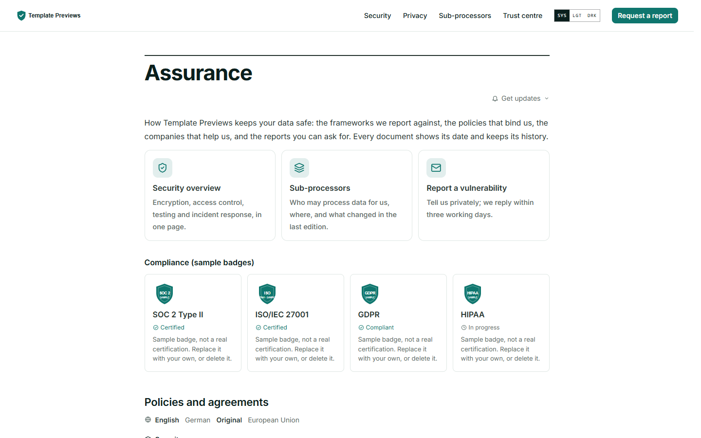
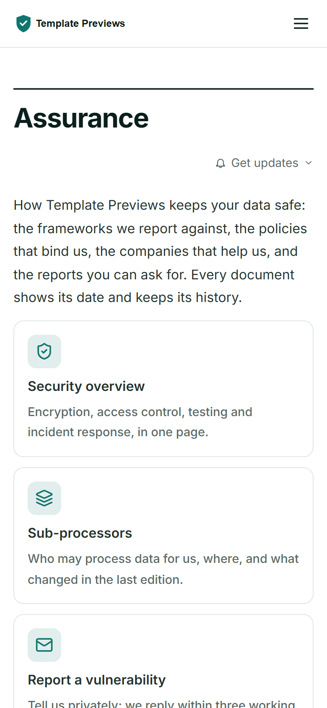

# Assurance

**An official Forumulate legal template.** Modelled on: a cloud platform’s trust centre.

A trust centre: compliance badge tiles in the brand accent, the policies grouped as Security, Privacy and Terms, a document library with public reports and Request access, the status page’s live state, a sortable sub-processor list and region/language versions.

| Desktop | Phone |
| ------- | ----- |
|  |  |

## What it uses

- Preset: standard — documents grouped under Security, Privacy and Terms, a filter box once the list is long
- Compliance band: four sample badge tiles in the brand accent (certified / compliant / in progress) — clearly marked as samples
- Document library band: public documents open, gated reports offer Request access
- Status band: the organization’s status page’s live state, as a card
- Sub-processors as data: a sortable table, published as JSON, with “added / removed since the last edition”
- Region and language versions: an EU privacy notice and an informational German translation, behind a picker
- Get updates band: subscribe to new editions by email or feed
- Zero custom CSS — every detail is a theme setting

## What applying it creates

- **The look** — `bundle.json`, a theme bundle: palette, type, header and footer, and the register's and documents' look (`theme.legal`). Published to the space straight away.
- **The front page** — the composed register page in `template.json` (`frontPage`), ending in the documents band.
- **The layout** — register preset `standard`.
- **11 sample documents** in 3 group(s) (Security, Privacy, Terms), each with its version, effective date and governing law set as fields and the typed sections (in plain English, the document, questions) filled in:
  - Security Overview
  - Vulnerability Disclosure Policy
  - Privacy Policy
  - Privacy Policy (EU and UK)
  - Data Processing Addendum
  - Sub-processors
  - Cookie Policy
  - Terms of Service
  - Nutzungsbedingungen
  - Service Level Agreement
  - Acceptable Use Policy

## The sample text is not legal advice

Every document is **sample text for a fictional company**, written to show the layout: clause numbering, the plain-English summary, definitions, history and the register. It is not legal advice, it is not copied from any real company's terms, and it is not fit to publish. Each document opens with a "Sample text" callout saying so. Replace every word with text written for your business and reviewed by your own counsel, then delete the callout. None of the samples asks members to accept anything (`mustAccept` is left off), so applying the template never prompts anyone.

## Placeholders

- **“Your Brand”** — everywhere the brand appears (header and footer copy, the wordmark, the sample text) it becomes your organization’s name when the template is applied.
- **Governing law** — the samples name a placeholder jurisdiction; set your own in each document's fields.
- **Addresses** — contact addresses use the reserved `example.com` domain.
- **Links** — header, footer and front-page links point at your register's own address.

## Files

- `template.json` — the manifest (`forumulate.space-template` v1): layout, front page and the sample documents under `legal`. Schema: `packages/shared/src/official-templates.ts`.
- `bundle.json` — the theme bundle (`forumulate.theme-bundle`); also listed in the theme marketplace as `template-assurance`.
- `assets/` — the placeholder pictures.

## The badges are samples

The compliance band shows four **sample badges** (SOC 2 Type II, ISO/IEC 27001, GDPR, HIPAA) drawn as generic shields in the brand accent, each stamped SAMPLE and carrying the note "Sample badge, not a real certification". Applying the template puts your organization's name on the page, so these would read as claims about you: replace each with a certification you actually hold (and its own mark and report link), or delete it, before you publish (`theme.legal.trust.compliance`). The gated reports in the document library are named "(sample)" for the same reason, and "Request access" goes to the placeholder `trust@example.com` until you set `theme.legal.trust.access.requestHref` (unset, it goes to your contact space).

## Versions

`privacy-eu` is a **region version** of `privacy` (Region: EU) and `terms-de` a **language version** of `terms` (Language: de, Translation for information only): the register lists each family once behind a region/language picker, the documents link each other, and the German one says the English text governs.
