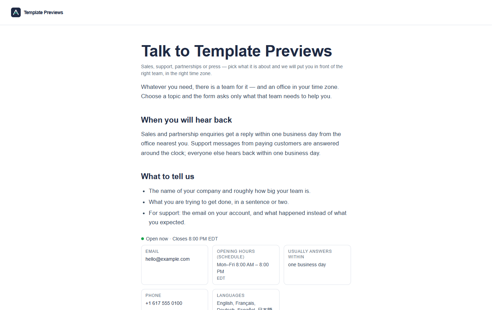

# Atriumline Contact

**An official Forumulate contact template.** Modelled on: a CRM company’s global contact page.

A company contact page for a business with offices around the world: topic cards that open the right form, your sales line and hours with an “Open now” line, and a grid of office cards — photo, address, phone, hours and a map link each.

## What applying it creates

- **The look** — `bundle.json`, a theme bundle: palette, type, form card, topic, fact, office and channel looks (`theme.contact`). Published to the space straight away.
- **The layout** — the `standard` preset, with the page's own heading and the line under it.
- **The form** — 7 question(s) beyond name, email and message, each asked only by the topics that need it, and the button and thank-you words.
- **Topics** — Talk to sales, Get support, Become a partner, Press and media, as cards. Every topic is routed to the person who applies the template until they give it its own address.
- **The page the copy lives on** — the intro and the facts (email, phone, opening hours as a schedule, response time, languages), set as the space's home page.
- **Offices** — six sample offices (Boston, Toronto, London, Dublin, Singapore, Sydney) in the home page's `offices` field: address, phone, email, a drawn photo and each office's own hours. Each card says whether that office is open right now, on its own clock.
- **Pictures** — 7 file(s) in `assets/`, copied into your library.

The addresses, phone numbers and emails are samples — edit the offices in the studio (double-click the band) or remove the ones you do not have. “Map” on each card is a link to an OpenStreetMap search for the address (or your own `mapUrl`), never an embedded map tile, so the page makes no third-party request.

Under the offices, “More ways to get help” lists the site's own docs, community and status spaces, found automatically.

Zero custom CSS — every detail is a theme setting. The brand is `Your Brand`, replaced with your organization's name.
