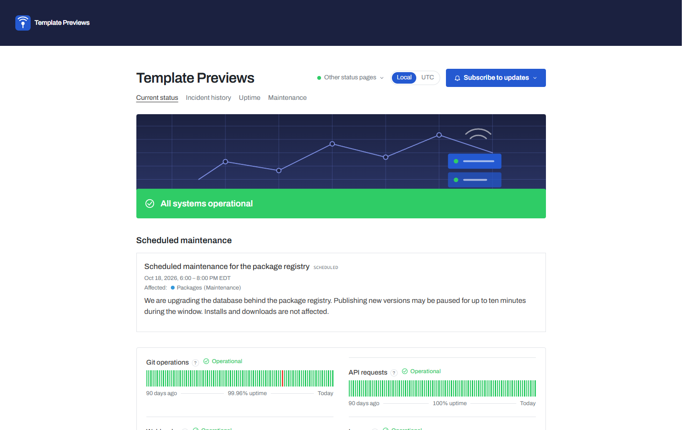

# Beacon Status

**An official Forumulate status page template.** Modelled on: A code-hosting platform’s status page.

The classic status page: a painted header, a solid banner that says it in one line, every component in a two-column grid with thin ninety-day bars, a legend under them and the last fifteen days spelled out — “No incidents reported” included.

## What applying it creates

- **The look** — `bundle.json`, a theme bundle: palette, type and every `theme.status` key (a drawn hero illustration with the solid banner overlapping it, thin bars, two-column grid, legend below, 15 quiet days). Published to the space straight away.
- **The front page** — the status bands in this order, at this width (`frontPage` in `template.json`).
- **Components** — 10 sample components. Every one is **manual**: nothing is probed. Point a component at your own service by giving it a check in the studio, or keep declaring its state by hand.
- **A short history** — 3 resolved incidents with their update streams (Delayed webhook deliveries; Pipeline jobs queued longer than usual; Git operations over SSH failing), dated a few days to a few weeks before you apply it, so the bars and the history read like a real page on day one. None of them notifies anybody.
- **Upcoming maintenance** — Scheduled maintenance for the package registry, a few days after you apply it.

The page runs 920px wide, like the classic hosted status pages. The sub-pages (history, uptime, maintenance) are linked under the title.

The sample components, incidents and maintenance are examples: rename them, delete them, or replace them with your own before you share the page. Zero custom CSS — every detail is a theme setting. The brand is `Your Brand`, replaced with your organization's name.
