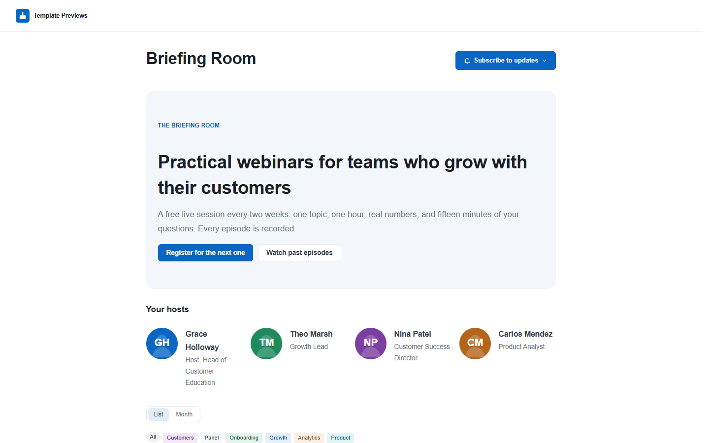
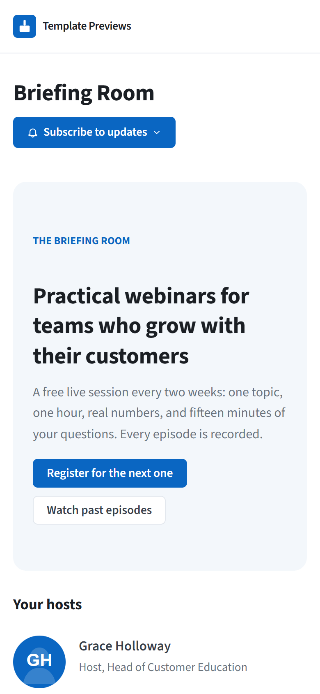

# Briefing Room

**An official Forumulate events template.** Modelled on: an events platform’s webinar series pages.

A webinar series: a calm white page with one blue call to action, the hosts, then each episode as a card with a wide cover; past episodes stay listed with their recordings. Each episode page opens on a wide cover with a sticky register card and every time shown in the host’s zone and the reader’s.

| Desktop | Phone |
| ------- | ----- |
|  |  |

## What it uses

- Series intro with one call to action and the hosts on the front page
- Episodes as three-up cards with 2:1 covers; past episodes listed under them with recordings
- Episode page: wide cover, facts card, countdown, sticky register card
- Every time in the host’s zone and the reader’s, with a switch
- FAQ and the registration-and-cancellation policy in each episode’s description
- Zero custom CSS — every detail is a theme setting

## What applying it creates

- **The look** — `bundle.json`, a theme bundle: palette, type, header and footer, and the calendar's look (`theme.events`: the list, the event page, the agenda and speakers). Published to the space straight away.
- **The front page** — `frontPage` in `template.json`, ending in the live calendar.
- **The layout** — preset `webinar` and its front-door options.
- **3 upcoming and 3 past events**, dated relative to the day you apply it, in each event's own time zone — so the calendar is never a page of past events:
  - Pricing Pages That Convert
  - Onboarding in Five Emails
  - Building a Customer Council
  - Reading Your Churn Data (past)
  - Writing Release Notes People Read (past)
  - Support as a Growth Channel (past)
- **Hosts** — 4 placeholder people in the space's author registry, credited on the events they host.
- **Settings** — email-only registration (`eventAttendance.emailRsvp`, double opt-in) and reminders a day and an hour before (`eventNotices`).
- **Registration questions** — the panel episode asks for a company and a role (optional), from the Forms field model.

Nobody is mailed about a sample: the events are announced to nobody, and none has an RSVP.

## Placeholders

- **“Your Brand”** — everywhere the brand appears (header and footer, the mark, the covers, the sample copy) it becomes your organization’s name.
- **Pictures** — the mark, covers and portraits in `assets/` are drawn placeholders, copied into your space’s asset library on apply.
- **Links** — join links and recordings point at `example.com` addresses. Replace them with your own before you publish; a past event’s recording link is what its page offers instead of an RSVP.
- **Events** — sample events in neutral copy. Edit, duplicate or delete them; a published event is a real event to search engines.

## Files

- `template.json` — the manifest (`forumulate.space-template` v1): layout, front page, hosts, the sample events and their programme. Schema: `packages/shared/src/official-templates.ts` and `official-templates-content-events.ts`.
- `bundle.json` — the theme bundle (`forumulate.theme-bundle`); also listed in the theme marketplace as `template-briefing-room`.
- `assets/` — the placeholder pictures.
