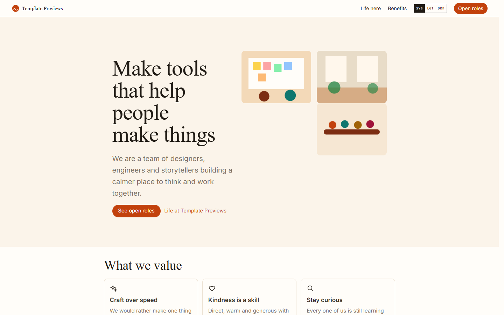
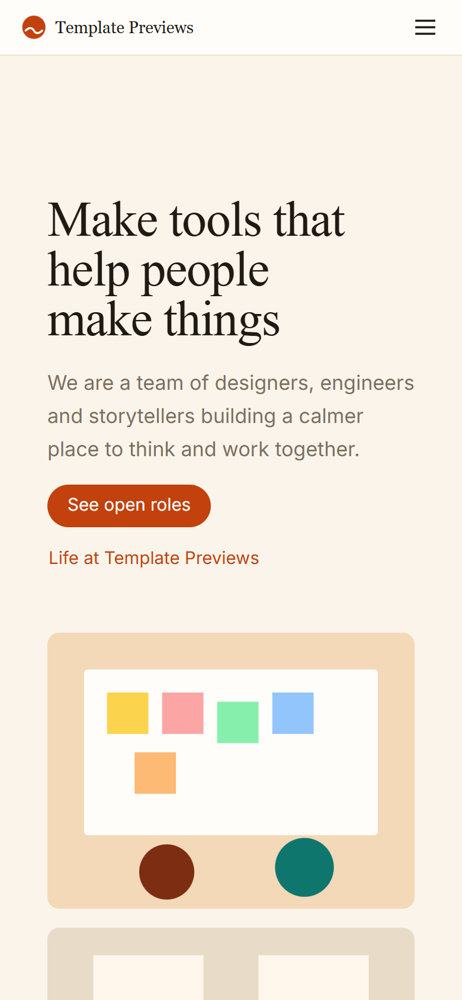

# Brightwater Careers

**An official Forumulate careers template.** Modelled on: a collaboration app’s culture-led careers page.

A warm, culture-led careers page: a photo-collage hero, values and benefits as cards, words from the team with portraits, office cards, then roles as two-up cards with their facts as chips.

| Desktop | Phone |
| ------- | ----- |
|  |  |

## What it uses

- Composed front page: photo-collage hero, values cards, benefits grid, testimonials with portraits, studio cards, the roles board
- Board preset: cards — two roles to a row, their facts as pill chips, a lift on hover
- Filter by team and location from dropdowns
- Role page: facts as chips, share links and “More roles” from the same team
- Two pages beside the roles (life here, benefits) marked as pages, not openings
- Warm palette with a serif display face
- Zero custom CSS — every detail is a theme setting
- Type: Newsreader and Inter (served from our own font store)

## What applying it creates

- **The look** — `bundle.json`, a theme bundle: palette, type, header and footer, and the board's look (`theme.careers`). Published to the space straight away.
- **The front page** — the composed careers page in `template.json` (`frontPage`), ending in the live roles board.
- **The layout** — board preset `cards` and its front-door options.
- **3 teams with 6 sample roles** — each with its location, employment type and where the work happens set as fields, and the typed sections (summary, what you will do, what we need, what we offer, how hiring works) filled in:
  - Senior Product Designer
  - Illustrator
  - Software Engineer, Editor
  - Engineering Manager, Platform
  - People Partner
  - Community Lead
- **2 page(s) beside the roles** (`kind: page` — read as pages: not listed as roles, no apply form, no job markup):
  - Life at Your Brand
  - Benefits

## Placeholders

- **“Your Brand”** — everywhere the brand appears (header and footer copy, the wordmark, the sample copy) it becomes your organization’s name when the template is applied.
- **Pictures** — the wordmark, favicon and every picture in `assets/` are generic placeholders, copied into your space’s asset library on apply.
- **Links** — header, footer and front-page links point at your new space’s own address.
- **Roles** — sample openings in neutral copy. Edit or unpublish them before you go live; a published role is a real job posting to search engines.

## Files

- `template.json` — the manifest (`forumulate.space-template` v1): layout, front page, the sample teams, roles and pages. Schema: `packages/shared/src/official-templates.ts`.
- `bundle.json` — the theme bundle (`forumulate.theme-bundle`); also listed in the theme marketplace as `template-brightwater`.
- `assets/` — the placeholder pictures.
