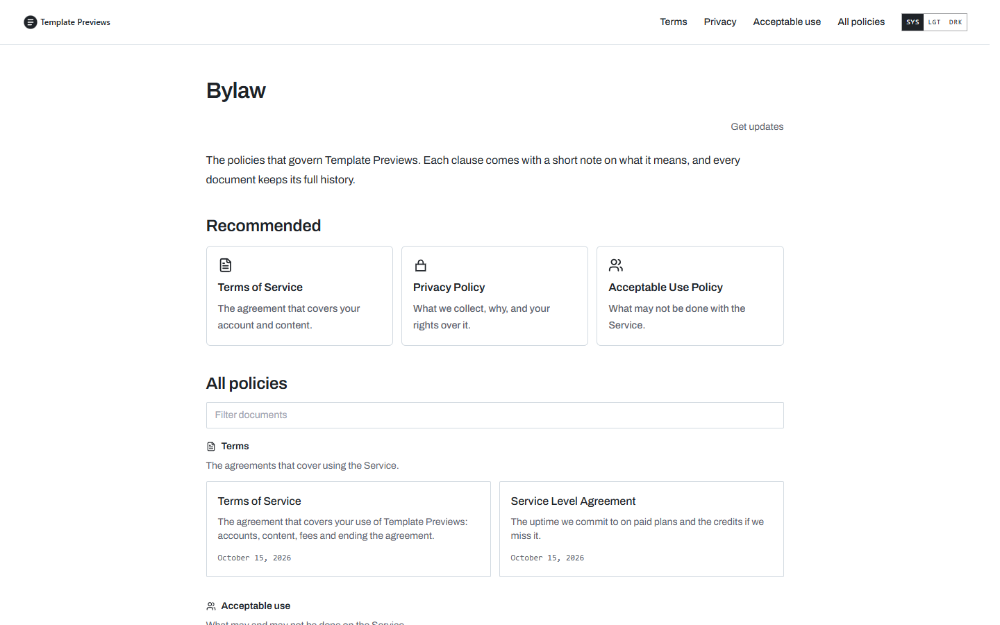
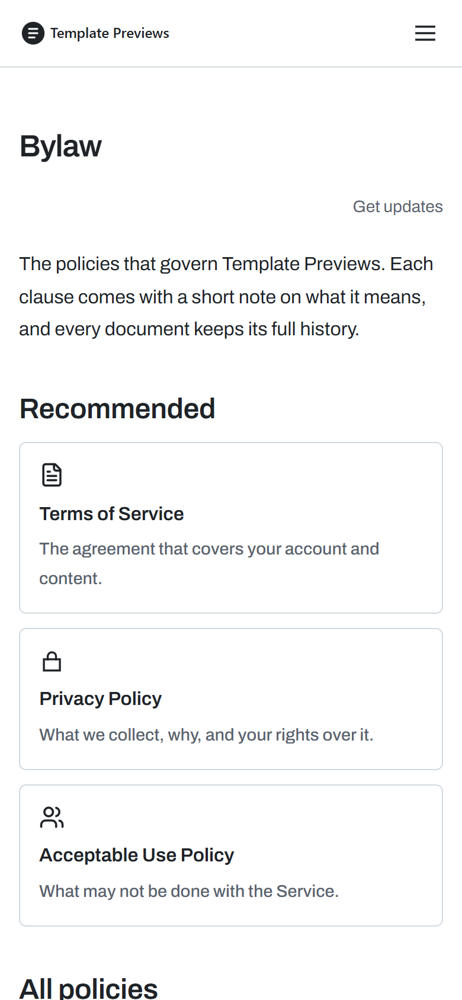

# Bylaw

**An official Forumulate legal template.** Modelled on: a code-hosting platform’s site-policy docs.

A site-policy register like an open-source handbook: recommended cards, a filterable list grouped as Terms, Acceptable use, Privacy and Security, and documents with lettered clauses, a “what each section says” table, a breadcrumb and Copy as Markdown.

| Desktop | Phone |
| ------- | ----- |
|  |  |

## What it uses

- Preset: cards — grouped under Terms, Acceptable use, Privacy and Security, with a filter box always on
- “Recommended” cards above the full list
- Lettered clauses (A., B., C.) written into the headings
- A plain-language gloss under each clause, gathered into a summary table above the document
- Breadcrumb trail (register / group / document) and an “In this article” rail
- Print / PDF and Copy as Markdown on every document; edition history listed open
- System font stack, light and dark
- Zero custom CSS — every detail is a theme setting

## What applying it creates

- **The look** — `bundle.json`, a theme bundle: palette, type, header and footer, and the register's and documents' look (`theme.legal`). Published to the space straight away.
- **The front page** — the composed register page in `template.json` (`frontPage`), ending in the documents band.
- **The layout** — register preset `cards`.
- **9 sample documents** in 4 group(s) (Terms, Acceptable use, Privacy, Security), each with its version, effective date and governing law set as fields and the typed sections (in plain English, the document, questions) filled in:
  - Terms of Service
  - Service Level Agreement
  - Acceptable Use Policy
  - Trademark Guidelines
  - Privacy Policy
  - Cookie Policy
  - Sub-processors
  - Data Processing Addendum
  - Vulnerability Disclosure Policy

## The sample text is not legal advice

Every document is **sample text for a fictional company**, written to show the layout: clause numbering, the plain-English summary, definitions, history and the register. It is not legal advice, it is not copied from any real company's terms, and it is not fit to publish. Each document opens with a "Sample text" callout saying so. Replace every word with text written for your business and reviewed by your own counsel, then delete the callout. None of the samples asks members to accept anything (`mustAccept` is left off), so applying the template never prompts anyone.

## Placeholders

- **“Your Brand”** — everywhere the brand appears (header and footer copy, the wordmark, the sample text) it becomes your organization’s name when the template is applied.
- **Governing law** — the samples name a placeholder jurisdiction; set your own in each document's fields.
- **Addresses** — contact addresses use the reserved `example.com` domain.
- **Links** — header, footer and front-page links point at your register's own address.

## Files

- `template.json` — the manifest (`forumulate.space-template` v1): layout, front page and the sample documents under `legal`. Schema: `packages/shared/src/official-templates.ts`.
- `bundle.json` — the theme bundle (`forumulate.theme-bundle`); also listed in the theme marketplace as `template-bylaw`.
- `assets/` — the placeholder pictures.
