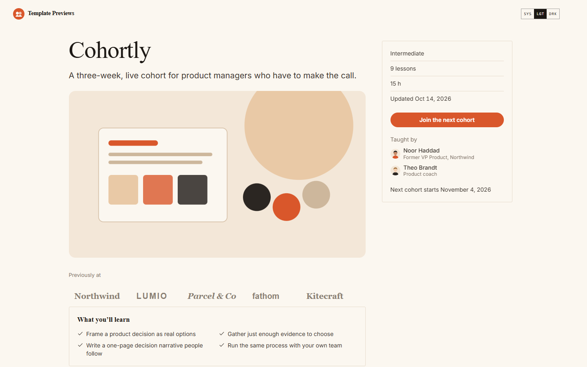

# Cohortly

**An official Forumulate course template.** Modelled on: A live cohort-course platform.

A cohort course landing: the pitch beside a sticky panel with the start date and the button, a "Previously at" logo row, what is included, a weekly syllabus that opens week by week, testimonials and a long FAQ, on a warm page with editorial serif headings.

## What applying it creates

- **The look** — `bundle.json`, a theme bundle: a warm palette, Newsreader headings over Inter, pill buttons, and the `theme.courses` keys for a cohort (cohort landing, accordion syllabus, week headings, spotlight testimonials, a signed classic certificate). Published to the space straight away.
- **The landing** — the course bands in this order (`frontPage` in `template.json`).
- **The course** — 3 modules and 9 sample lessons, each with its length and kind, written in the course's voice.
- **Quizzes** — a check after the first live session and a final check closing week 3.
- **The cohort** — week one starts 21 days after you apply the template; link an EVENTS space in the course details to list its live sessions in the panel.
- **Pacing** — weeks 2 and 3 open 7 and 14 days after each learner starts; a nudge mail goes out after 5 quiet days.
- **The course details** — subtitle, cover, outcomes, prerequisites, two placeholder instructors, three testimonials and a five-question FAQ.

The sample lessons are examples: rewrite or delete them before you share the course. Zero custom CSS — every detail is a theme setting or course data. The brand is `Your Brand`, replaced with your organization's name.
