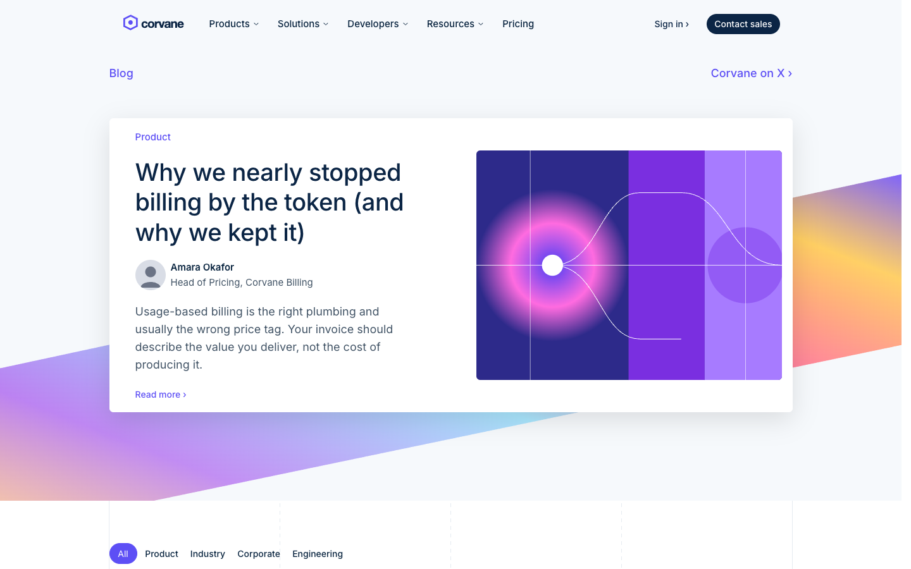
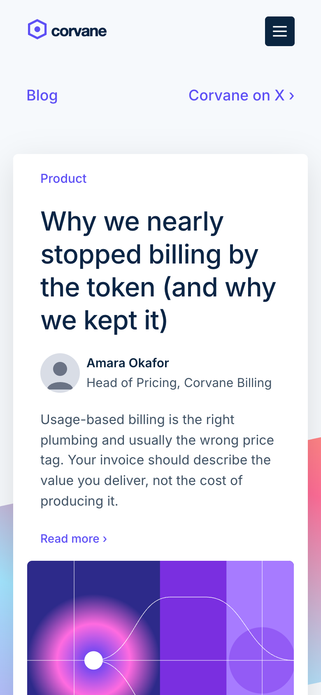

# Corvane

**An official Forumulate blog template.** Modelled on: a payments company’s product and engineering blog.

A bright product blog with a gradient hero band, a lead story, category tabs and a subscribe band after every post. Light, crisp and corporate.

| Desktop                                          | Phone                                        |
| ------------------------------------------------ | -------------------------------------------- |
|  |  |

## What it uses

- Composed front page (7 sections)
- Header with drop-down menus
- 5-column footer
- Index layout: feed
- Post layout: article-rail
- A band after every post
- Motion presets
- Zero custom CSS — every detail is a theme setting
- Type: Inter (Google Fonts)
- Colour scheme: light

## What applying it creates

- **The look** — `bundle.json`, a theme bundle: palette, type, header and footer, the composed front page. Published to the space straight away.
- **The layout** — index layout `feed`, post layout `article-rail`, and the post page’s own sidebar / after-post band.
- **Tags** — 4 tags with their labels.
- **Authors** — 2 placeholder people in the author registry (Alex Morgan, Sam Rivera). Rename or replace them.
- **5 sample posts** — short, neutral placeholder copy so the space looks like the preview on day one:
  - Pricing that matches the value customers actually get
  - Faster payouts across borders, now on by default
  - Smarter retries recover more failed renewals
  - What rising fraud attempts tell us about travel bookings
  - How we built it: resolving tax rules in under a millisecond

## Placeholders

- **“Your Brand”** — everywhere the brand appears (header and footer copy, the wordmark) it becomes your organization’s name when the template is applied.
- **Pictures** — the logo, wordmark, favicon, covers, avatars and decorative art in `assets/` are generic placeholders. They are copied into your space’s asset library, so replacing one is an ordinary upload.
- **Links** — header, footer and front-page links point at your new space’s own address.

## Files

- `template.json` — the manifest (`forumulate.space-template` v1): layout, post page, tags, authors, forms, sample posts. Schema: `packages/shared/src/official-templates.ts`.
- `bundle.json` — the theme bundle (`forumulate.theme-bundle`); also listed in the theme marketplace as `template-corvane`.
- `assets/` — the placeholder pictures.
- `screenshots/` — taken from the live preview.
