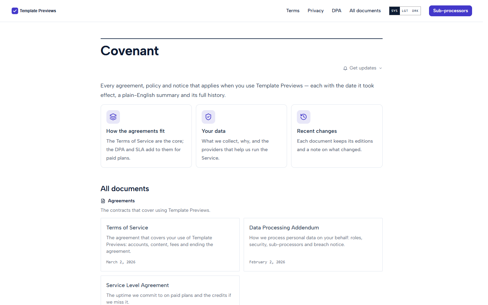
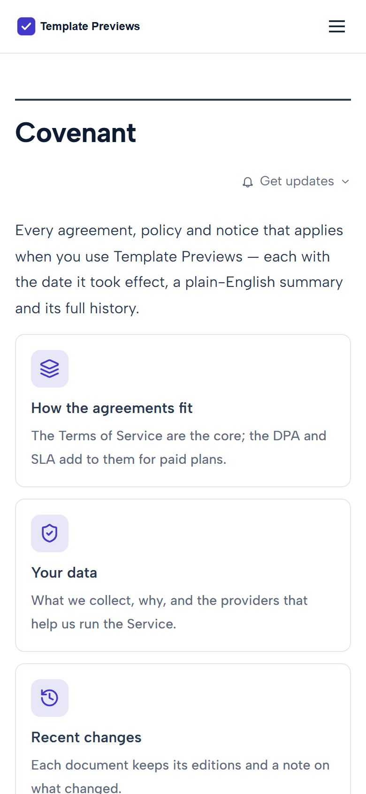

# Covenant

**An official Forumulate legal template.** Modelled on: a payments company’s legal hub.

A legal hub with weight: an intro and three cards on how the agreements fit, documents grouped as Agreements, Privacy and Policies, and documents with numbered clauses, a boxed plain-English summary and the register in a sidebar.

| Desktop | Phone |
| ------- | ----- |
|  |  |

## What it uses

- Preset: cards — each document as a card with its description, grouped under its collection
- Intro band with three cards: how the agreements fit, your data, recent changes
- Automatic clause numbers (1. / 1.1) written into the headings and the contents rail
- Effective date as the kicker above the title and the lead of the head, spelled long
- Plain-English summary as a raised callout; definitions as a two-column table
- The register beside every document (sidebar) and an on-this-page rail
- History disclosure under the head; Get updates as a menu
- Zero custom CSS — every detail is a theme setting

## What applying it creates

- **The look** — `bundle.json`, a theme bundle: palette, type, header and footer, and the register's and documents' look (`theme.legal`). Published to the space straight away.
- **The front page** — the composed register page in `template.json` (`frontPage`), ending in the documents band.
- **The layout** — register preset `cards`.
- **8 sample documents** in 3 group(s) (Agreements, Privacy, Policies), each with its version, effective date and governing law set as fields and the typed sections (in plain English, the document, questions) filled in:
  - Terms of Service
  - Data Processing Addendum
  - Service Level Agreement
  - Privacy Policy
  - Sub-processors
  - Cookie Policy
  - Acceptable Use Policy
  - Trademark Guidelines

## The sample text is not legal advice

Every document is **sample text for a fictional company**, written to show the layout: clause numbering, the plain-English summary, definitions, history and the register. It is not legal advice, it is not copied from any real company's terms, and it is not fit to publish. Each document opens with a "Sample text" callout saying so. Replace every word with text written for your business and reviewed by your own counsel, then delete the callout. None of the samples asks members to accept anything (`mustAccept` is left off), so applying the template never prompts anyone.

## Placeholders

- **“Your Brand”** — everywhere the brand appears (header and footer copy, the wordmark, the sample text) it becomes your organization’s name when the template is applied.
- **Governing law** — the samples name a placeholder jurisdiction; set your own in each document's fields.
- **Addresses** — contact addresses use the reserved `example.com` domain.
- **Links** — header, footer and front-page links point at your register's own address.

## Files

- `template.json` — the manifest (`forumulate.space-template` v1): layout, front page and the sample documents under `legal`. Schema: `packages/shared/src/official-templates.ts`.
- `bundle.json` — the theme bundle (`forumulate.theme-bundle`); also listed in the theme marketplace as `template-covenant`.
- `assets/` — the placeholder pictures.
