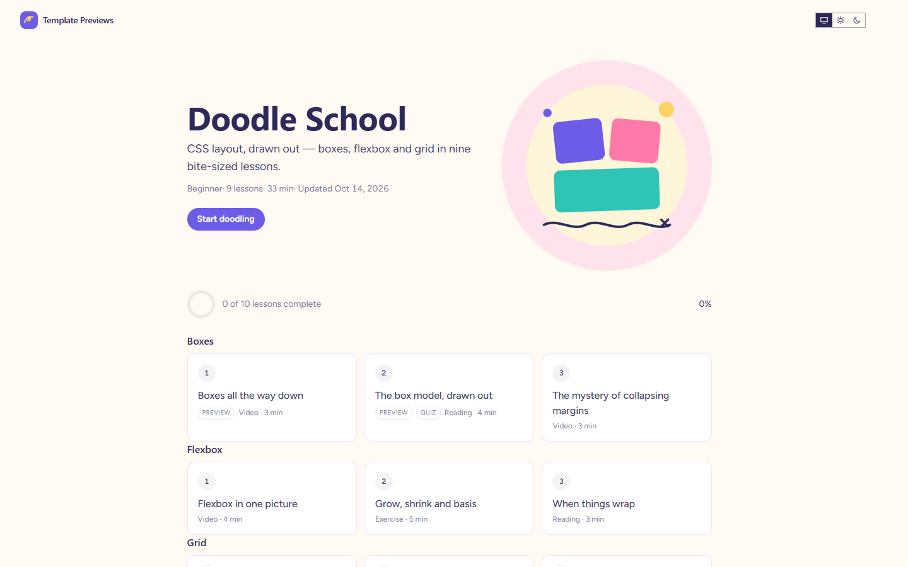

# Doodle School

**An official Forumulate course template.** Modelled on: An illustrated short-course site for front-end developers.

An illustrated short course: a round, hand-drawn course badge beside the pitch, bite-sized lessons as cards with their length, kind and free-preview pills, a playful display face and soft pastel colours, in light and dark.

## What applying it creates

- **The look** — `bundle.json`, a theme bundle: a pastel palette in light and dark, Fredoka over Figtree, soft shadows, and the `theme.courses` keys for an illustrated course (round square cover, card outline, ring progress, a pink-accented certificate). Published to the space straight away.
- **The landing** — the course bands in this order (`frontPage` in `template.json`).
- **The course** — 3 modules and 9 sample lessons, each with its length and kind, written in the course's voice.
- **Quizzes** — a check after “The box model, drawn out” and a final quiz closing the Grid module.
- **The course details** — subtitle, illustrated cover, level, outcomes and a placeholder instructor (Juno Park).

The sample lessons are examples: rewrite or delete them before you share the course. Zero custom CSS — every detail is a theme setting or course data. The brand is `Your Brand`, replaced with your organization's name.
