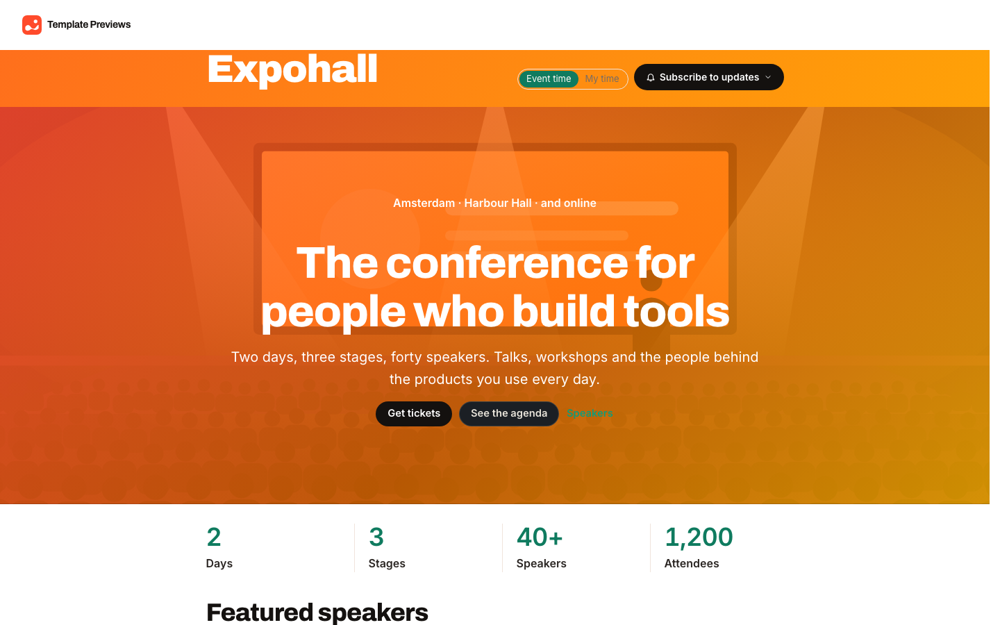
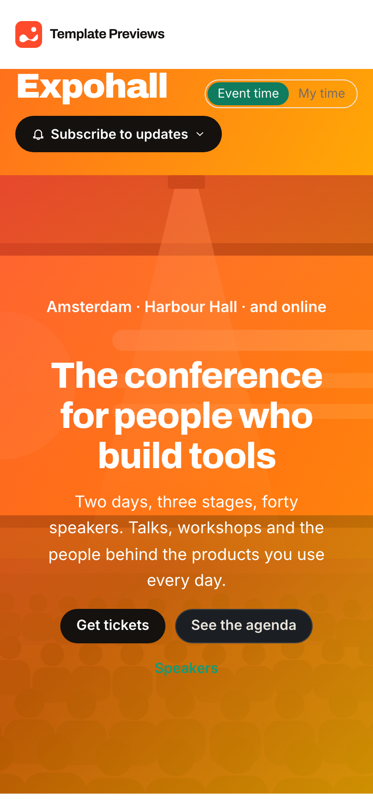

# Expohall

**An official Forumulate events template.** Modelled on: A trade show’s expo and summit site.

A trade show and summit with the whole event toolkit switched on: an exhibitor hall with sponsor booths and opt-in leads, live Q&A and polls, attendee photos, an open call for papers, sign-up workshops with their own seats, a password-protected VIP dinner, certificates of attendance and an after-event rating.

| Desktop | Phone |
| ------- | ----- |
|  |  |

## What it uses

- Summit page with sponsors by tier, an FAQ, accessibility and age notes, and the event’s own fact fields
- Live Q&A with upvotes, polls, attendee photo wall and a rating with NPS once it is over
- Exhibitor booths: sponsors list a booth and attendees choose to leave their details
- An open call for papers with categories, formats and the organizer’s own questions
- Workshops that take sign-ups up to their own seats, a VIP dinner behind a page password
- Certificates of attendance for everyone checked in at the door
- Zero custom CSS — every detail is a theme setting

## What applying it creates

- Six events: the two-day summit (with its programme, speakers, sponsors, FAQ and an open call for papers), an exhibitors' breakfast, a VIP dinner behind the page password `expohall-vip`, and three past events with ratings and photos switched on
- Speakers and a programme by stage; every fourth session is a workshop that takes sign-ups up to 24 seats
- Change the VIP password, the sponsors and the call for papers in the event form (Access and During and after)

Tickets, tax, refunds and the seat map are set per event under “Tax, fees, refunds, seating and sales” once your Stripe account is connected.
