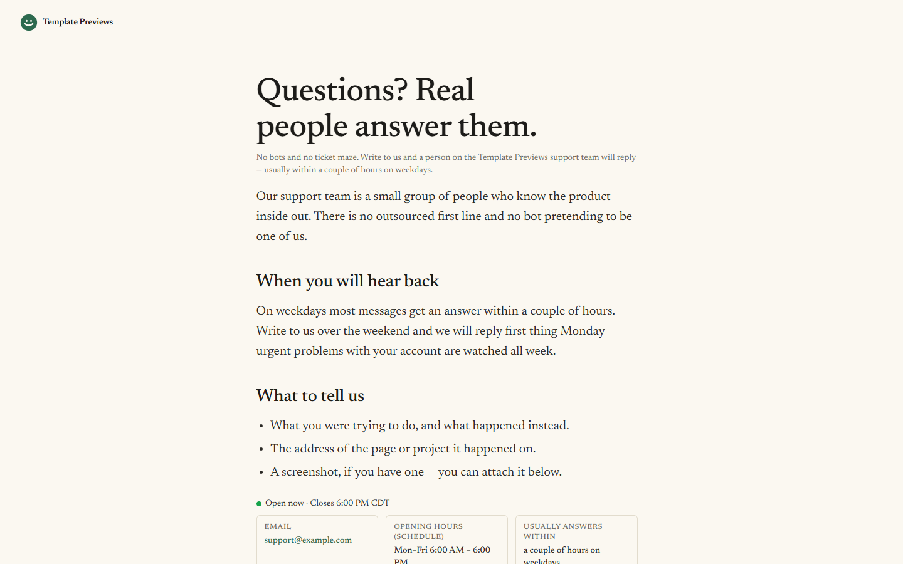

# Fieldnote Support

**An official Forumulate contact template.** Modelled on: a project-management company’s support page.

A calm, single-column support page in a large serif: a human promise, your hours and how fast you answer up front, and a plain form with no box around it.

## What applying it creates

- **The look** — `bundle.json`, a theme bundle: palette, type, form card, topic and fact looks (`theme.contact`). Published to the space straight away.
- **The layout** — the `standard` preset, with the page's own heading and the line under it.
- **The form** — 1 question(s) beyond name, email and message, and the button and thank-you words.
- **Topics** — A question about my account, Billing and invoices, Something is not working, Just saying hello. Every topic is routed to the person who applies the template until they give it its own address.
- **The page the copy lives on** — the intro and the facts (email, opening hours as a schedule, response time), set as the space's home page.

- **The page the copy lives on** — the intro and the facts (email, hours, response time), set as the space's home page.
- **While they type** — docs suggestions under the message (`frontDoor.deflect`), from the site's docs, and "Open now" from the support hours (Mon–Fri 06:00–18:00, US Central — change the time zone with yours).
- **Pictures** — 1 file(s) in `assets/`, copied into your library.

The hours are a schedule in the team's own time zone (US Central), so the page says “Open now · closes 18:00” — or when you open next — on that clock, written in each visitor's own day names and time format. Change the zone and the times in the studio.

While somebody types a subject or a message, up to three articles from your help docs are suggested under the box (`frontDoor.deflect`, `theme.contact.deflect.limit`) — often the answer arrives before the message is sent. The suggestions come from the site's one public docs space, so they appear once the contact page shares a site with one; without one, the form simply has no suggestions. The same docs, community and status spaces are listed under the form as a short “Or help yourself” list.

Zero custom CSS — every detail is a theme setting. The brand is `Your Brand`, replaced with your organization's name.
