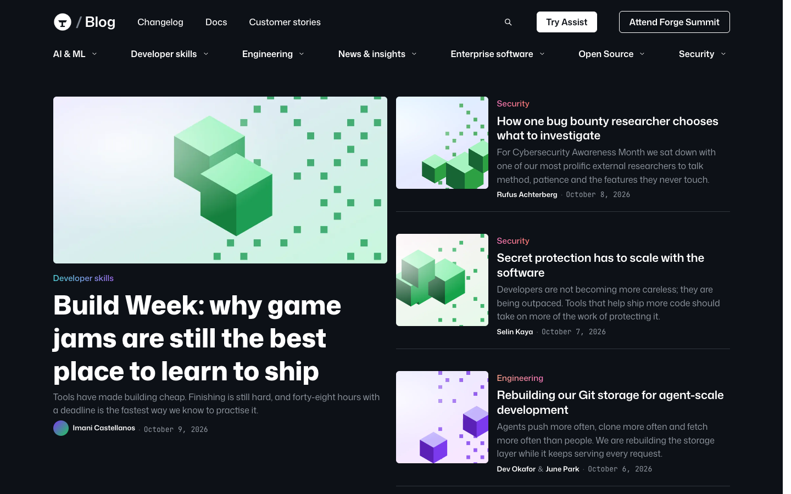
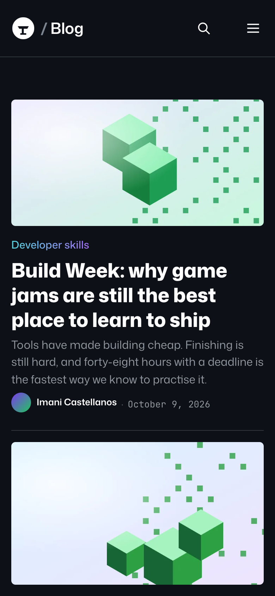

# Forgeline

**An official Forumulate blog template.** Modelled on: a developer platform company’s engineering blog.

A developer-platform blog with a dark header and footer, category mega-menus, featured strip, “popular” sidebar and a table-of-contents article layout.

| Desktop                                            | Phone                                          |
| -------------------------------------------------- | ---------------------------------------------- |
|  |  |

## What it uses

- Composed front page (8 sections)
- 4-column footer
- Index layout: magazine
- Post layout: article-toc
- Post-page sidebar
- A band after every post
- Light and dark palettes
- Motion presets
- Colour-coded tags
- Zero custom CSS — every detail is a theme setting
- Type: Mona Sans (Google Fonts)
- Colour scheme: light

## What applying it creates

- **The look** — `bundle.json`, a theme bundle: palette, type, header and footer, the composed front page. Published to the space straight away.
- **The layout** — index layout `magazine`, post layout `article-toc`, and the post page’s own sidebar / after-post band.
- **Tags** — 9 tags with their labels and colours.
- **Authors** — 2 placeholder people in the author registry (Alex Morgan, Sam Rivera). Rename or replace them.
- **6 sample posts** — short, neutral placeholder copy so the space looks like the preview on day one:
  - Why game jams are still the best place to learn to ship
  - How one security researcher chooses what to investigate
  - Secret protection has to scale with the software
  - Rebuilding our storage layer for the next decade
  - An open benchmark for automated code review
  - Ten talks worth watching from this year’s summit

## Placeholders

- **“Your Brand”** — everywhere the brand appears (header and footer copy, the wordmark) it becomes your organization’s name when the template is applied.
- **Pictures** — the logo, wordmark, favicon, covers, avatars and decorative art in `assets/` are generic placeholders. They are copied into your space’s asset library, so replacing one is an ordinary upload.
- **Links** — header, footer and front-page links point at your new space’s own address.

## Files

- `template.json` — the manifest (`forumulate.space-template` v1): layout, post page, tags, authors, forms, sample posts. Schema: `packages/shared/src/official-templates.ts`.
- `bundle.json` — the theme bundle (`forumulate.theme-bundle`); also listed in the theme marketplace as `template-forgeline`.
- `assets/` — the placeholder pictures.
- `screenshots/` — taken from the live preview.
