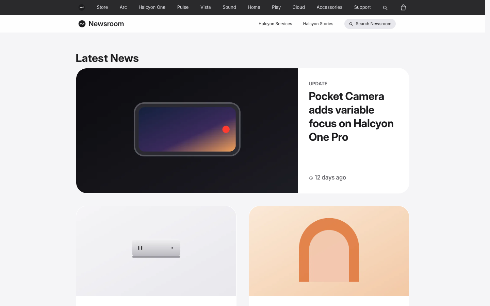
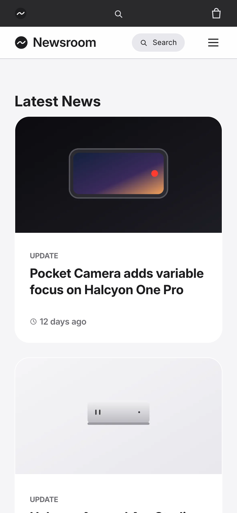

# Halcyon

**An official Forumulate blog template.** Modelled on: a consumer electronics company’s newsroom.

A polished newsroom: a thin top bar, large feature tiles with standfirsts, “In the loop” stories and a share-and-download press kit on every article.

| Desktop                                          | Phone                                        |
| ------------------------------------------------ | -------------------------------------------- |
|  |  |

## What it uses

- Composed front page (4 sections)
- Top bar above the header
- 10-column footer
- Index layout: magazine
- Post layout: article-clean
- A band after every post
- Colour-coded tags
- Zero custom CSS — every detail is a theme setting
- Type: Inter (Google Fonts)
- Colour scheme: light

## What applying it creates

- **The look** — `bundle.json`, a theme bundle: palette, type, header and footer, the composed front page. Published to the space straight away.
- **The layout** — index layout `magazine`, post layout `article-clean`, and the post page’s own sidebar / after-post band.
- **Tags** — 13 tags with their labels and colours.
- **Authors** — 2 placeholder people in the author registry (Alex Morgan, Sam Rivera). Rename or replace them.
- **6 sample posts** — short, neutral placeholder copy so the space looks like the preview on day one:
  - Camera update adds variable focus to the flagship phone
  - The new laptops arrive in stores today
  - A new riverside store opens its doors
  - Devices learn to listen for sign language
  - The watch now reads recovery, not just effort
  - Carbon milestone reached four years early

## Placeholders

- **“Your Brand”** — everywhere the brand appears (header and footer copy, the wordmark) it becomes your organization’s name when the template is applied.
- **Pictures** — the logo, wordmark, favicon, covers, avatars and decorative art in `assets/` are generic placeholders. They are copied into your space’s asset library, so replacing one is an ordinary upload.
- **Links** — header, footer and front-page links point at your new space’s own address.

## Files

- `template.json` — the manifest (`forumulate.space-template` v1): layout, post page, tags, authors, forms, sample posts. Schema: `packages/shared/src/official-templates.ts`.
- `bundle.json` — the theme bundle (`forumulate.theme-bundle`); also listed in the theme marketplace as `template-halcyon`.
- `assets/` — the placeholder pictures.
- `screenshots/` — taken from the live preview.
