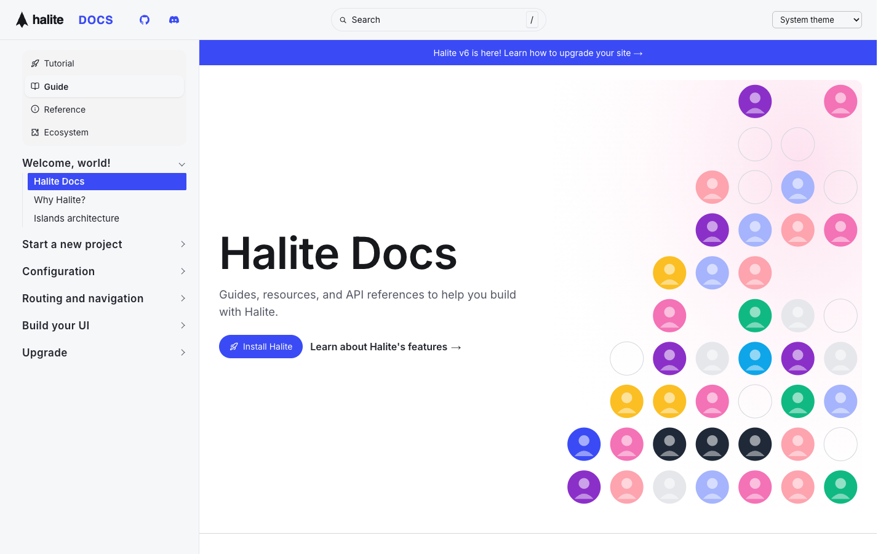

# Halite

**An official Forumulate documentation template.** Modelled on: a web framework’s documentation.

Framework docs with a version banner, a bold hero beside a dotted illustration and a sidebar switching Tutorial, Guide, Reference and Ecosystem.

## What applying it creates

- **The look** — `bundle.json`, a theme bundle: palette, type, header and footer. Published to the space straight away.
- **Pictures** — 3 file(s) in `assets/`, copied into your library.

The brand is the replica's own fictional one; rename it in the space's settings.
