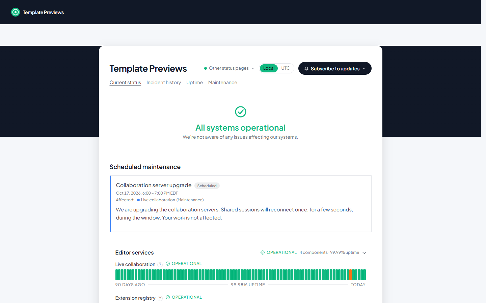

# Halo Status

**An official Forumulate status page template.** Modelled on: A code editor’s status page.

A floating card over a dark band: a centred headline inside a soft halo, each group as its own card with its uptime, fat ribbon bars that read as one stripe, and a light/dark switch in the footer.

## What applying it creates

- **The look** — `bundle.json`, a theme bundle: palette, type and every `theme.status` key (band-card frame, centred banner, card per group, ribbon bars under an uppercase tracked caption, footer theme switch). Published to the space straight away.
- **The front page** — the status bands in this order, at this width (`frontPage` in `template.json`).
- **Components** — 9 sample components in 3 groups (Editor services, Accounts, Website). Every one is **manual**: nothing is probed. Point a component at your own service by giving it a check in the studio, or keep declaring its state by hand.
- **A short history** — 3 resolved incidents with their update streams (Live collaboration sessions disconnecting; Extension search showing stale results; Update downloads failing from one mirror), dated a few days to a few weeks before you apply it, so the bars and the history read like a real page on day one. None of them notifies anybody.
- **Upcoming maintenance** — Collaboration server upgrade, a few days after you apply it.

The band behind the card is `theme.status.page.band` (dark navy, near-black in dark mode); change it to your brand colour in the studio.

The sample components, incidents and maintenance are examples: rename them, delete them, or replace them with your own before you share the page. Zero custom CSS — every detail is a theme setting. The brand is `Your Brand`, replaced with your organization's name.
