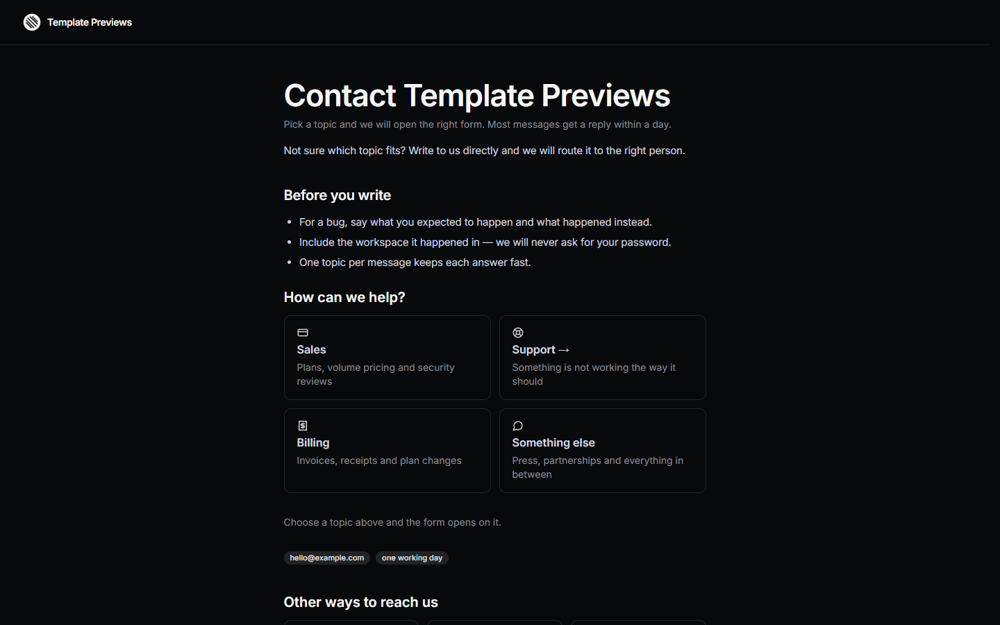

# Halyard Contact

**An official Forumulate contact template.** Modelled on: a product tool’s contact router.

A dark topic router: a card per topic with a line saying what it is for, and the form opening on the one somebody picks — asking only that topic’s questions.

## What applying it creates

- **The look** — `bundle.json`, a theme bundle: palette, type, form card, topic and fact looks (`theme.contact`). Published to the space straight away.
- **The layout** — the `router` preset, with the page's own heading and the line under it.
- **The form** — 4 question(s) beyond name, email and message, and the button and thank-you words.
- **Topics** — Sales, Support, Billing, Something else. Every topic is routed to the person who applies the template until they give it its own address.
- **The page the copy lives on** — the intro and the facts (email, hours, response time), set as the space's home page.
- **Pictures** — 1 file(s) in `assets/`, copied into your library.

The topics are cards; picking one opens the form on it (`?topic=` links straight there). **Support** goes to your documentation instead (`redirectTo: "docs"`): the card links to the site's docs space, found when the page is served, so it follows your docs wherever they live. With no docs space it stays a form. The other ways to get help — docs, community, status — are linked in a band under the form.

Under the form, a channels band lists your other places to get help: the site's own docs, community, status and changelog spaces, found automatically, plus two links of your own (security reports and feature requests — change or replace them under `theme.contact.channels.links`).

Zero custom CSS — every detail is a theme setting. The brand is `Your Brand`, replaced with your organization's name.
