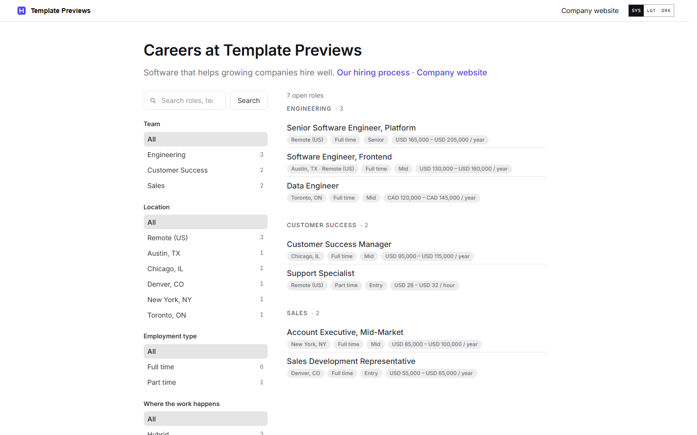
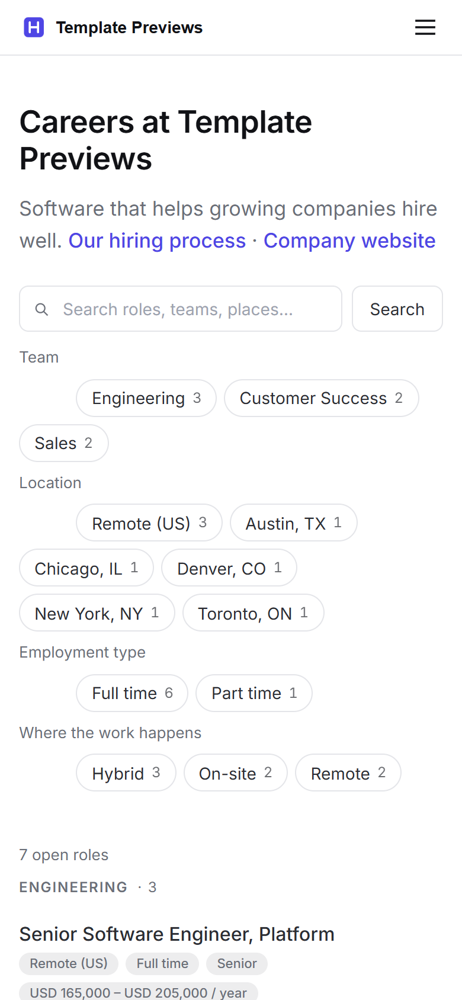

# Hostboard

**An official Forumulate careers template.** Modelled on: an applicant-tracking system’s hosted job board.

A neutral, hosted-style job board: the brand’s accent and nothing else, a left filter rail beside roles grouped by department with pill chips, and role pages with Overview and Application tabs and a full native apply form.

| Desktop | Phone |
| ------- | ----- |
|  |  |

## What it uses

- Front page: the brand, one line and the board — nothing else, like a hosted board
- Left filter rail (department, location, type, where the work happens; a bar over the list on a phone) beside roles grouped by department with counts
- Role facts as pill chips; published pay band on every role
- Role layout: tabs — Overview and Application, Apply at the top and in a bar that stays in reach
- Native apply form: phone, LinkedIn, GitHub, portfolio, two custom questions, the voluntary self-identification section and a consent line
- Neutral palette — the brand’s accent is the only colour
- Zero custom CSS — every detail is a theme setting
- Type: Inter (served from our own font store)

## What applying it creates

- **The look** — `bundle.json`, a theme bundle: palette, type, header and footer, and the board's look (`theme.careers`). Published to the space straight away.
- **The front page** — the composed careers page in `template.json` (`frontPage`), ending in the live roles board.
- **The layout** — board preset `departments` and its front-door options.
- **3 teams with 7 sample roles** — each with its location, employment type and where the work happens set as fields, and the typed sections (summary, what you will do, what we need, what we offer, how hiring works) filled in:
  - Senior Software Engineer, Platform
  - Software Engineer, Frontend
  - Data Engineer
  - Customer Success Manager
  - Support Specialist
  - Account Executive, Mid-Market
  - Sales Development Representative
- **1 page(s) beside the roles** (`kind: page` — read as pages: not listed as roles, no apply form, no job markup):
  - Our hiring process
- **The apply form** — `settings.careersForm`: the default links, two custom questions, the voluntary self-identification (EEO) section, a consent line, a one-year retention window and the candidate confirmation email. Change it in the space’s Apply form settings.

## Placeholders

- **“Your Brand”** — everywhere the brand appears (header and footer copy, the wordmark, the sample copy) it becomes your organization’s name when the template is applied.
- **Pictures** — the wordmark, favicon and every picture in `assets/` are generic placeholders, copied into your space’s asset library on apply.
- **Links** — header, footer and front-page links point at your new space’s own address.
- **Roles** — sample openings in neutral copy. Edit or unpublish them before you go live; a published role is a real job posting to search engines.

## Files

- `template.json` — the manifest (`forumulate.space-template` v1): layout, front page, the sample teams, roles and pages. Schema: `packages/shared/src/official-templates.ts`.
- `bundle.json` — the theme bundle (`forumulate.theme-bundle`); also listed in the theme marketplace as `template-hostboard`.
- `assets/` — the placeholder pictures.
