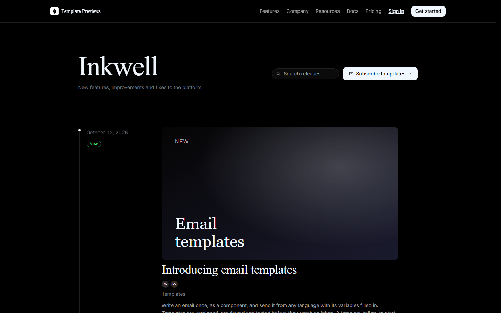
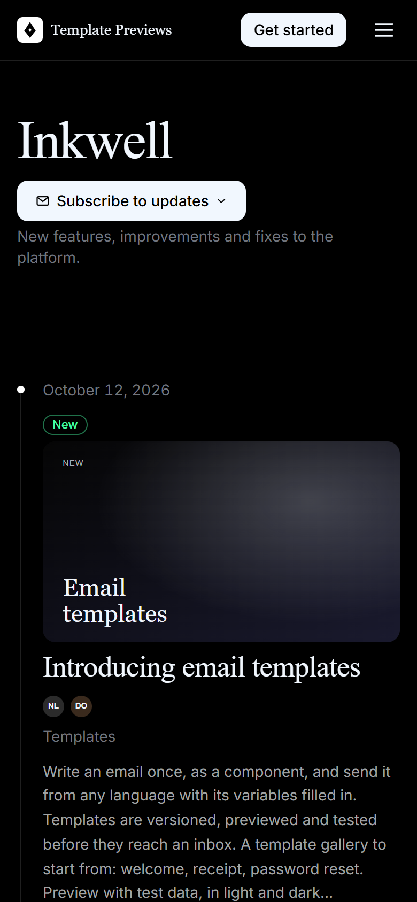

# Inkwell

**An official Forumulate changelog template.** Modelled on: a transactional email API’s changelog.

A black, editorial changelog: a large serif title, a cover picture over every release, summaries with the authors’ faces, a white-dotted rail — and a centred release page with code in tabs, video and a link to the page as Markdown.

| Desktop | Phone |
| ------- | ----- |
|  |  |

## What it uses

- Index layout: gutter, white rail dots, the change type under the date
- 16:9 cover picture above every release title
- Summaries with the authors as avatars
- Serif display headings (Newsreader) over Inter
- Search and an email-popover subscribe on the title row
- Release page: centred head, date above the title, “More releases”, Markdown actions
- Sample release with a code group and a self-hosted video
- Zero custom CSS — every detail is a theme setting
- Type: Newsreader, Inter and JetBrains Mono — self-hosted (the font is mirrored onto our own CDN on apply; readers never fetch from a third party)
- Colour scheme: dark (strict)

## What applying it creates

- **The look** — `bundle.json`, a theme bundle: palette, type, header and footer, the changelog's look (`theme.changelog`) and the composed front page. Published to the space straight away.
- **The layout** — index preset `gutter` and its front-door options.
- **The release page's after-band** — `piecePage`: a subscribe box under every release.
- **Tags** — 6 tags with their labels and colours.
- **Authors** — 3 placeholder people in the space's author registry, credited on the releases they wrote (credited by name; no account is made).
- **5 sample releases** — short, neutral placeholder copy with the change types, channels and versions the look is built to show, so the space looks like the preview on day one:
  - Introducing email templates (New, cover)
  - Receive email with inbound routes (New, Beta, cover)
  - Logs that load in a blink (Improved, cover)
  - Scoped API keys (Security, breaking, with upgrade notes, cover)
  - Domain health checks (Improved, cover)

Nobody is mailed about a sample: the releases are published without notifying subscribers or watchers.

## Placeholders

- **“Your Brand”** — everywhere the brand appears (header and footer copy, the wordmark, the sample copy) it becomes your organization’s name when the template is applied.
- **Pictures** — the mark, wordmark, covers and portraits in `assets/` are drawn placeholders. They are copied into your space’s asset library, so replacing one is an ordinary upload.
- **Links** — header, footer and front-page links point at your new space’s own address; “Try it” links point at `example.com`.
- **Change types** — the samples use the changelog's own options (New, Improved, Fixed, Deprecated, Retired, Security). Rename them to your words in Design → shape; `theme.changelog.typeBadge.tones` keys follow the new names.

## Files

- `template.json` — the manifest (`forumulate.space-template` v1): layout, release page, tags, authors, sample releases (with their `fields`). Schema: `packages/shared/src/official-templates.ts`.
- `bundle.json` — the theme bundle (`forumulate.theme-bundle`); also listed in the theme marketplace as `template-inkwell`.
- `assets/` — the placeholder pictures.
