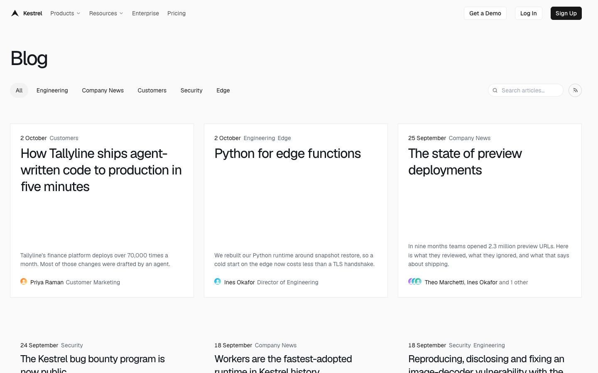
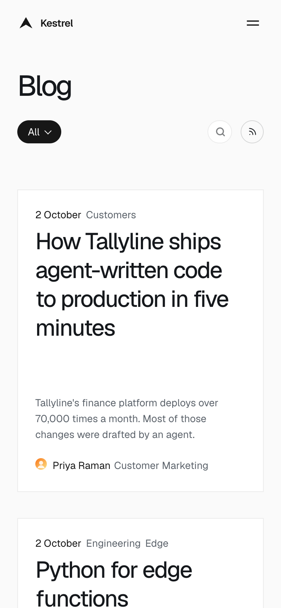

# Kestrel

**An official Forumulate blog template.** Modelled on: a developer cloud platform’s engineering blog.

A monochrome developer blog: a dense card grid, tag pills, mega-menu header, six-column footer and a closing call to action under every post.

| Desktop                                          | Phone                                        |
| ------------------------------------------------ | -------------------------------------------- |
|  |  |

## What it uses

- Composed front page (4 sections)
- Header with drop-down menus
- 12-column footer
- Index layout: grid
- Post layout: article-meta-rail
- Motion presets
- 1 theme component
- Zero custom CSS — every detail is a theme setting
- Type: Geist (Google Fonts)
- Colour scheme: light

## What applying it creates

- **The look** — `bundle.json`, a theme bundle: palette, type, header and footer, the composed front page, and its theme component. Published to the space straight away.
- **The layout** — index layout `grid`, post layout `article-meta-rail`.
- **Tags** — 5 tags with their labels.
- **Authors** — 2 placeholder people in the author registry (Alex Morgan, Sam Rivera). Rename or replace them.
- **5 sample posts** — short, neutral placeholder copy so the space looks like the preview on day one:
  - How one team ships to production in five minutes
  - Python for edge functions
  - The state of preview deployments
  - Our bug bounty program is now public
  - Reproducing, disclosing and fixing an image decoder bug

## Placeholders

- **“Your Brand”** — everywhere the brand appears (header and footer copy, the wordmark) it becomes your organization’s name when the template is applied.
- **Pictures** — the logo, wordmark, favicon, avatars and decorative art in `assets/` are generic placeholders. They are copied into your space’s asset library, so replacing one is an ordinary upload.
- **Links** — header, footer and front-page links point at your new space’s own address.

## Files

- `template.json` — the manifest (`forumulate.space-template` v1): layout, post page, tags, authors, forms, sample posts. Schema: `packages/shared/src/official-templates.ts`.
- `bundle.json` — the theme bundle (`forumulate.theme-bundle`); also listed in the theme marketplace as `template-kestrel`.
- `assets/` — the placeholder pictures.
- `screenshots/` — taken from the live preview.
