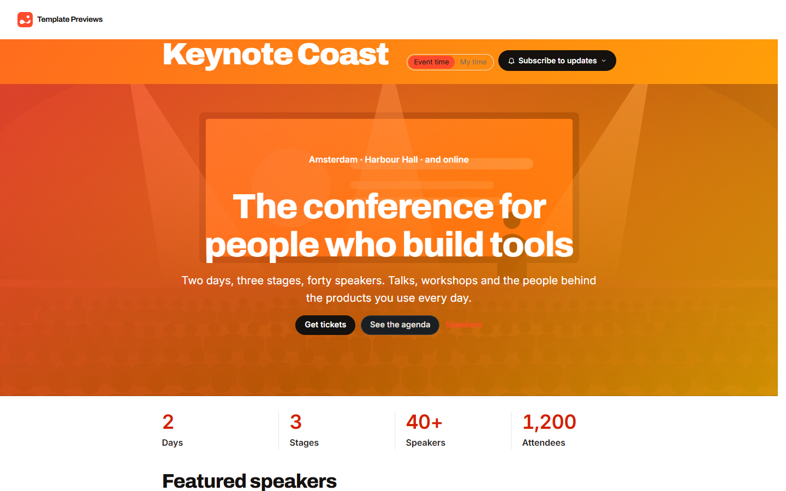
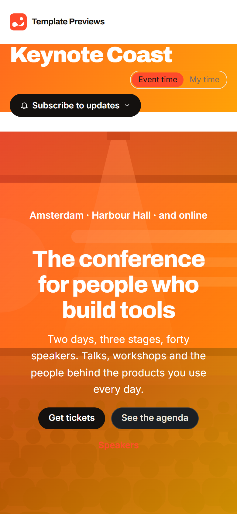

# Keynote Coast

**An official Forumulate events template.** Modelled on: a design-tool company’s annual conference site.

An annual conference microsite: a saturated full-width hero, the numbers, featured speakers, the calendar, a call for proposals, tiered sponsors and an FAQ. The conference itself opens on a full-bleed hero with a countdown, and its programme reads as a grid by stage with day tabs and filters.

| Desktop | Phone |
| ------- | ----- |
|  |  |

## What it uses

- Full-bleed hero picture (a drawn conference hall) under a translucent brand gradient, stats row, featured speakers and sponsor tiers on the front page
- Conference page: full-bleed hero cover, countdown, fact tiles, sticky register card
- Two-day programme as a grid by stage with day tabs, filters by track, stage, level and tag, and My agenda
- Ten speakers on a five-wide grid of square portraits, each with a page listing their sessions
- Large, tight display type and a painted title band over every page title
- Zero custom CSS — every detail is a theme setting

## What applying it creates

- **The look** — `bundle.json`, a theme bundle: palette, type, header and footer, and the calendar's look (`theme.events`: the list, the event page, the agenda and speakers). Published to the space straight away.
- **The front page** — `frontPage` in `template.json`, ending in the live calendar.
- **The layout** — preset `conference` and its front-door options.
- **3 upcoming and 3 past events**, dated relative to the day you apply it, in each event's own time zone — so the calendar is never a page of past events:
  - Keynote Coast Conference
  - Speaker Office Hours
  - Warm-up Night
  - Spring Sessions (past)
  - Design Systems Summit (past)
  - Last Year at Keynote Coast (past)
- **A programme** — 12 sessions and 10 speakers, so the agenda, session and speaker pages are populated on day one. Session times are local to the event's zone, counted from its first day.
- **Hosts** — 1 placeholder people in the space's author registry, credited on the events they host.

Nobody is mailed about a sample: the events are announced to nobody, and none has an RSVP.

## Placeholders

- **“Your Brand”** — everywhere the brand appears (header and footer, the mark, the covers, the sample copy) it becomes your organization’s name.
- **Pictures** — the mark, the front page's hero hall, covers and portraits in `assets/` are drawn placeholders, copied into your space’s asset library on apply.
- **Links** — join links and recordings point at `example.com` addresses. Replace them with your own before you publish; a past event’s recording link is what its page offers instead of an RSVP.
- **Events** — sample events in neutral copy. Edit, duplicate or delete them; a published event is a real event to search engines.

## Files

- `template.json` — the manifest (`forumulate.space-template` v1): layout, front page, hosts, the sample events and their programme. Schema: `packages/shared/src/official-templates.ts` and `official-templates-content-events.ts`.
- `bundle.json` — the theme bundle (`forumulate.theme-bundle`); also listed in the theme marketplace as `template-keynote-coast`.
- `assets/` — the placeholder pictures.
