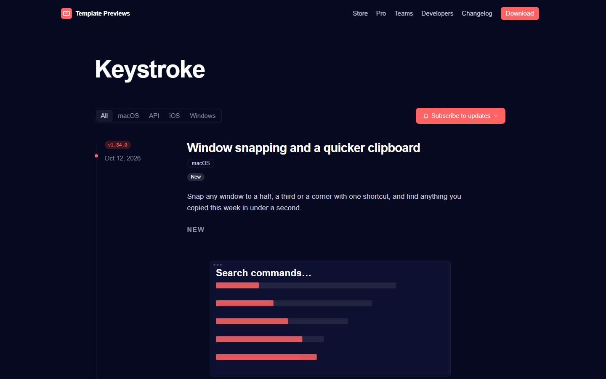
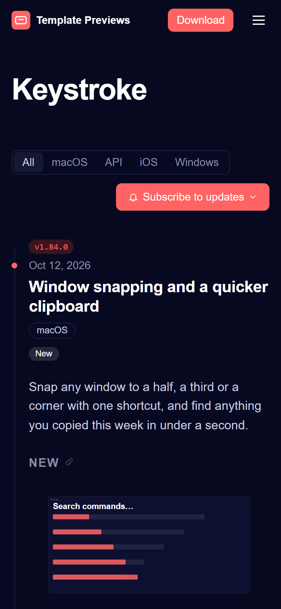

# Keystroke

**An official Forumulate changelog template.** Modelled on: a desktop launcher app’s changelog.

A dark, version-led changelog for an app on several platforms: the version in a red pill over the date in the gutter, platforms as a segmented switch, every release in full under New, Improvements and Fixes, and key caps inline.

| Desktop | Phone |
| ------- | ----- |
|  |  |

## What it uses

- Index layout: gutter, version first (tinted red pill) then the date
- Platforms as a segmented tag switch, each with its own page
- Full release notes on the index, sectioned New / Improvements / Fixes
- Inline key caps (<kbd>)
- Beta channel badge; breaking releases lead with their upgrade notes
- Numbered pages and an email subscribe band
- Zero custom CSS — every detail is a theme setting
- Type: Inter and JetBrains Mono — self-hosted (the font is mirrored onto our own CDN on apply; readers never fetch from a third party)
- Colour scheme: dark (strict)

## What applying it creates

- **The look** — `bundle.json`, a theme bundle: palette, type, header and footer, the changelog's look (`theme.changelog`) and the composed front page. Published to the space straight away.
- **The layout** — index preset `gutter` and its front-door options.
- **The release page's after-band** — `piecePage`: a subscribe box under every release.
- **Tags** — 4 tags with their labels and colours.
- **5 sample releases** — short, neutral placeholder copy with the change types, channels and versions the look is built to show, so the space looks like the preview on day one:
  - Window snapping and a quicker clipboard (1.84.0, New)
  - Smoother scrolling in long lists (1.83.2, Improved)
  - Now on Windows, in beta (0.9.0, New, Beta)
  - Extensions API 2.0 (1.83.0, Deprecated, breaking, with upgrade notes)
  - Quick notes on iPhone (1.4.0, New)

Nobody is mailed about a sample: the releases are published without notifying subscribers or watchers.

## Placeholders

- **“Your Brand”** — everywhere the brand appears (header and footer copy, the wordmark, the sample copy) it becomes your organization’s name when the template is applied.
- **Pictures** — the mark, wordmark, covers and portraits in `assets/` are drawn placeholders. They are copied into your space’s asset library, so replacing one is an ordinary upload.
- **Links** — header, footer and front-page links point at your new space’s own address; “Try it” links point at `example.com`.
- **Change types** — the samples use the changelog's own options (New, Improved, Fixed, Deprecated, Retired, Security). Rename them to your words in Design → shape; `theme.changelog.typeBadge.tones` keys follow the new names.

## Files

- `template.json` — the manifest (`forumulate.space-template` v1): layout, release page, tags, authors, sample releases (with their `fields`). Schema: `packages/shared/src/official-templates.ts`.
- `bundle.json` — the theme bundle (`forumulate.theme-bundle`); also listed in the theme marketplace as `template-keystroke`.
- `assets/` — the placeholder pictures.
