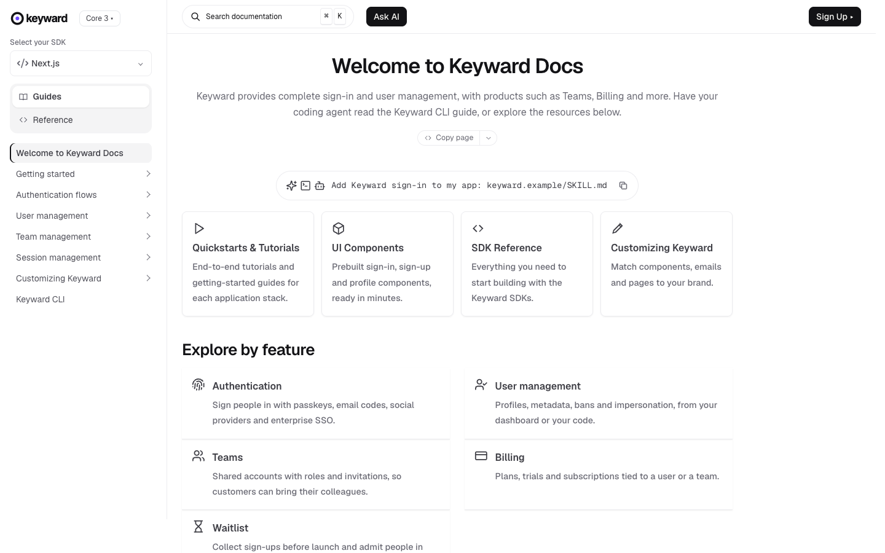

# Keyward Docs

**An official Forumulate documentation template.** Modelled on: an authentication provider’s developer docs.

A centred welcome, a copy-a-prompt bar, product cards and an explore-by-feature grid, with an SDK picker in the sidebar.

## What applying it creates

- **The look** — `bundle.json`, a theme bundle: palette, type, header and footer. Published to the space straight away.
- **Pictures** — 3 file(s) in `assets/`, copied into your library.

The brand is the replica's own fictional one; rename it in the space's settings.
