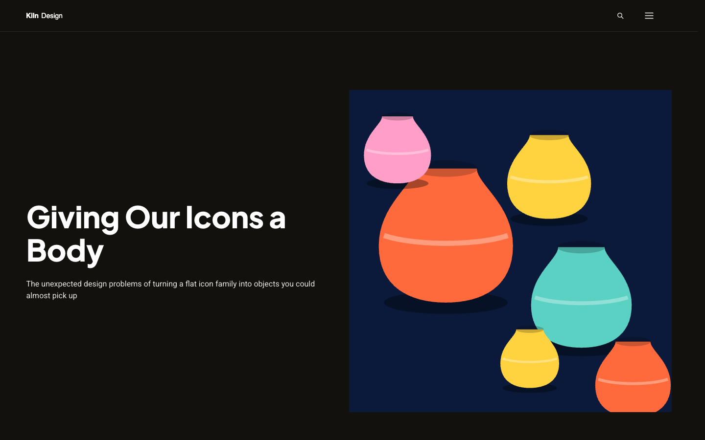
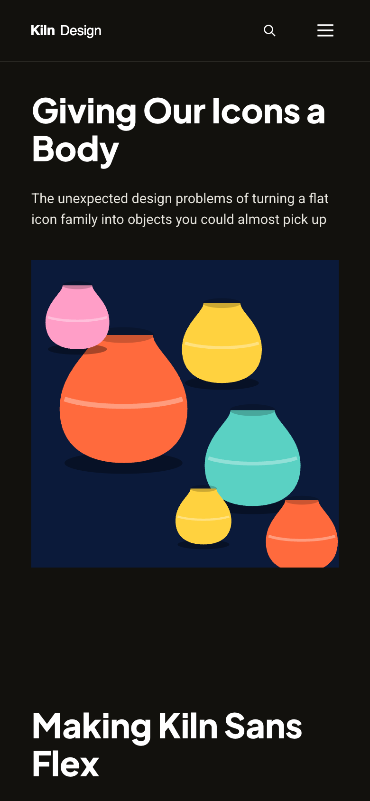

# Kiln Journal

**An official Forumulate blog template.** Modelled on: a design studio’s journal.

A warm, dark studio journal: big cover grid, outlined topic badges, illustrated menu feature and a quiet single-column article page.

| Desktop                                               | Phone                                             |
| ----------------------------------------------------- | ------------------------------------------------- |
|  |  |

## What it uses

- Composed front page (5 sections)
- Header with drop-down menus
- Index layout: grid
- Post layout: article-clean
- Light and dark palettes
- Motion presets
- Zero custom CSS — every detail is a theme setting
- Type: Plus Jakarta Sans, Roboto (Google Fonts)
- Colour scheme: dark

## What applying it creates

- **The look** — `bundle.json`, a theme bundle: palette, type, header and footer, the composed front page. Published to the space straight away.
- **The layout** — index layout `grid`, post layout `article-clean`.
- **Tags** — 11 tags with their labels.
- **Authors** — 2 placeholder people in the author registry (Alex Morgan, Sam Rivera). Rename or replace them.
- **6 sample posts** — short, neutral placeholder copy so the space looks like the preview on day one:
  - Designing for every reader
  - Designing warmth
  - Type after dark
  - A font that dances
  - Unboxing a shared language
  - Giving icons a body

## Placeholders

- **“Your Brand”** — everywhere the brand appears (header and footer copy, the wordmark) it becomes your organization’s name when the template is applied.
- **Pictures** — the logo, wordmark, favicon, covers, avatars and decorative art in `assets/` are generic placeholders. They are copied into your space’s asset library, so replacing one is an ordinary upload.
- **Links** — header, footer and front-page links point at your new space’s own address.

## Files

- `template.json` — the manifest (`forumulate.space-template` v1): layout, post page, tags, authors, forms, sample posts. Schema: `packages/shared/src/official-templates.ts`.
- `bundle.json` — the theme bundle (`forumulate.theme-bundle`); also listed in the theme marketplace as `template-kiln-journal`.
- `assets/` — the placeholder pictures.
- `screenshots/` — taken from the live preview.
