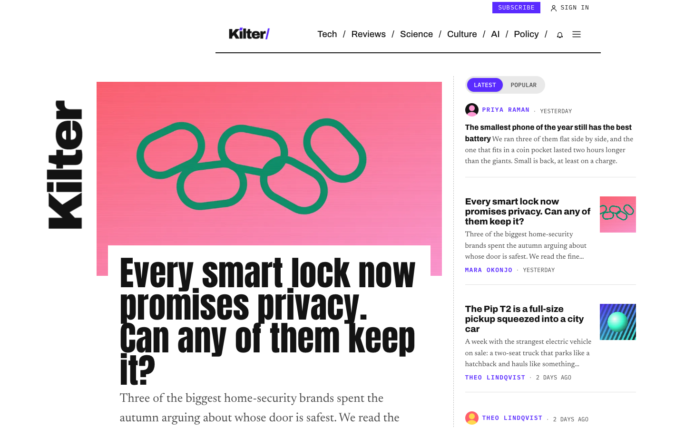
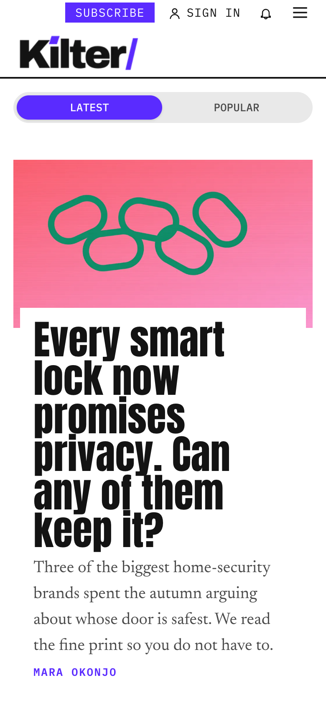

# Kilter

**An official Forumulate blog template.** Modelled on: a consumer technology news magazine.

A loud tech-news front page: a vertical masthead, lead story, quick-hit rail, colour-coded sections and a “most popular” sidebar on every story.

| Desktop                                         | Phone                                       |
| ----------------------------------------------- | ------------------------------------------- |
|  |  |

## What it uses

- Composed front page (5 sections, with a sidebar)
- Top bar above the header
- Index layout: magazine
- Post layout: article-suggested
- Post-page sidebar
- A band after every post
- Motion presets
- Colour-coded tags
- Zero custom CSS — every detail is a theme setting
- Type: Archivo, Newsreader (Google Fonts)
- Colour scheme: light

## What applying it creates

- **The look** — `bundle.json`, a theme bundle: palette, type, header and footer, the composed front page. Published to the space straight away.
- **The layout** — index layout `magazine`, post layout `article-suggested`, and the post page’s own sidebar / after-post band.
- **Tags** — 10 tags with their labels and colours.
- **Authors** — 2 placeholder people in the author registry (Alex Morgan, Sam Rivera). Rename or replace them.
- **6 sample posts** — short, neutral placeholder copy so the space looks like the preview on day one:
  - The smallest phone of the year still has the best battery
  - Every smart lock promises privacy. Can any of them keep it?
  - A full-size pickup squeezed into a city car
  - A map app now routes you around the potholes your neighbours hit
  - My short, strange romance with a robot bird feeder
  - Mathematicians will need years to check what the machine just wrote

## Placeholders

- **“Your Brand”** — everywhere the brand appears (header and footer copy, the wordmark) it becomes your organization’s name when the template is applied.
- **Pictures** — the logo, wordmark, favicon, covers, avatars and decorative art in `assets/` are generic placeholders. They are copied into your space’s asset library, so replacing one is an ordinary upload.
- **Links** — header, footer and front-page links point at your new space’s own address.

## Files

- `template.json` — the manifest (`forumulate.space-template` v1): layout, post page, tags, authors, forms, sample posts. Schema: `packages/shared/src/official-templates.ts`.
- `bundle.json` — the theme bundle (`forumulate.theme-bundle`); also listed in the theme marketplace as `template-kilter`.
- `assets/` — the placeholder pictures.
- `screenshots/` — taken from the live preview.
