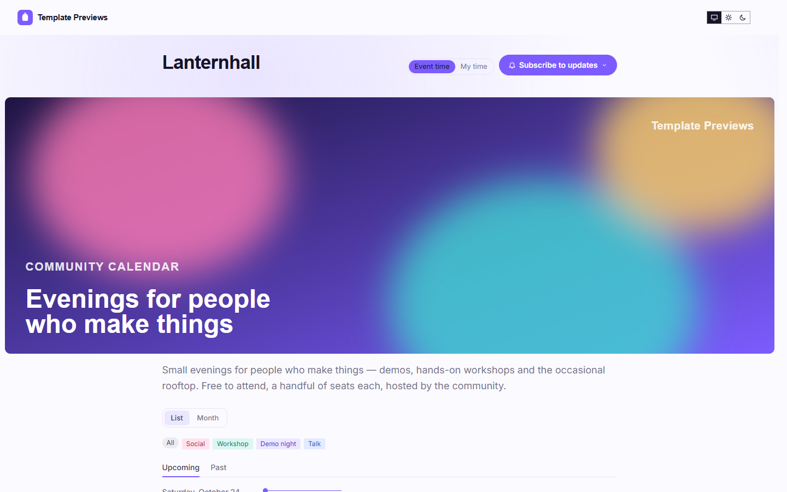
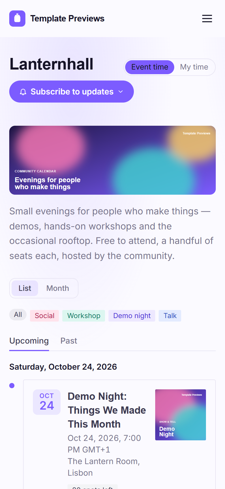

# Lanternhall

**An official Forumulate events template.** Modelled on: a community events platform’s calendar and event pages.

A community calendar in the day-by-day style: every event on a timeline under its date, a square cover beside it, the hosts and who is going; each event page puts the cover on the left over a sticky register card, with the place drawn as our own map card.

| Desktop | Phone |
| ------- | ----- |
|  |  |

## What it uses

- Timeline grouped by day, the date in the left gutter, Upcoming and Past as tabs
- Square covers beside each event, hosts and “N going” on every card
- Event page: cover left with a sticky register card, date and place as tiles
- Location as a drawn map card — no third-party map request
- Gentle aurora background, rounded geometric headings, one violet accent, light or dark by visitor
- Zero custom CSS — every detail is a theme setting

## What applying it creates

- **The look** — `bundle.json`, a theme bundle: palette, type, header and footer, and the calendar's look (`theme.events`: the list, the event page, the agenda and speakers). Published to the space straight away.
- **The front page** — `frontPage` in `template.json`, ending in the live calendar.
- **The layout** — preset `luma` and its front-door options.
- **3 upcoming and 3 past events**, dated relative to the day you apply it, in each event's own time zone — so the calendar is never a page of past events:
  - Demo Night: Things We Made This Month
  - Prompt Craft Lab
  - Rooftop Mixer
  - Tiny Tools, Big Ideas (past)
  - Type and Motion Workshop (past)
  - Winter Potluck (past)
- **Hosts** — 3 placeholder people in the space's author registry, credited on the events they host.
- **Settings** — the who’s-going list is switched on (`eventAttendance.publicAttendees`): only attendees who tick “show me” appear.

Nobody is mailed about a sample: the events are announced to nobody, and none has an RSVP.

## Placeholders

- **“Your Brand”** — everywhere the brand appears (header and footer, the mark, the covers, the sample copy) it becomes your organization’s name.
- **Pictures** — the mark, covers and portraits in `assets/` are drawn placeholders, copied into your space’s asset library on apply.
- **Links** — join links and recordings point at `example.com` addresses. Replace them with your own before you publish; a past event’s recording link is what its page offers instead of an RSVP.
- **Events** — sample events in neutral copy. Edit, duplicate or delete them; a published event is a real event to search engines.

## Files

- `template.json` — the manifest (`forumulate.space-template` v1): layout, front page, hosts, the sample events and their programme. Schema: `packages/shared/src/official-templates.ts` and `official-templates-content-events.ts`.
- `bundle.json` — the theme bundle (`forumulate.theme-bundle`); also listed in the theme marketplace as `template-lanternhall`.
- `assets/` — the placeholder pictures.
