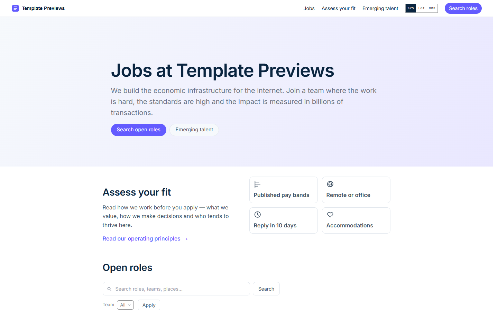
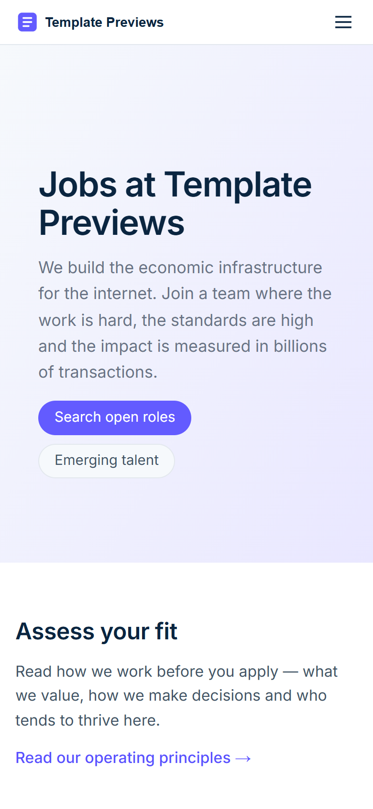

# Ledgerwise Jobs

**An official Forumulate careers template.** Modelled on: a payments company’s job search.

A bright, large-board jobs search: a slim hero, an “assess your fit” band, then one ruled table of roles — team, location and type as columns — with search, a filter bar and pages of twenty.

| Desktop | Phone |
| ------- | ----- |
|  |  |

## What it uses

- Board preset: table — one ruled table, a column each for team, location and type
- Role layout: split — the role beside a column with its facts, Apply and share
- A published pay band and a pay-transparency note on every role; one role in two cities
- Search box and a filter bar (team, location, type, where the work happens) as dropdowns, 20 roles a page
- Composed front page: slim gradient hero, an “assess your fit” band, the board, an equal-opportunity line
- Equal-opportunity statement and accommodations contact under every role (front-door words, written once)
- Apply form with the voluntary self-identification section and a consent line with a one-year retention window
- Zero custom CSS — every detail is a theme setting
- Type: Inter (served from our own font store)

## What applying it creates

- **The look** — `bundle.json`, a theme bundle: palette, type, header and footer, and the board's look (`theme.careers`). Published to the space straight away.
- **The front page** — the composed careers page in `template.json` (`frontPage`), ending in the live roles board.
- **The layout** — board preset `table` and its front-door options.
- **4 teams with 12 sample roles** — each with its location, employment type and where the work happens set as fields, and the typed sections (summary, what you will do, what we need, what we offer, how hiring works) filled in:
  - Backend Engineer, Payments Core
  - Staff Engineer, Ledger
  - Frontend Engineer, Dashboard
  - Site Reliability Engineer
  - Software Engineering Intern
  - Product Manager, Billing
  - Product Designer, Checkout
  - Enterprise Account Executive
  - Solutions Architect
  - Partner Marketing Manager
  - Compliance Analyst
  - Financial Analyst
- **2 page(s) beside the roles** (`kind: page` — read as pages: not listed as roles, no apply form, no job markup):
  - Assess your fit
  - Emerging talent
- **The apply form** — `settings.careersForm`: the voluntary self-identification (EEO) section on, a consent line and a one-year retention window. Change it in the space’s Apply form settings.

## Placeholders

- **“Your Brand”** — everywhere the brand appears (header and footer copy, the wordmark, the sample copy) it becomes your organization’s name when the template is applied.
- **Pictures** — the wordmark, favicon and every picture in `assets/` are generic placeholders, copied into your space’s asset library on apply.
- **Links** — header, footer and front-page links point at your new space’s own address.
- **Roles** — sample openings in neutral copy. Edit or unpublish them before you go live; a published role is a real job posting to search engines.

## Files

- `template.json` — the manifest (`forumulate.space-template` v1): layout, front page, the sample teams, roles and pages. Schema: `packages/shared/src/official-templates.ts`.
- `bundle.json` — the theme bundle (`forumulate.theme-bundle`); also listed in the theme marketplace as `template-ledgerwise`.
- `assets/` — the placeholder pictures.
