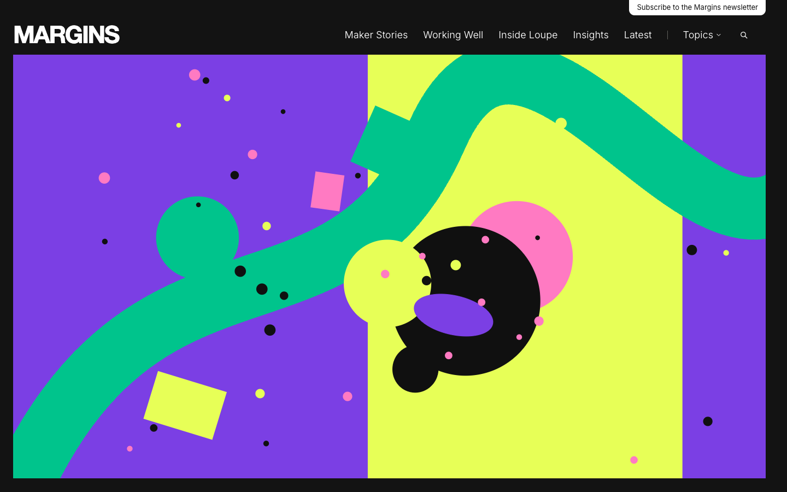
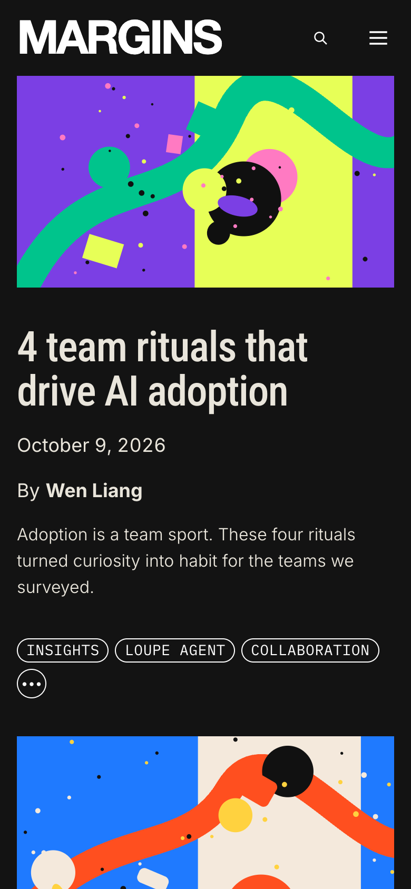

# Margins

**An official Forumulate blog template.** Modelled on: a design tool company’s editorial magazine.

A dark editorial magazine with condensed headlines, colourful collage covers, featured-story menus and a newsletter band — a design publication, not a changelog.

| Desktop                                          | Phone                                        |
| ------------------------------------------------ | -------------------------------------------- |
|  |  |

## What it uses

- Composed front page (9 sections)
- Header with drop-down menus
- Top bar above the header
- 4-column footer
- Index layout: magazine
- Post layout: article-margin
- Light and dark palettes
- Motion presets
- Zero custom CSS — every detail is a theme setting
- Type: Roboto Condensed, Inter (Google Fonts)
- Colour scheme: dark

## What applying it creates

- **The look** — `bundle.json`, a theme bundle: palette, type, header and footer, the composed front page. Published to the space straight away.
- **The layout** — index layout `magazine`, post layout `article-margin`.
- **Tags** — 11 tags with their labels.
- **Authors** — 2 placeholder people in the author registry (Alex Morgan, Sam Rivera). Rename or replace them.
- **6 sample posts** — short, neutral placeholder copy so the space looks like the preview on day one:
  - Four team rituals that help new tools stick
  - Three designers on speed, craft and expression
  - How to make design system upkeep lighter
  - Workflow lab: staying in flow
  - What it takes to build great products now
  - Source material: the references that taught us to look again

## Placeholders

- **“Your Brand”** — everywhere the brand appears (header and footer copy, the wordmark) it becomes your organization’s name when the template is applied.
- **Pictures** — the logo, wordmark, favicon, covers, avatars and decorative art in `assets/` are generic placeholders. They are copied into your space’s asset library, so replacing one is an ordinary upload.
- **Links** — header, footer and front-page links point at your new space’s own address.

## Files

- `template.json` — the manifest (`forumulate.space-template` v1): layout, post page, tags, authors, forms, sample posts. Schema: `packages/shared/src/official-templates.ts`.
- `bundle.json` — the theme bundle (`forumulate.theme-bundle`); also listed in the theme marketplace as `template-margins`.
- `assets/` — the placeholder pictures.
- `screenshots/` — taken from the live preview.
