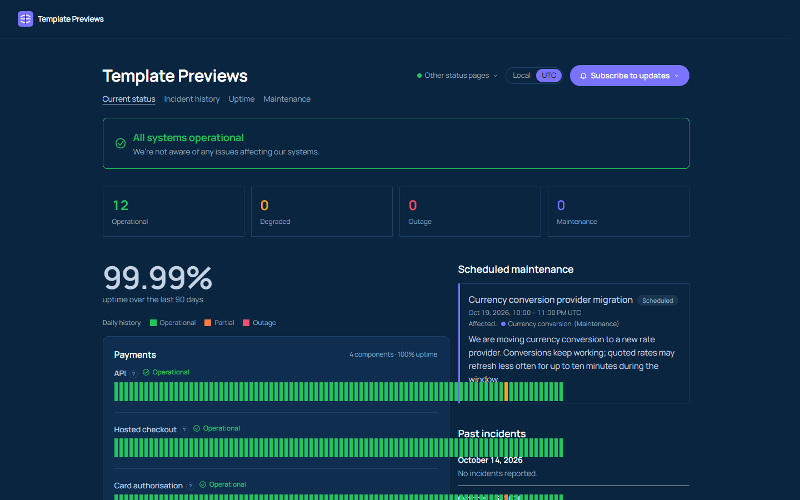

# Meridian

**An official Forumulate status page template.** Modelled on: A payments network’s status page.

A dark, bespoke page for a payments network: tiles that count components by state, the flagship group as a hero card beside the open incidents and maintenance, square bars, and times in UTC with a Local / UTC switch.

## What applying it creates

- **The look** — `bundle.json`, a theme bundle: a navy palette in both schemes (the page is always dark), Manrope, and every `theme.status` key (outlined banner, raised card per group with its uptime, a big uptime figure over the Payments card, square bars, a three-state legend on top, accent-rule incidents with chips). Published to the space straight away.
- **Times in UTC, with a switch** — `theme.status.page.timezone: utc` spells every time in UTC until a reader picks Local with the switch beside the title (`theme.status.header.zoneSwitch`). Incident timelines read the same for everyone on a call.
- **The front page** — at 1120px: the banner, the `kpis` tiles, then a 60/40 row of columns. Left: the Payments group alone as the hero card (a `components` band with `groups`), then a second `components` band with the other three groups. Right: open incidents, maintenance (two `active` bands with `only`) and the last 30 days (`history` with `days`). On a phone the columns stack.
- **Components** — 12 sample components in 4 groups (Payments, Money movement, Global edge, Developers). Every one is **manual**: nothing is probed.
- **A short history** — 3 resolved incidents with their update streams (Delayed webhook delivery; Elevated card authorisation errors for one network, with a write-up; Payout reports loading slowly in the dashboard), a few days to a few weeks before you apply it. None of them notifies anybody.
- **Upcoming maintenance** — Currency conversion provider migration, a few days after you apply it.

If you rename the Payments group, rename it in the first `components` band’s `groups` too (the studio’s band editor), or the hero card draws nothing.

The sample components, incidents and maintenance are examples: rename them, delete them, or replace them with your own before you share the page. Zero custom CSS — every detail is a theme setting. The brand is `Your Brand`, replaced with your organization's name.
