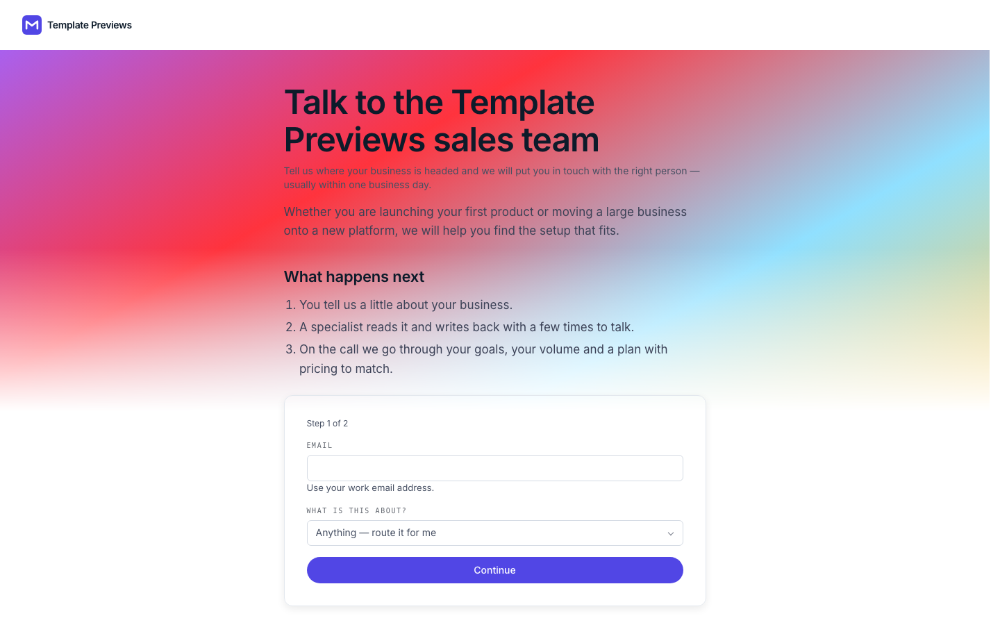

# Merrow Sales

**An official Forumulate contact template.** Modelled on: a payments company’s contact-sales page.

A two-step contact-sales page: work email and topic first, the qualifying questions after Continue, in a raised card on a bright, generous page.

## What applying it creates

- **The look** — `bundle.json`, a theme bundle: palette, type, form card, topic and fact looks (`theme.contact`). Published to the space straight away.
- **The layout** — the `steps` preset, with the page's own heading and the line under it.
- **The form** — 4 question(s) beyond name, email and message, and the button and thank-you words.
- **Topics** — Talk to sales, Become a partner, Something else. Every topic is routed to the person who applies the template until they give it its own address.
- **The page the copy lives on** — the intro and the facts (email, hours, response time), set as the space's home page.
- **Pictures** — 1 file(s) in `assets/`, copied into your library.

The first step asks only for a work email and a topic; **Continue** opens the rest. A topic only asks the questions it needs — a partner is not asked for a company size.

The form takes **work email addresses only** (`contactForm.workEmailOnly`): a gmail.com or outlook.com address is refused beside the field, before anything is sent. A soft gradient (`theme.contact.backdrop`) paints the top of the page and fades into it. To end on a calendar, give "Talk to sales" a booking page (a Cal.com or Calendly link) in the studio's topic settings — it opens under the thank-you with the sender filled in.

Zero custom CSS — every detail is a theme setting. The brand is `Your Brand`, replaced with your organization's name.
