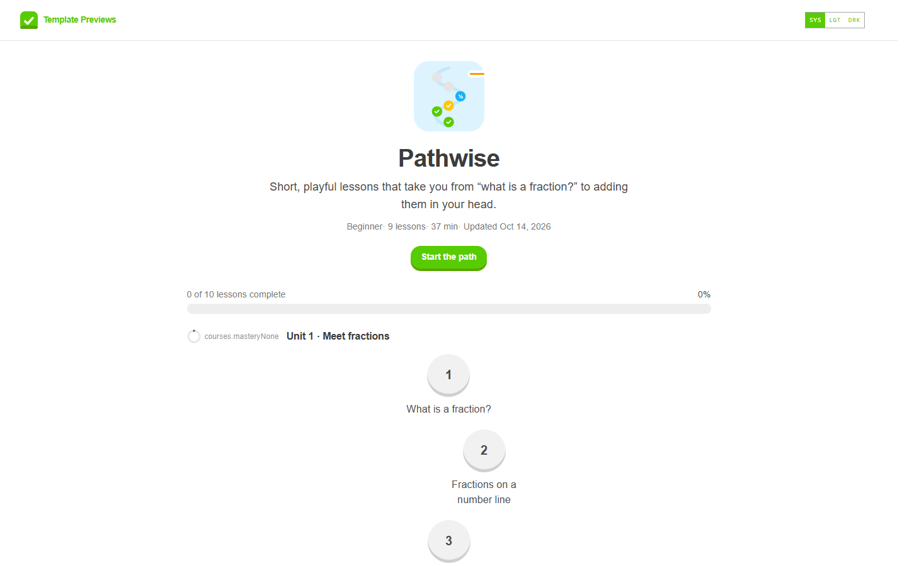

# Pathwise

**An official Forumulate course template.** Modelled on: A gamified language- and maths-learning app.

A bright, game-like learning path: short lessons as round nodes on a winding path, a chunky progress bar over every lesson, quick checks between explanations, lessons that open one after another, and a unit test at the end.

## What applying it creates

- **The look** — `bundle.json`, a theme bundle: a saturated green/blue/yellow palette, Nunito at heavy weights, chunky rounded buttons standing on a raised darker edge they sink into when pressed (`components.button.edge`), and the `theme.courses` keys for a path (path landing, path-node outline, thick progress bar on top, padlocks). Published to the space straight away.
- **The landing** — the course bands in this order (`frontPage` in `template.json`).
- **The course** — 3 modules and 9 sample lessons, each with its length and kind, written in the course's voice.
- **Quizzes** — a checkpoint after “Compare fractions” (all answers must be right) and a unit test closing unit 3. Answers are shown after every attempt.
- **Pacing** — lessons open in order; each lesson is worth 10 XP and the course 100 on your organization’s progression track (when it is on).
- **The course details** — subtitle, cover, level, outcomes and a placeholder teacher (hidden on the path landing).

The sample lessons are examples: rewrite or delete them before you share the course. Zero custom CSS — every detail is a theme setting or course data. The brand is `Your Brand`, replaced with your organization's name.
