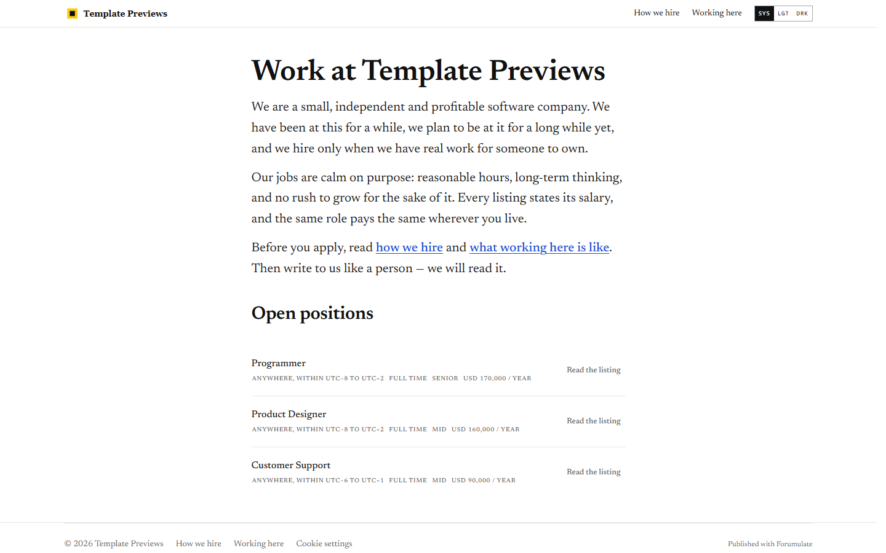
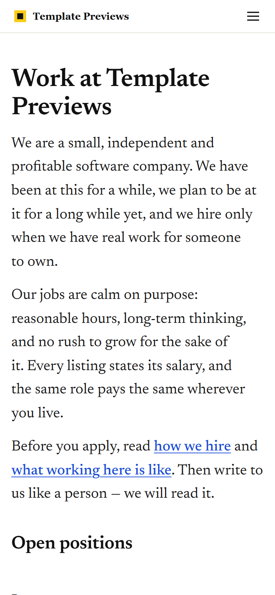

# Plainwork Jobs

**An official Forumulate careers template.** Modelled on: a calm software company’s jobs page.

A calm, single-column jobs page in large serif prose: a few paragraphs about the company, a link to how we hire, and a plain list of openings with the salary stated in every one.

| Desktop | Phone |
| ------- | ----- |
|  |  |

## What it uses

- Composed front page: a few paragraphs of plain prose, links to how we hire, the list of openings
- Board preset: list — no filters, no search, the salary shown on every row
- A “How we hire” page and a “Working here” page beside the roles, marked as pages, not openings
- Single narrow column in large serif type
- Zero custom CSS — every detail is a theme setting
- Type: Newsreader (served from our own font store)

## What applying it creates

- **The look** — `bundle.json`, a theme bundle: palette, type, header and footer, and the board's look (`theme.careers`). Published to the space straight away.
- **The front page** — the composed careers page in `template.json` (`frontPage`), ending in the live roles board.
- **The layout** — board preset `list` and its front-door options.
- **1 teams with 3 sample roles** — each with its location, employment type and where the work happens set as fields, and the typed sections (summary, what you will do, what we need, what we offer, how hiring works) filled in:
  - Programmer
  - Product Designer
  - Customer Support
- **2 page(s) beside the roles** (`kind: page` — read as pages: not listed as roles, no apply form, no job markup):
  - How we hire
  - Working here

## Placeholders

- **“Your Brand”** — everywhere the brand appears (header and footer copy, the wordmark, the sample copy) it becomes your organization’s name when the template is applied.
- **Pictures** — the wordmark, favicon and every picture in `assets/` are generic placeholders, copied into your space’s asset library on apply.
- **Links** — header, footer and front-page links point at your new space’s own address.
- **Roles** — sample openings in neutral copy. Edit or unpublish them before you go live; a published role is a real job posting to search engines.

## Files

- `template.json` — the manifest (`forumulate.space-template` v1): layout, front page, the sample teams, roles and pages. Schema: `packages/shared/src/official-templates.ts`.
- `bundle.json` — the theme bundle (`forumulate.theme-bundle`); also listed in the theme marketplace as `template-plainwork`.
- `assets/` — the placeholder pictures.
