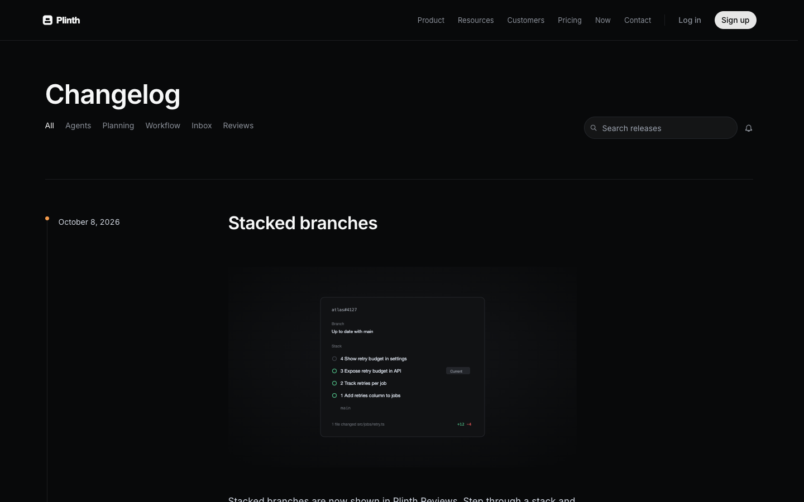
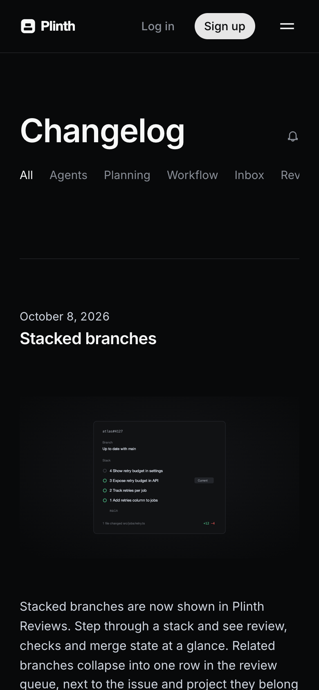

# Plinth

**An official Forumulate changelog template.** Modelled on: a product-planning tool’s changelog.

A sleek dark changelog: dates in the gutter, illustrated release notes, tag filters and a one-line email subscribe.

| Desktop                                         | Phone                                       |
| ----------------------------------------------- | ------------------------------------------- |
|  |  |

## What it uses

- Composed front page (4 sections)
- 5-column footer
- Index layout: gutter
- Light and dark palettes
- Motion presets
- Zero custom CSS — every detail is a theme setting
- Type: Inter (Google Fonts)
- Colour scheme: dark

## What applying it creates

- **The look** — `bundle.json`, a theme bundle: palette, type, header and footer, the composed front page. Published to the space straight away.
- **The layout** — index layout `gutter`.
- **Tags** — 5 tags with their labels.
- **5 sample releases** — short, neutral placeholder copy so the space looks like the preview on day one:
  - Stacked branches
  - More control over agent runs
  - Priority inbox
  - Boards at scale
  - Keyboard-first everything

## Placeholders

- **“Your Brand”** — everywhere the brand appears (header and footer copy, the wordmark) it becomes your organization’s name when the template is applied.
- **Pictures** — the logo, wordmark, favicon and decorative art in `assets/` are generic placeholders. They are copied into your space’s asset library, so replacing one is an ordinary upload.
- **Links** — header, footer and front-page links point at your new space’s own address.

## Files

- `template.json` — the manifest (`forumulate.space-template` v1): layout, post page, tags, authors, forms, sample posts. Schema: `packages/shared/src/official-templates.ts`.
- `bundle.json` — the theme bundle (`forumulate.theme-bundle`); also listed in the theme marketplace as `template-plinth`.
- `assets/` — the placeholder pictures.
- `screenshots/` — taken from the live preview.
