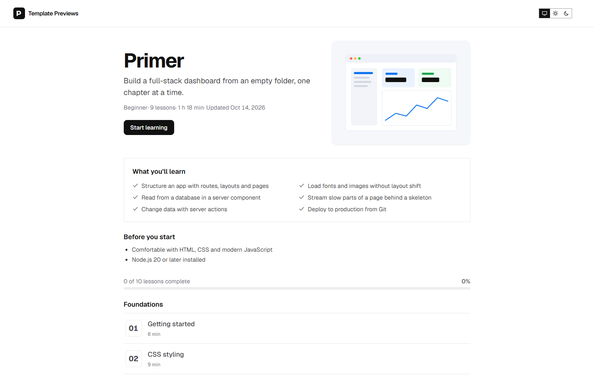

# Primer

**An official Forumulate course template.** Modelled on: A web framework’s official chapter tutorial.

A chapter-by-chapter tutorial: numbered chapters, a chapter badge and an "In this chapter" box over every lesson, code with file names, Reveal-the-solution exercises, and a "Next up" card at the end of each chapter.

## What applying it creates

- **The look** — `bundle.json`, a theme bundle: Geist type, a single blue accent, light and dark, and every `theme.courses` key the tutorial look needs (numbered chapters, chapter badge, objectives box, end card). Published to the space straight away.
- **The landing** — the course bands in this order (`frontPage` in `template.json`).
- **The course** — 3 modules and 9 sample lessons, each with its length and kind, written in the course's voice.
- **Quizzes** — a check after “Fetching data” and a final check closing the last module. Answers are shown after every attempt.
- **The course details** — subtitle, cover, level, outcomes, prerequisites, FAQ and a placeholder instructor (Ada Reyes).

The sample lessons are examples: rewrite or delete them before you share the course. Zero custom CSS — every detail is a theme setting or course data. The brand is `Your Brand`, replaced with your organization's name.
