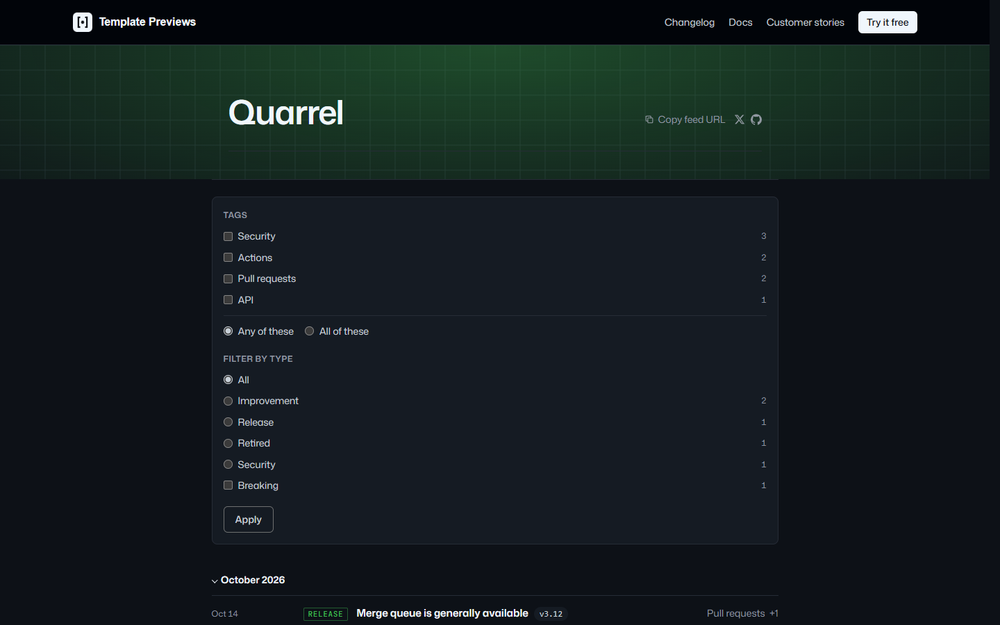
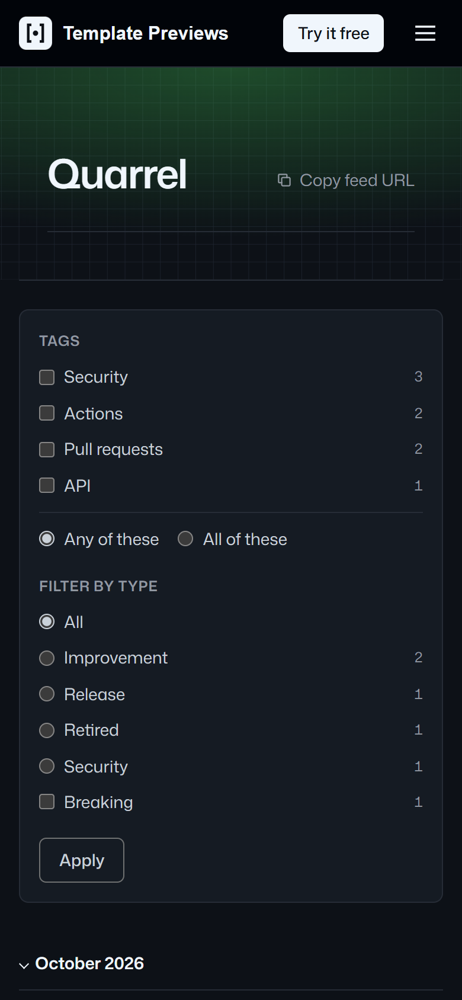

# Quarrel

**An official Forumulate changelog template.** Modelled on: a code hosting platform’s changelog.

A dark, dense changelog of typed rows: a grid-line hero, releases grouped under collapsible month headings, a mono date and an upper-case type label on every row, and a checkbox panel to narrow by type and tag.

| Desktop | Phone |
| ------- | ----- |
|  |  |

## What it uses

- Index layout: rows (one ruled line per release)
- Collapsible month headings
- Upper-case, outlined change-type labels in mono (Release, Improvement, Security, Retired)
- Filter panel: types, tags, Breaking, Any/All
- Copy-the-feed and social links on the title row
- Release page: centred, on-this-page outline, reading time, prev/next
- Zero custom CSS — every detail is a theme setting
- Type: Mona Sans and JetBrains Mono — self-hosted (the font is mirrored onto our own CDN on apply; readers never fetch from a third party)
- Colour scheme: dark (strict)

## What applying it creates

- **The look** — `bundle.json`, a theme bundle: palette, type, header and footer, the changelog's look (`theme.changelog`) and the composed front page. Published to the space straight away.
- **The layout** — index preset `rows` and its front-door options.
- **The release page's after-band** — `piecePage`: a subscribe box under every release.
- **Tags** — 4 tags with their labels and colours.
- **5 sample releases** — short, neutral placeholder copy with the change types, channels and versions the look is built to show, so the space looks like the preview on day one:
  - Merge queue is generally available (v3.12, Release)
  - Required reviewers per path (v3.11.4, Improvement)
  - Faster log search in workflow runs (v3.11.2, Improvement)
  - Secret scanning for private keys in commits (v3.11.0, Security)
  - Classic deploy keys are retired (v3.10.0, Retired, breaking, with upgrade notes)

Nobody is mailed about a sample: the releases are published without notifying subscribers or watchers.

## Placeholders

- **“Your Brand”** — everywhere the brand appears (header and footer copy, the wordmark, the sample copy) it becomes your organization’s name when the template is applied.
- **Pictures** — the mark, wordmark, covers and portraits in `assets/` are drawn placeholders. They are copied into your space’s asset library, so replacing one is an ordinary upload.
- **Links** — header, footer and front-page links point at your new space’s own address; “Try it” links point at `example.com`.
- **Change types** — the template renames the changelog's change types to Release, Improvement, Security and Retired (`shape` in `template.json`, a patch on the type's `type` field). Rename them again in Design → shape; `theme.changelog.typeBadge.tones` keys follow the names.

## Files

- `template.json` — the manifest (`forumulate.space-template` v1): layout, release page, tags, authors, sample releases (with their `fields`). Schema: `packages/shared/src/official-templates.ts`.
- `bundle.json` — the theme bundle (`forumulate.theme-bundle`); also listed in the theme marketplace as `template-quarrel`.
- `assets/` — the placeholder pictures.
