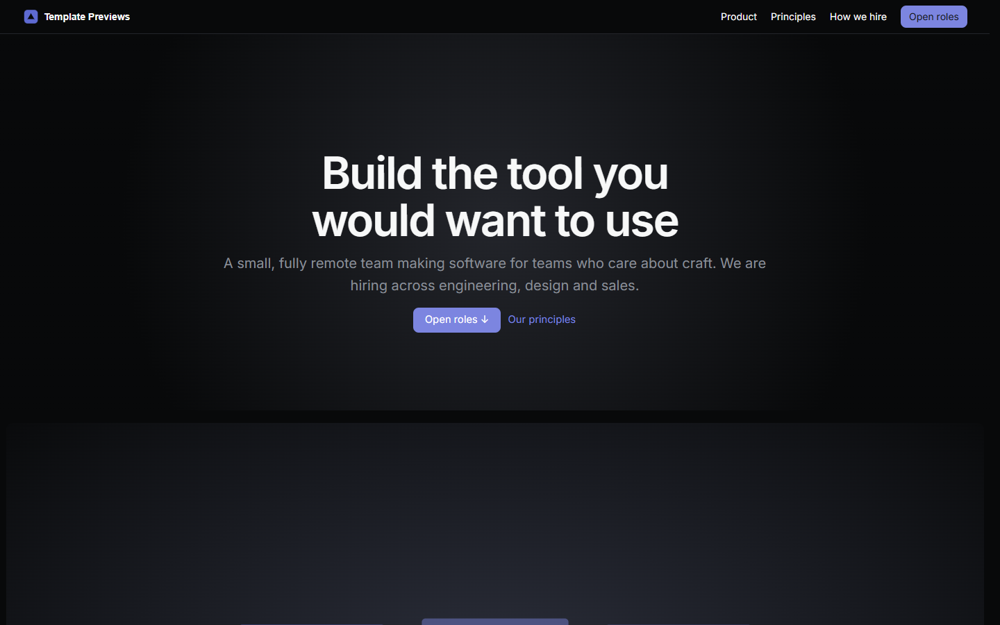
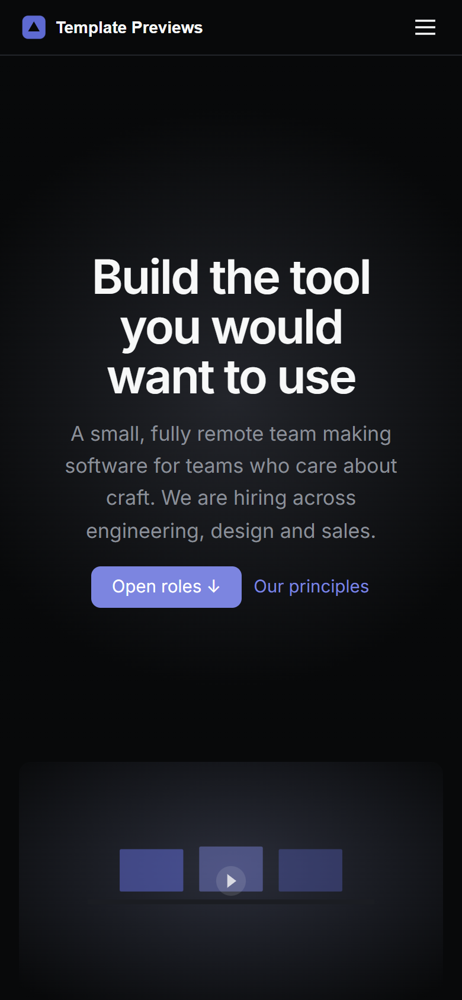

# Quarry Careers

**An official Forumulate careers template.** Modelled on: a product-quality issue tracker’s careers page.

A dark, culture-first careers page: a one-line hero with an anchor to the roles, a short essay on quality, eleven numbered principles, talks and interviews, then every opening grouped under its team with counts.

| Desktop | Phone |
| ------- | ----- |
|  |  |

## What it uses

- Composed front page: hero with an “Open roles ↓” anchor, film still, essay, 11 numbered principles, talks and interviews, the roles board
- Board preset: departments — roles under their team with counts, “Learn more” at the end of each row
- Role layout: single — the role, then the apply form, with an Apply bar that stays in reach
- Two pages beside the roles (principles, how we hire) marked as pages, not openings
- Dark, pinned colour scheme
- Zero custom CSS — every detail is a theme setting
- Type: Inter (served from our own font store)

## What applying it creates

- **The look** — `bundle.json`, a theme bundle: palette, type, header and footer, and the board's look (`theme.careers`). Published to the space straight away.
- **The front page** — the composed careers page in `template.json` (`frontPage`), ending in the live roles board.
- **The layout** — board preset `departments` and its front-door options.
- **3 teams with 7 sample roles** — each with its location, employment type and where the work happens set as fields, and the typed sections (summary, what you will do, what we need, what we offer, how hiring works) filled in:
  - Senior Product Engineer
  - Infrastructure Engineer
  - Mobile Engineer, iOS
  - Product Designer
  - Brand Designer
  - Account Executive
  - Solutions Engineer
- **2 page(s) beside the roles** (`kind: page` — read as pages: not listed as roles, no apply form, no job markup):
  - Our principles
  - How we hire

## Placeholders

- **“Your Brand”** — everywhere the brand appears (header and footer copy, the wordmark, the sample copy) it becomes your organization’s name when the template is applied.
- **Pictures** — the wordmark, favicon and every picture in `assets/` are generic placeholders, copied into your space’s asset library on apply.
- **Links** — header, footer and front-page links point at your new space’s own address.
- **Roles** — sample openings in neutral copy. Edit or unpublish them before you go live; a published role is a real job posting to search engines.

## Files

- `template.json` — the manifest (`forumulate.space-template` v1): layout, front page, the sample teams, roles and pages. Schema: `packages/shared/src/official-templates.ts`.
- `bundle.json` — the theme bundle (`forumulate.theme-bundle`); also listed in the theme marketplace as `template-quarry-careers`.
- `assets/` — the placeholder pictures.
