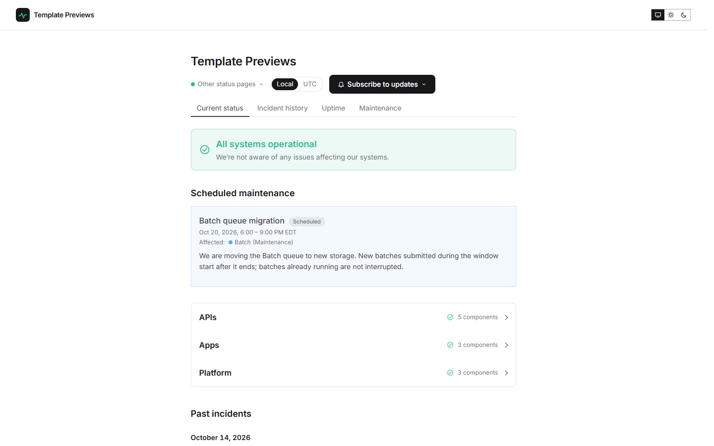

# Quietline

**An official Forumulate status page template.** Modelled on: An AI model provider’s status page.

A calm, narrow status page that follows the visitor’s light or dark setting: a tinted banner, components folded into groups that say how many they hold, small rounded bars with the uptime beside each, and the incident history as a month calendar.

## What applying it creates

- **The look** — `bundle.json`, a theme bundle: palette, type and every `theme.status` key (tinted banner, folded groups, pill bars, calendar history, visitor theme toggle). Published to the space straight away.
- **The front page** — the status bands in this order, at this width (`frontPage` in `template.json`).
- **Components** — 11 sample components in 3 groups (APIs, Apps, Platform). Every one is **manual**: nothing is probed. Point a component at your own service by giving it a check in the studio, or keep declaring its state by hand.
- **A short history** — 3 resolved incidents with their update streams (Elevated error rates on the Responses API; Slow file uploads in the web app; Sign-in failures for some accounts), dated a few days to a few weeks before you apply it, so the bars and the history read like a real page on day one. None of them notifies anybody.
- **Upcoming maintenance** — Batch queue migration, a few days after you apply it.

It follows the visitor’s system setting and the header carries a light/dark toggle. The sub-pages sit under the title as tabs.

The sample components, incidents and maintenance are examples: rename them, delete them, or replace them with your own before you share the page. Zero custom CSS — every detail is a theme setting. The brand is `Your Brand`, replaced with your organization's name.
