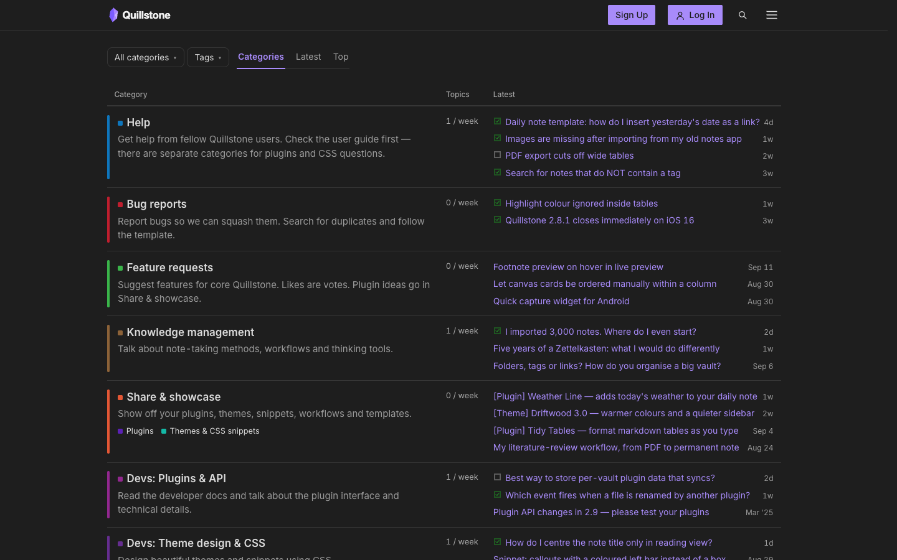

# Quillstone Forum

**An official Forumulate forum template.** Modelled on: a note-taking app’s community forum.

A dark forum: categories beside their latest topics, coloured category bars and purple accents.

## What applying it creates

- **The look** — `bundle.json`, a theme bundle: palette, type, header and footer, the composed front page. Published to the space straight away.
- **The front page** — `frontPage` in `template.json`, applied after the look.
- **The layout** — `categories`.
- **Pictures** — 2 file(s) in `assets/`, copied into your library.

The brand is the replica's own fictional one; rename it in the space's settings.
