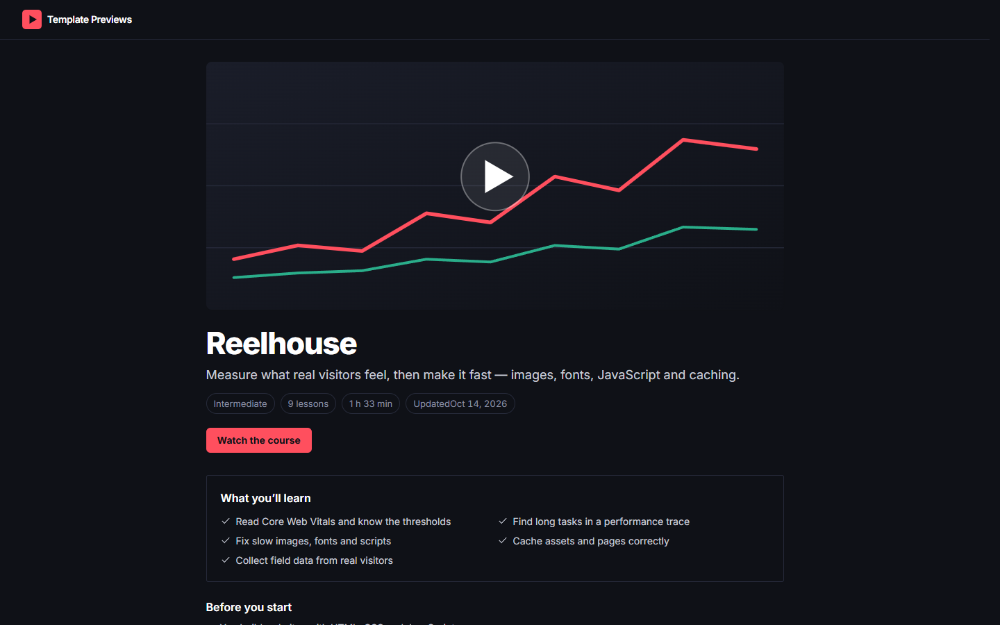

# Reelhouse

**An official Forumulate course template.** Modelled on: A video course platform for front-end engineers.

A dark, dense video course: a wide cover over a stats strip, the instructors with their companies, and the lessons as a timed table. Every lesson is a self-hosted video with chapters, a searchable transcript and a speed row.

## What applying it creates

- **The look** — `bundle.json`, a theme bundle: dark only, Inter, a coral accent, and the `theme.courses` keys for the video look (hero-cover, timestamp table, open transcript, complete at 90% watched). Published to the space straight away.
- **The landing** — the course bands in this order (`frontPage` in `template.json`).
- **The course** — 3 modules and 9 sample lessons, each with its length and kind, written in the course's voice.
- **Quizzes** — a check after “Core Web Vitals” and a final quiz closing the last module (three attempts; answers shown once passed).
- **The videos** — one short self-hosted sample clip (`assets/lesson.mp4`, 27 KB, with its poster) stands in for every lesson, each with its own chapters and WebVTT transcript. Replace it with your recordings; nothing is loaded from a video host.
- **The course details** — subtitle, wide cover, level, outcomes, prerequisites and two placeholder instructors.
- **A learning path** — the organization's “The Web Performance track” (`course.paths`), published, with this course in it; the landing ends on a row of the path's courses in order (`spaceFeed` with `source: "courses"`). Applying Reelhouse to a second course space appends that course to the same path instead of making another; an existing path of that slug keeps its own title, cover and order. Rename or reorder it under Learning paths in the studio.

The sample lessons are examples: rewrite or delete them before you share the course. Zero custom CSS — every detail is a theme setting or course data. The brand is `Your Brand`, replaced with your organization's name.
