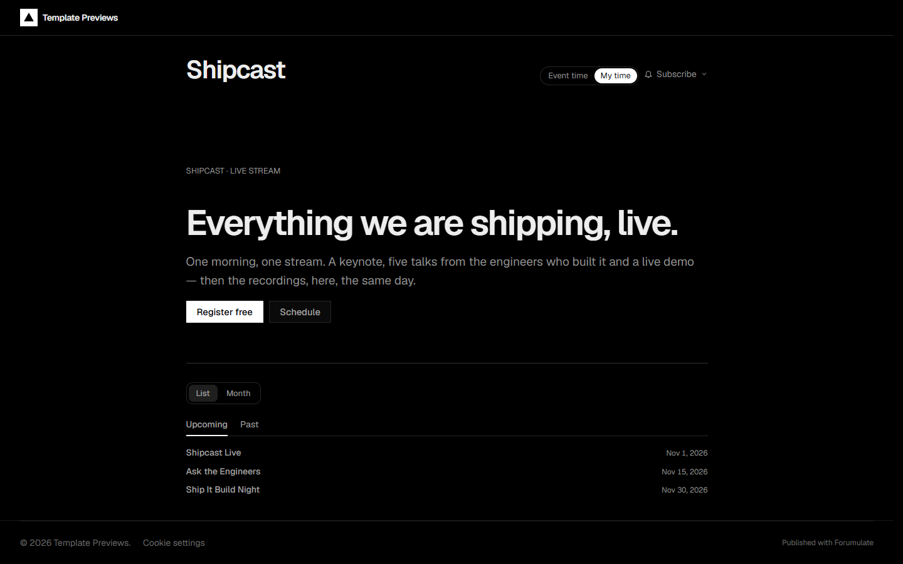
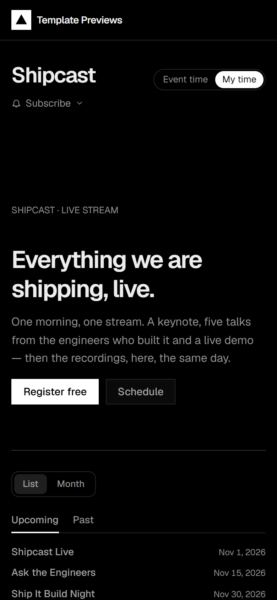

# Shipcast

**An official Forumulate events template.** Modelled on: a frontend cloud platform’s launch-event stream.

A developer launch stream: strict dark, hairline borders and square corners, times in mono in both zones. The launch page counts down over a single column, its schedule is a time · title · speaker table, and after the stream every session keeps its recording.

| Desktop | Phone |
| ------- | ----- |
|  |  |

## What it uses

- Strict dark scheme, hairline rules, zero radius, Geist and Geist Mono
- Compact list with every time in the event’s zone and the reader’s
- Launch page: one column, countdown, the stream link and a “More events” row
- Schedule as a hairline table (time · title · speaker) with per-session calendar files
- Past edition with a recording on every session — the after-event library
- Zero custom CSS — every detail is a theme setting

## What applying it creates

- **The look** — `bundle.json`, a theme bundle: palette, type, header and footer, and the calendar's look (`theme.events`: the list, the event page, the agenda and speakers). Published to the space straight away.
- **The front page** — `frontPage` in `template.json`, ending in the live calendar.
- **The layout** — preset `webinar` and its front-door options.
- **3 upcoming and 3 past events**, dated relative to the day you apply it, in each event's own time zone — so the calendar is never a page of past events:
  - Shipcast Live
  - Ask the Engineers
  - Ship It Build Night
  - Shipcast Winter Edition (past)
  - Edge Caching Deep Dive (past)
  - Launch Recap (past)
- **A programme** — 11 sessions and 6 speakers, so the agenda, session and speaker pages are populated on day one. Session times are local to the event's zone, counted from its first day.
- **Hosts** — 1 placeholder people in the space's author registry, credited on the events they host.
- **Settings** — email-only registration is on (`eventAttendance.emailRsvp`, double opt-in), with reminders a day and fifteen minutes before (`eventNotices`).

Nobody is mailed about a sample: the events are announced to nobody, and none has an RSVP.

## Placeholders

- **“Your Brand”** — everywhere the brand appears (header and footer, the mark, the covers, the sample copy) it becomes your organization’s name.
- **Pictures** — the mark, covers and portraits in `assets/` are drawn placeholders, copied into your space’s asset library on apply.
- **Links** — join links and recordings point at `example.com` addresses. Replace them with your own before you publish; a past event’s recording link is what its page offers instead of an RSVP.
- **Events** — sample events in neutral copy. Edit, duplicate or delete them; a published event is a real event to search engines.

## Files

- `template.json` — the manifest (`forumulate.space-template` v1): layout, front page, hosts, the sample events and their programme. Schema: `packages/shared/src/official-templates.ts` and `official-templates-content-events.ts`.
- `bundle.json` — the theme bundle (`forumulate.theme-bundle`); also listed in the theme marketplace as `template-shipcast`.
- `assets/` — the placeholder pictures.
