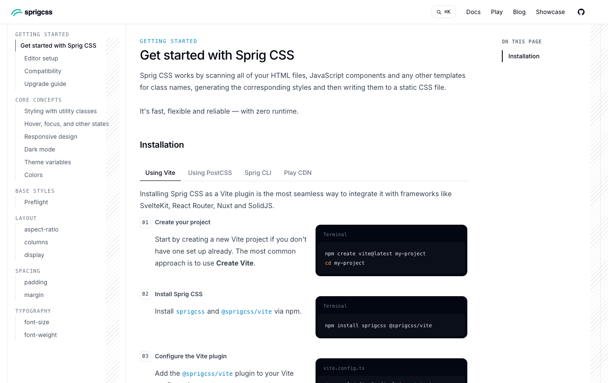

# Sprig CSS

**An official Forumulate documentation template.** Modelled on: a utility-first CSS framework’s docs.

Monospace section labels, numbered install steps with terminal panels and hatched gutters.

## What applying it creates

- **The look** — `bundle.json`, a theme bundle: palette, type, header and footer. Published to the space straight away.
- **Pictures** — 2 file(s) in `assets/`, copied into your library.

The brand is the replica's own fictional one; rename it in the space's settings.
