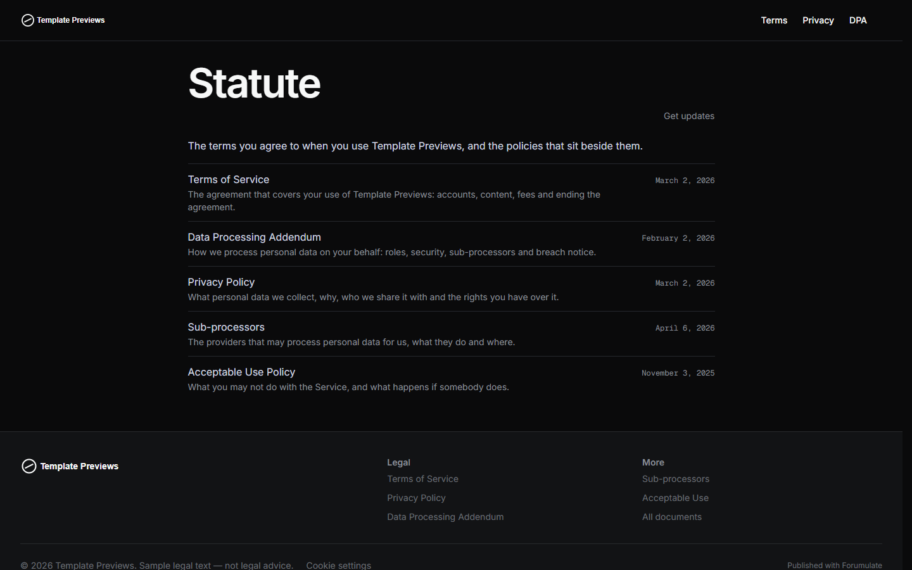
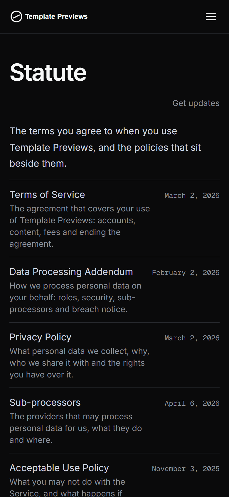

# Statute

**An official Forumulate legal template.** Modelled on: an issue tracker’s terms of service.

Minimal and typographic, on dark: a huge title under a monospace “EFFECTIVE DATE” kicker, headings exactly as written, defined terms set bold at the start of their meaning, and a narrow measure.

| Desktop | Phone |
| ------- | ----- |
|  |  |

## What it uses

- Preset: standard — a ruled list with descriptions and effective dates
- Monospace upper-case effective-date kicker above a 64px title
- Headings as written (numbering off) — the samples number their own clauses
- Definitions set inline-bold, the way contracts print them
- Narrow 42rem measure, Inter and Geist Mono, always dark
- Zero custom CSS — every detail is a theme setting

## What applying it creates

- **The look** — `bundle.json`, a theme bundle: palette, type, header and footer, and the register's and documents' look (`theme.legal`). Published to the space straight away.
- **The front page** — the composed register page in `template.json` (`frontPage`), ending in the documents band.
- **The layout** — register preset `standard`.
- **5 sample documents** in 1 group(s) (Documents), each with its version, effective date and governing law set as fields and the typed sections (in plain English, the document, questions) filled in:
  - Terms of Service
  - Privacy Policy
  - Data Processing Addendum
  - Sub-processors
  - Acceptable Use Policy

## The sample text is not legal advice

Every document is **sample text for a fictional company**, written to show the layout: clause numbering, the plain-English summary, definitions, history and the register. It is not legal advice, it is not copied from any real company's terms, and it is not fit to publish. Each document opens with a "Sample text" callout saying so. Replace every word with text written for your business and reviewed by your own counsel, then delete the callout. None of the samples asks members to accept anything (`mustAccept` is left off), so applying the template never prompts anyone.

## Placeholders

- **“Your Brand”** — everywhere the brand appears (header and footer copy, the wordmark, the sample text) it becomes your organization’s name when the template is applied.
- **Governing law** — the samples name a placeholder jurisdiction; set your own in each document's fields.
- **Addresses** — contact addresses use the reserved `example.com` domain.
- **Links** — header, footer and front-page links point at your register's own address.

## Files

- `template.json` — the manifest (`forumulate.space-template` v1): layout, front page and the sample documents under `legal`. Schema: `packages/shared/src/official-templates.ts`.
- `bundle.json` — the theme bundle (`forumulate.theme-bundle`); also listed in the theme marketplace as `template-statute`.
- `assets/` — the placeholder pictures.
