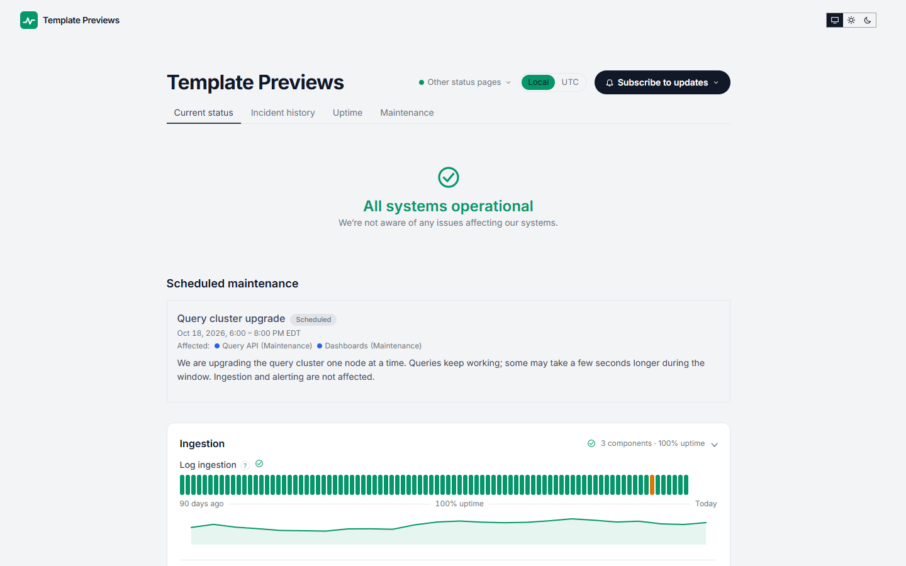

# Switchyard

**An official Forumulate status page template.** Modelled on: An observability vendor’s status page.

An observability dashboard: pill tabs, a big centred headline with the time it was last checked, a card per group with its uptime, response-time charts under the bars, and a system-metrics panel with a Day / Week / Month switch.

## What applying it creates

- **The look** — `bundle.json`, a theme bundle: palette, type and every `theme.status` key (pill tabs, centred banner, card per group with its uptime, `rowMeta: chart`, ribbon bars at three decimals, `theme.status.metrics`). Published to the space straight away.
- **The front page** — the status bands in this order, with a `metrics` band for the system metrics, at 960px (`frontPage` in `template.json`).
- **Components** — 11 sample components in 4 groups (Ingestion, Query and dashboards, Alerting and on-call, Platform). Every one is **manual**: nothing is probed.
- **Sample metrics** — six custom series, each belonging to a component (the band shows Ingestion latency, Query API p95 and Alert delivery time), each named “(sample)” and described as sample data. The template draws a month of hourly points for each from a recipe (a daily swing, noise, and a bump where a sample incident happened), so the charts and the Day / Week / Month switch have something to show on day one. **They are not measurements.** Replace them by pushing your own points (`POST …/status/metrics/{key}/points`), or delete them, before you share the page.
- **A short history** — 3 resolved incidents with their update streams (Delayed log ingestion in one region; SMS notifications delayed for some carriers; Slow and failing queries over long time ranges, with a write-up), a few days to a few weeks before you apply it. None of them notifies anybody.
- **Upcoming maintenance** — Query cluster upgrade, a few days after you apply it.

## Response-time charts

`rowMeta: chart` draws each component’s response time under its bars, from the checks our probes record — or, for a component nothing probes, the custom series that belongs to it (`metrics.rows: auto`). Six of the sample components own a sample series (Log ingestion, Trace ingestion, Query API, Alert routing, Web app, Public API), so their rows have a chart on day one; the others get one once you give them a check or attach a metric to them in the console. The `metrics` band also takes `latency` — a list of component slugs — to draw their response time above the custom series.

The sample components, incidents, maintenance and metrics are examples: rename them, delete them, or replace them with your own before you share the page. Zero custom CSS — every detail is a theme setting. The brand is `Your Brand`, replaced with your organization's name.
