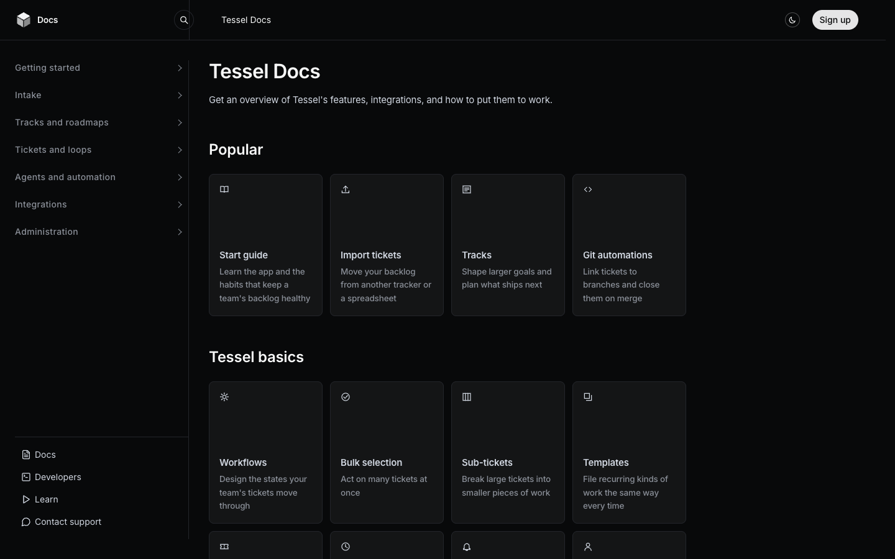

# Tessel Docs

**An official Forumulate documentation template.** Modelled on: an issue tracker’s help center.

A dark help centre: Popular and Basics card grids under a quiet title, with collapsible sidebar sections.

## What applying it creates

- **The look** — `bundle.json`, a theme bundle: palette, type, header and footer. Published to the space straight away.
- **The layout** — `guide`.
- **Pictures** — 1 file(s) in `assets/`, copied into your library.

The brand is the replica's own fictional one; rename it in the space's settings.
