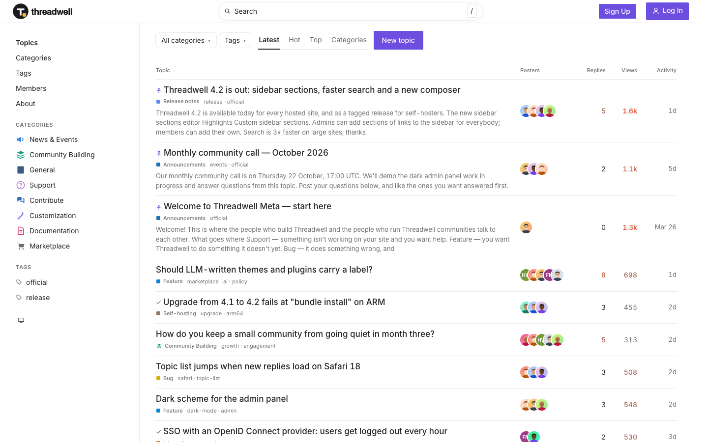

# Threadwell Meta

**An official Forumulate forum template.** Modelled on: a forum software project’s meta community.

A classic topic list with excerpts, poster avatars, views and activity, and a categories sidebar.

## What applying it creates

- **The look** — `bundle.json`, a theme bundle: palette, type, header and footer. Published to the space straight away.
- **The layout** — `dense`.
- **Pictures** — 3 file(s) in `assets/`, copied into your library.

The brand is the replica's own fictional one; rename it in the space's settings.
