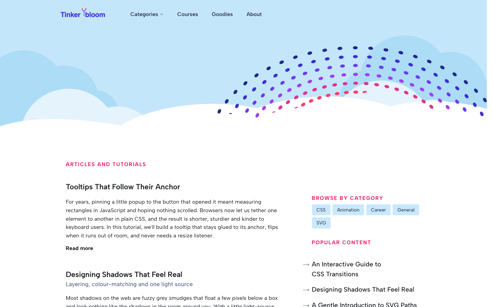
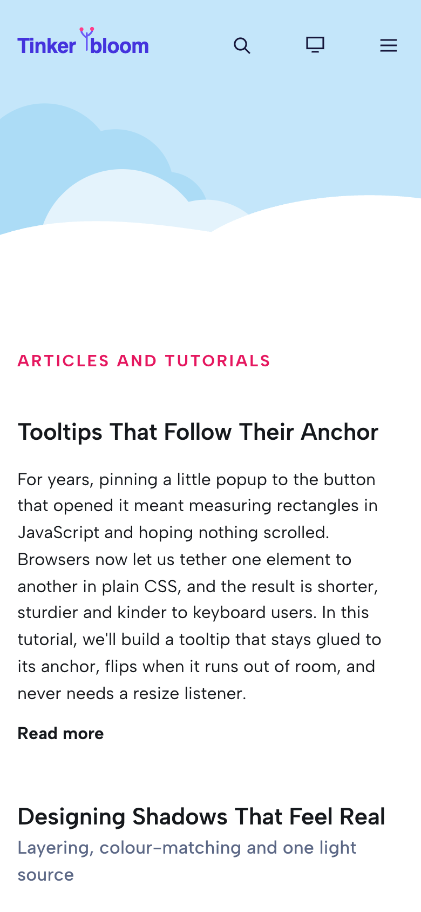

# Tinkerbloom

**An official Forumulate blog template.** Modelled on: an independent front-end tutorial blog.

A friendly, hand-made tutorial blog: sky-and-hills hero, category chips, a “popular content” list and a table-of-contents article page with a playful masthead.

| Desktop                                              | Phone                                            |
| ---------------------------------------------------- | ------------------------------------------------ |
|  |  |

## What it uses

- Composed front page (4 sections, with a sidebar)
- Header with drop-down menus
- 3-column footer
- Newsletter sign-up in the footer
- Index layout: feed
- Post layout: article-toc
- Light and dark palettes
- Motion presets
- Colour-coded tags
- Zero custom CSS — every detail is a theme setting
- Type: Albert Sans (Google Fonts)
- Colour scheme: light

## What applying it creates

- **The look** — `bundle.json`, a theme bundle: palette, type, header and footer, the composed front page. Published to the space straight away.
- **The layout** — index layout `feed`, post layout `article-toc`.
- **Tags** — 6 tags with their labels and colours.
- **Authors** — 2 placeholder people in the author registry (Alex Morgan, Sam Rivera). Rename or replace them.
- **A newsletter form** — created in your Forms area and wired to the footer sign-up.
- **6 sample posts** — short, neutral placeholder copy so the space looks like the preview on day one:
  - Tooltips that follow their anchor
  - Designing shadows that feel real
  - The humble transform-origin
  - An interactive guide to CSS transitions
  - Why your z-index doesn't work
  - A gentle introduction to SVG paths

## Placeholders

- **“Your Brand”** — everywhere the brand appears (header and footer copy, the wordmark) it becomes your organization’s name when the template is applied.
- **Pictures** — the logo, wordmark, favicon, avatars and decorative art in `assets/` are generic placeholders. They are copied into your space’s asset library, so replacing one is an ordinary upload.
- **Links** — header, footer and front-page links point at your new space’s own address.

## Files

- `template.json` — the manifest (`forumulate.space-template` v1): layout, post page, tags, authors, forms, sample posts. Schema: `packages/shared/src/official-templates.ts`.
- `bundle.json` — the theme bundle (`forumulate.theme-bundle`); also listed in the theme marketplace as `template-tinkerbloom`.
- `assets/` — the placeholder pictures.
- `screenshots/` — taken from the live preview.
