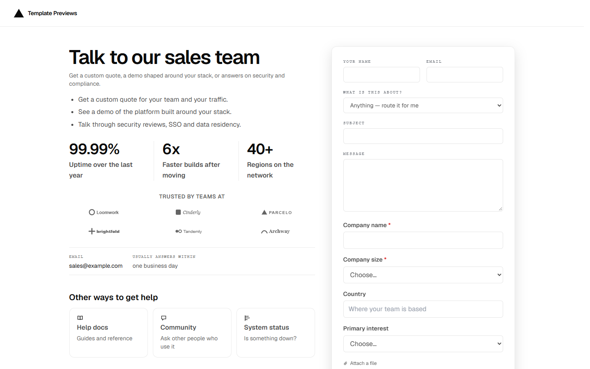

# Vantage Contact

**An official Forumulate contact template.** Modelled on: a frontend cloud platform’s contact-sales page.

A split contact-sales page: the pitch, three proof numbers and a logo wall on the left; a raised form card on the right that stays in view while you read.

## What applying it creates

- **The look** — `bundle.json`, a theme bundle: palette, type, form card, topic and fact looks (`theme.contact`). Published to the space straight away.
- **The layout** — the `split` preset, with the page's own heading and the line under it.
- **The form** — 4 question(s) beyond name, email and message, and the button and thank-you words.
- **Topics** — A new project, Moving from another platform, Security and compliance. Every topic is routed to the person who applies the template until they give it its own address.
- **The page the copy lives on** — the intro and the facts (email, hours, response time), set as the space's home page.
- **Pictures** — 7 file(s) in `assets/`, copied into your library.

The proof numbers (a `stats` block) and the logo wall (a `logoWall` block) are part of the home page, so they are edited in place like any page. The logos are fictional placeholders — swap in your customers’.

Zero custom CSS — every detail is a theme setting. The brand is `Your Brand`, replaced with your organization's name.
