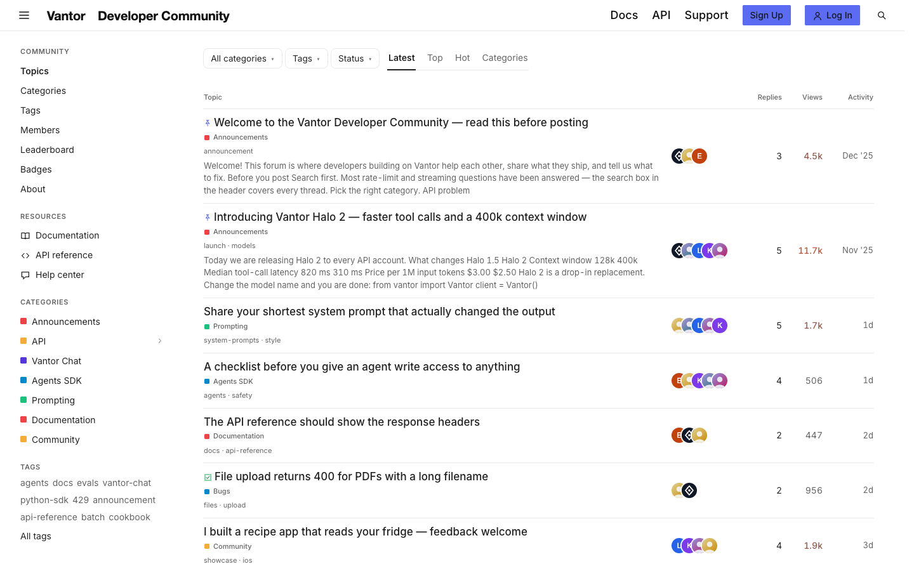

# Vantor Developer Community

**An official Forumulate forum template.** Modelled on: an AI model provider’s developer community.

A developer forum with resource links in the sidebar, pinned announcements and a dense topic table.

## What applying it creates

- **The look** — `bundle.json`, a theme bundle: palette, type, header and footer. Published to the space straight away.
- **The layout** — `dense`.
- **Pictures** — 3 file(s) in `assets/`, copied into your library.

The brand is the replica's own fictional one; rename it in the space's settings.
