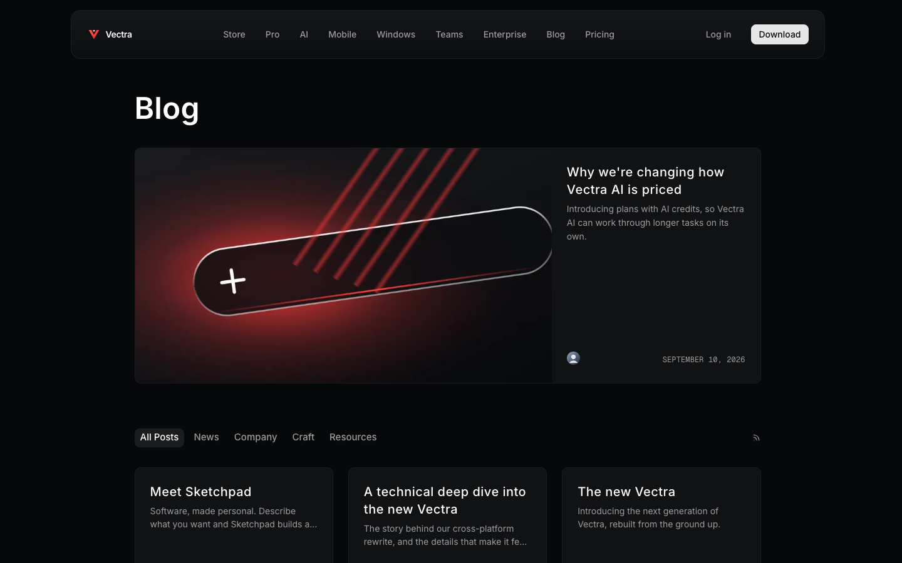
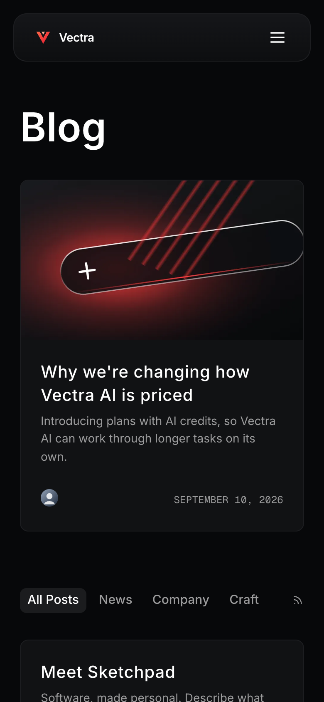

# Vectra

**An official Forumulate blog template.** Modelled on: a productivity app’s product blog.

A near-black product blog with a red accent, glowing footer art, a two-up post grid and a newsletter footer — launch-day energy for an app company.

| Desktop                                         | Phone                                       |
| ----------------------------------------------- | ------------------------------------------- |
|  |  |

## What it uses

- Composed front page (4 sections)
- 6-column footer
- Newsletter sign-up in the footer
- Index layout: grid
- Post layout: article-clean
- Light and dark palettes
- Motion presets
- Zero custom CSS — every detail is a theme setting
- Type: Inter (Google Fonts)
- Colour scheme: dark

## What applying it creates

- **The look** — `bundle.json`, a theme bundle: palette, type, header and footer, the composed front page. Published to the space straight away.
- **The layout** — index layout `grid`, post layout `article-clean`.
- **Tags** — 4 tags with their labels.
- **Authors** — 2 placeholder people in the author registry (Alex Morgan, Sam Rivera). Rename or replace them.
- **A newsletter form** — created in your Forms area and wired to the footer sign-up.
- **5 sample posts** — short, neutral placeholder copy so the space looks like the preview on day one:
  - Why we are changing how pricing works
  - Meet the notes app
  - A technical deep dive into the new release
  - The new release
  - A year of community extensions

## Placeholders

- **“Your Brand”** — everywhere the brand appears (header and footer copy, the wordmark) it becomes your organization’s name when the template is applied.
- **Pictures** — the logo, wordmark, favicon, covers, avatars and decorative art in `assets/` are generic placeholders. They are copied into your space’s asset library, so replacing one is an ordinary upload.
- **Links** — header, footer and front-page links point at your new space’s own address.

## Files

- `template.json` — the manifest (`forumulate.space-template` v1): layout, post page, tags, authors, forms, sample posts. Schema: `packages/shared/src/official-templates.ts`.
- `bundle.json` — the theme bundle (`forumulate.theme-bundle`); also listed in the theme marketplace as `template-vectra`.
- `assets/` — the placeholder pictures.
- `screenshots/` — taken from the live preview.
